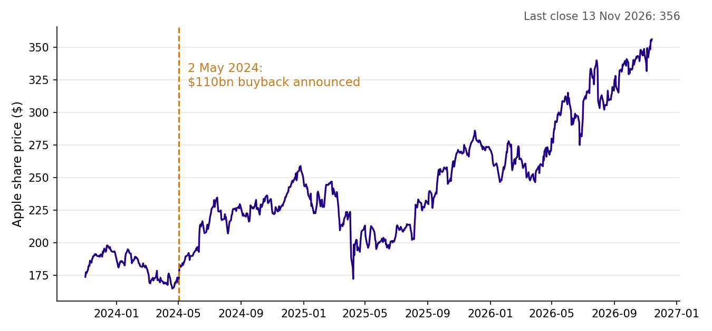
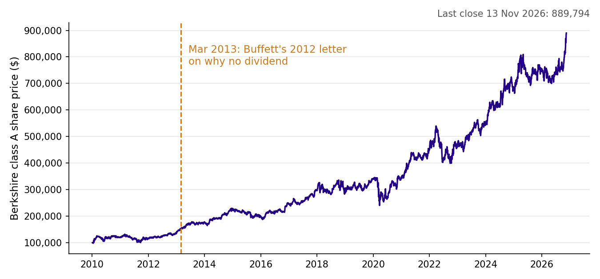
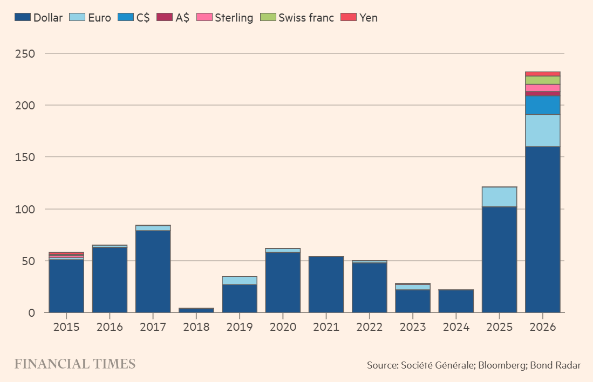

## Announcements

- **Last year's exam** is now available on **Blackboard**.

- **Two weeks before the exam**, all the **Pearson exercises** will be open for
  you to practice.

## Apple: the largest buyback in US history {.smaller}

- **May 2024**: Apple announces a share repurchase programme of
  **\$110 billion**, the largest ever announced by a US company.

- At the same time it raised its dividend by only 4%. Apple returns most of
  its cash through **buybacks**, not dividends.

- Why prefer buybacks? They are **flexible** (no promise to repeat them every
  year), and in many countries they are taxed more lightly than dividends.

## Apple: the share price since the buyback {.smaller}

::: {.center}
{fig-align="center" height="200" style="height: 400px; max-height: none"}
:::

- \$173 the day of the announcement, \$356 on 13 November 2026. The buyback
  did not create this value by itself: the price follows Apple's profits.

::: {.tiny}
Source: Yahoo Finance, daily closing prices.
:::

## Berkshire Hathaway: no dividend at all {.smaller}

- Warren Buffett's Berkshire Hathaway has paid **no dividend since 1967**.

- Buffett's argument (2012 letter to shareholders): a shareholder who wants
  cash can **sell a few shares** each year. This is the **homemade dividend**
  of the Modigliani-Miller payout irrelevance result (Lecture 10).

- And Berkshire keeps the cash to invest, because Buffett believes he earns
  more on it than shareholders would elsewhere.

::: {.box .box-a}
In a perfect market, payout policy does not change firm value: investors can
create the payout they want by themselves.
:::

## Berkshire: the share price without dividends {.smaller}

::: {.center}
{fig-align="center" height="200" style="height: 400px; max-height: none"}
:::

- About \$153,000 a share in March 2013, \$890,000 on 13 November 2026.
  Shareholders were paid through the **rising price**, not through dividends.

::: {.tiny}
Source: Yahoo Finance, daily closing prices (class A shares).
:::

## The opposite of a payout: AI hyperscalers {.smaller}

::: {.center}
{fig-align="center" height="160" style="height: 340px; max-height: none"}
:::

- The **hyperscalers** (Amazon, Alphabet, Meta, Microsoft, Oracle) keep their
  cash **and borrow more** to build data centres for AI: about \$200bn of new
  financing in 2026, and more than \$1tn of new debt expected in the next few
  years. Meta will issue bonds in Europe for the first time this autumn.

::: {.tiny}
Bond issuance, \$bn, by currency. Source: *Financial Times*; Société Générale,
Bloomberg, Bond Radar.
:::

## Hyperscalers: what it means for the course {.smaller}

- **Payout or retain?** A firm should pay out only the cash it cannot invest
  in positive-NPV projects (Chap. 17.5). The hyperscalers believe AI projects
  are worth more than their cost, so they keep everything and raise more.

- **Debt and new shares**: mostly debt, since interest is tax deductible
  (Lecture 9). But the needs are so large that some also sell shares:
  Alphabet, next slide.

## Alphabet: selling shares to pay for AI {.smaller}

- **1 June 2026**: Alphabet (Google) announces **\$80bn of new equity**:

  - \$30bn sold to investors at once;

  - up to \$40bn sold gradually on the stock market;

  - \$10bn bought directly by **Berkshire Hathaway**.

- **Why?** To pay for AI data centres: Alphabet expects to invest
  \$180-190bn in 2026, and "significantly" more in 2027.

- **The cost**: new shares dilute existing shareholders. The share price fell
  only about 1% after the announcement: investors believed the projects are
  worth it.

::: {.box .box-a}
The opposite of a buyback: Apple buys its shares back with spare cash;
Alphabet sells new shares because it has more projects than cash.
:::

::: {.tiny}
Sources: Alphabet press release, 1 June 2026 (SEC Form 8-K); Al Jazeera, 2 June 2026.
:::
