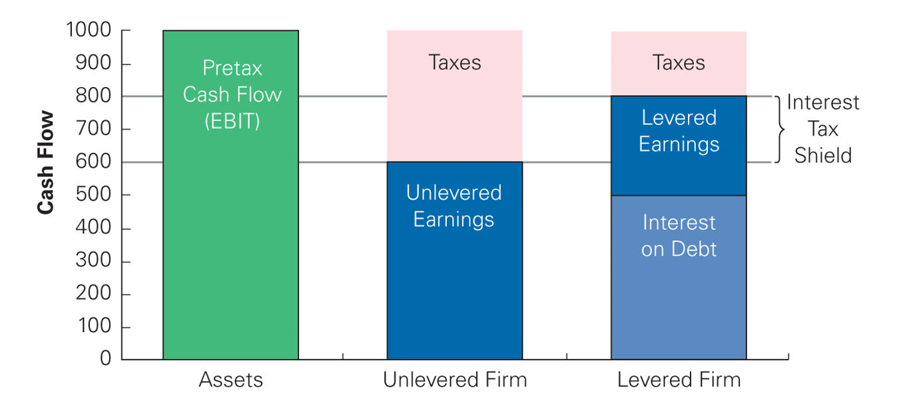
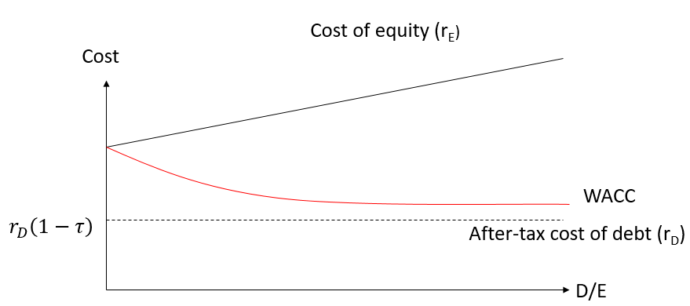
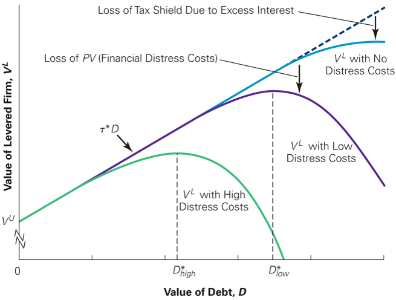
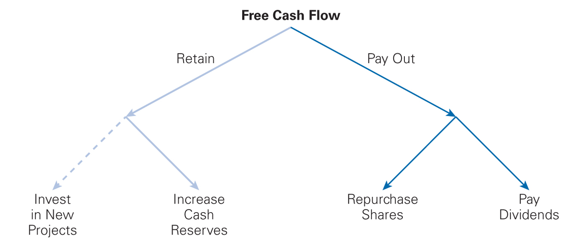
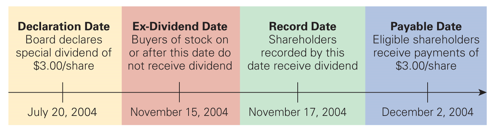
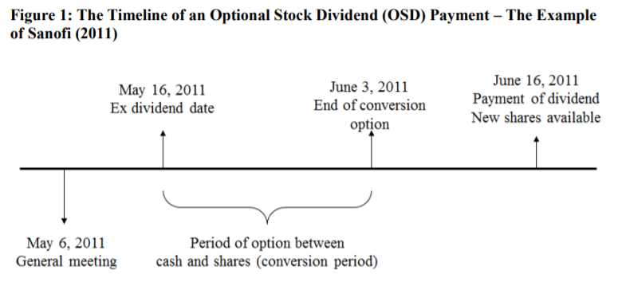
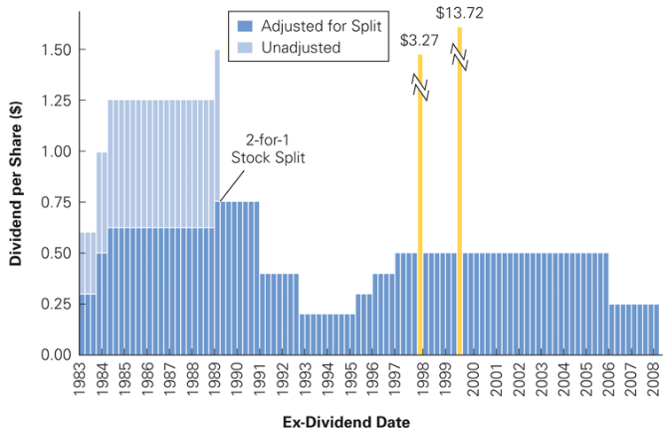
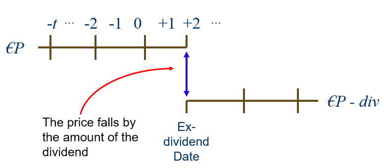
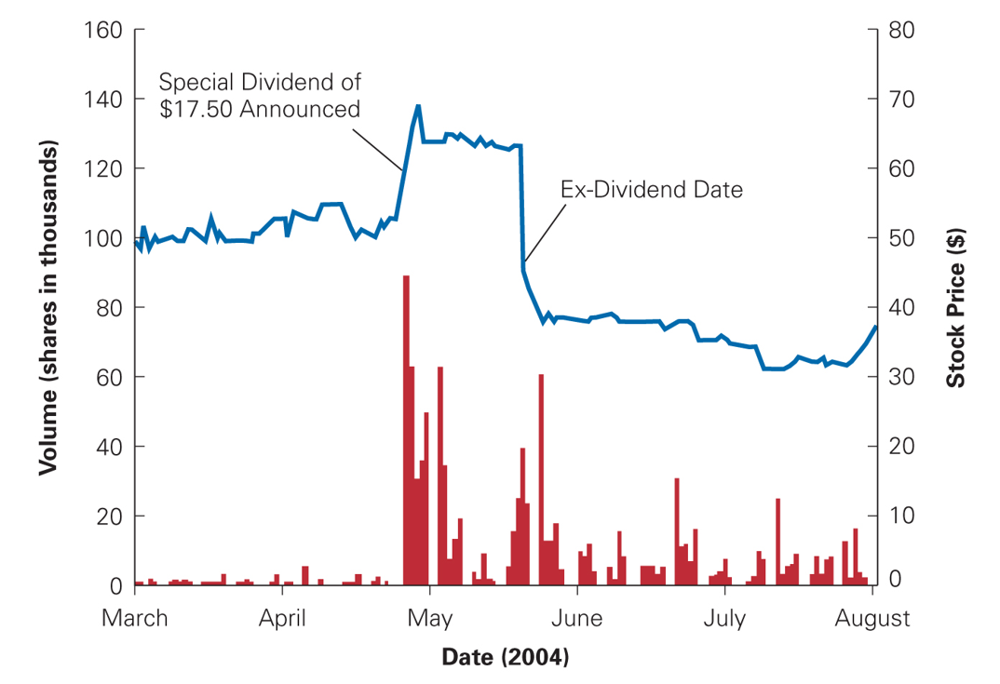
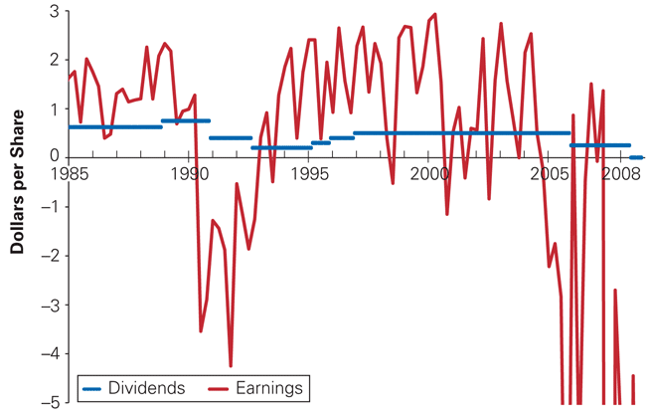

## Plan

A.  Distributions to shareholders (Chap. 17.1)

B.  Comparison of dividends and share repurchases (Chap. 17.2)

C.  Payout policy in practice (Chap 17.3, 17.5-6)

Mostly based on the BDM textbook Chap. 17.

## {.center}

::: {.content-visible when-format="revealjs"}
::: {.center .huge}
Recap lecture 9
:::
:::

```{=latex}
\vfill
\begin{center}
{\color{escpblue}\Huge\bfseries Recap lecture 9}
\end{center}
\vfill
```

## Recap: the interest tax shield {.smaller}

- Interest is paid **before** corporate tax, dividends **after**. Every euro
  paid as interest instead of dividends saves tax for the firm.

::: {.box .box-a}
$$\text{Interest tax shield} = \tau_{C} \times \text{Interest payments}$$
:::

- $\tau_{C}$ is the corporate tax rate. In words: of every euro of interest,
  the firm gets back the tax it would have paid on that euro.

- The gain goes to investors as a group: shareholders receive less, but
  shareholders and lenders together receive more, by exactly the tax saved.

- Seen from the firm, the shield makes borrowing cheaper. Of each euro of
  interest the firm pays, the tax authority refunds $\tau_{C}$, so the
  **effective cost of debt** is
  $$r_{D}\,(1 - \tau_{C})$$

## Recap: the interest tax shield (con't) {.smaller}

::: {.center}
{fig-align="center" height="250" style="height: 400px; max-height: none"}
:::


## Recap: MM2 Proposition 1 {.smaller}

::: {.box .box-a}
**MM2 Proposition 1.** With corporate taxes, the levered firm is worth the
unlevered firm plus the present value of its tax savings:
$$V^{L} = V^{U} + PV(\text{Interest tax shield})$$
:::

- This means that in presence of taxes, the firm's value changes with the capital structure,
as the tax shield should be considered:
  $$V^{L} = V^{U} + \tau_{C}\, D$$


## Recap: the four propositions {.smaller}

::::: {.columns}
::: {.column width="49%"}
**MM1: no taxes (Lecture 8)**

::: {.box .box-a}
**MM1 Proposition 1.** Firm value does not depend on debt:
$$V^{L} = V^{U}$$
:::

::: {.box .box-a}
**MM1 Proposition 2.** The cost of equity rises with debt:
$$r^{L}_{E} = r^{U}_{E} + \frac{D}{E^{L}}\left(r^{U}_{E}-r_D\right)$$
:::
:::

::: {.column width="2%"}
:::

::: {.column width="49%"}
**MM2: with corporate taxes (Lecture 9)**

::: {.box .box-b}
**MM2 Proposition 1.** Debt adds the value of the tax it saves:
$$V^{L} = V^{U} + \tau_{C} D$$
:::

::: {.box .box-b}
**Cost of equity with taxes.** It rises more slowly:
$$r^{L}_{E} = r^{U}_{E} + \frac{D}{E^{L}}(1-\tau_C)\left(r^{U}_{E}-r_D\right)$$
:::
:::
:::::

## Recap: cost of equity and WACC with taxes {.smaller}

::: {.center}
{fig-align="center" height="230" style="height: 340px; max-height: none"}
:::

- With taxes the cost of equity still rises with debt, but debt costs only
  $r_{D}(1 - \tau_{C})$ after tax, so the **WACC falls** as the share of debt
  rises:
  $$r_{WACC} = \frac{E}{E+D}\, r^{L}_{E} + \frac{D}{E+D}\, r_{D}\,(1 - \tau_{C})$$

## Recap: betas with taxes {.smaller}

- Lecture 8, risk-free debt and no taxes: the equity beta is the asset beta
  scaled up by the leverage,
  $$\beta^{L}_{E} = \beta^{U}_{E}\,\Big(1 + \frac{D}{E}\Big)$$

- With corporate taxes (MM2), the same factor $(1 - \tau_{C})$ that slowed
  the rise of the cost of equity also slows the rise of the beta:

::: {.box .box-a}
$$\beta^{L}_{E} = \beta^{U}_{E}\,\Big(1 + (1 - \tau_{C})\,\frac{D}{E}\Big)$$
:::

- In words: debt still makes the shares riskier, but part of the debt is
  "paid for" by the tax authority through the shield, so each euro of debt
  adds less risk to the equity than without taxes.

- $\beta^{U}_{E}$ is the unlevered (asset) beta, $\beta^{L}_{E}$ the levered
  (equity) beta, $D/E$ the market-value debt-to-equity ratio.

## Recap: personal taxes, step by step {.smaller}

- Investors pay tax too: $\tau_{i}$ on interest, $\tau_{e}$ on equity
  income. Follow **one euro of EBIT**.

- **Route 1, paid as interest.** No corporate tax (interest is deductible).
  The lender pays $\tau_{i}$ on the euro and keeps $1 - \tau_{i}$.

- **Route 2, paid to shareholders.** The firm pays $\tau_{C}$ first and keeps
  $1 - \tau_{C}$; the shareholder then pays $\tau_{e}$ on that and keeps
  $(1 - \tau_{C})(1 - \tau_{e})$.

- Example: $\tau_{C} = 25\%$, $\tau_{e} = 30\%$, $\tau_{i} = 40\%$.

  | Route    | After $\tau_{C}$      | After personal tax                     |
  |:---------|:---------------------:|:--------------------------------------:|
  | Interest | $1$                   | $1 - \tau_{i} = 0.60$                  |
  | Equity   | $1 - \tau_{C} = 0.75$ | $(1 - \tau_{C})(1 - \tau_{e}) = 0.75 \times 0.70 = 0.525$ |

- Debt still wins, but by $0.60 - 0.525 = 0.075$ per euro, not by the full
  $\tau_{C} = 0.25$ of corporate tax saved.

## Recap: the effective tax advantage and the limits of debt {.smaller}

- The **effective tax advantage of debt** measures that gap as a fraction of
  what the interest route leaves:
  $$\tau^{*} = 1 - \frac{(1 - \tau_{C})(1 - \tau_{e})}{1 - \tau_{i}}$$

- In the example: $\tau^{*} = 1 - 0.525 / 0.60 = 12.5\%$. Without personal
  taxes ($\tau_{e} = \tau_{i} = 0$) the formula gives $\tau^{*} = \tau_{C} = 25\%$.

- In words: personal taxes fall more heavily on interest than on equity
  income, so part of the corporate tax saving is given back to the tax
  authority at the investor's level. The advantage of debt shrinks.

- Interest above taxable income (or above the legal limit) saves no tax.

- Yet firms use far less debt than taxes alone would suggest: the **low
  leverage puzzle**.

## Recap: the trade-off {.smaller}

::: {.center}
{fig-align="center" height="230" style="height: 360px; max-height: none"}
:::

- Debt adds tax savings ($\tau^{*} D$), but too much debt brings financial
  distress costs and agency costs. The best debt level $D^{*}$ balances the
  two.

## Recap: what this means for payout {.smaller}

- Lecture 8 said that **cash is negative debt**. Lecture 9 added the tax
  reading: just as interest paid saves tax, interest **received** on cash
  held in the firm is taxed. Holding cash has a tax cost.

- So once a firm has funded all its good projects, what should it do with the
  cash that is left?

  - keep it in the firm,

  - pay it out as a **dividend**,

  - pay it out by **buying back shares**.

- That choice is the firm's **payout policy**, the subject of today.

::: {.box .box-a}
Same method as before: first a perfect market, where Modigliani and Miller
show that the choice does not matter; then the frictions that make it matter.
:::

## {.center}

::: {.content-visible when-format="revealjs"}
::: {.center .huge}
Beginning of lecture 10 content
:::

::: {.center .small}
Lectures 7 to 9 asked how a firm should raise money. Today we turn the question
around: once the money has been earned, how should it be given back?
:::
:::

```{=latex}
\vfill
\begin{center}
{\color{escpblue}\Huge\bfseries Beginning of lecture 10 content}

\vspace{1.5em}
\begin{minipage}{0.8\textwidth}
\small\centering
Lectures 7 to 9 asked how a firm should raise money. Today we turn the question
around: once the money has been earned, how should it be given back?
\end{minipage}
\end{center}
\vfill
```

## Introduction {.smaller}

- A firm that generates more cash than it can invest well faces three
  questions:

  1. **Pay out or keep?** Return the cash to shareholders, or hold it in the
     firm for later.

  2. **Dividend or repurchase?** If it pays out, send a cheque to every
     shareholder, or buy shares back from those who want to sell.

  3. **What does the choice say?** Investors read payout decisions as news
     about the firm's future.

- As with capital structure, the benchmark is a **perfect capital market**,
  where Modigliani and Miller show the choice is irrelevant. Then taxes,
  issuance costs, agency problems and information decide.

## A. Distributions to shareholders

Uses of free cash flow:

::: {.center}
{fig-align="center"}
:::

## Uses of free cash flow: reading the tree {.smaller}

- **Free cash flow** is the cash the business generates after paying for its
  operations and its investments. The tree shows the two things a firm can do
  with it.

- **Retain** it inside the firm:

  - invest in new projects (good, as long as they have positive NPV);

  - add to the cash reserves (keep it for later).

- **Pay it out** to shareholders:

  - **dividends**: a cash payment per share, to every shareholder;

  - **share repurchases**: the firm buys its own shares back from the
    shareholders who choose to sell.

- The way a firm chooses among these is its **payout policy** (Chap. 17.1).
  For a firm with debt, part of the cash also serves interest and principal.

## Types of dividends {.smaller}

- "True" dividends:

  - Cash Div: cash payment.

    - Regular Cash Div: quarterly (US) or annually (France)

    - Special Cash Div: one-time dividend payment, usually much larger
      than a regular dividend

  - Optional stock dividends (in France)/ Scrip dividend (UK)

- "Fake" dividends:

  - Stock Div: issue of dividends in shares.

  - Stock Splits: division of a stock in multiple stocks.

- Financial ratios:

  - Dividend yield: Annual dividend / Stock price

  - Payout ratio: Cash dividends / Earnings per share

## Payment of a dividend: procedure

::: {.center}
{fig-align="center"}
:::

- Declaration Date: board authorizes the dividend and makes it public.

- Record Date: dividend is paid to all shareholders of record on a
  specific date (it takes three days for shares to be registered).

- Ex-Dividend Date: anyone who purchases the stock on or after the
  ex-dividend date will not receive a dividend.

## The four dates, step by step {.smaller}

Costco's special dividend of \$10 per share, 2020, in order:

- **Step 1, declaration date** (16 November). The board announces the amount
  per share and the dates below. The firm is now legally bound to pay.

- **Step 2, ex-dividend date** (1 December). First day on which a buyer does
  **not** get the dividend. One business day before the record date, because
  a purchase takes time to be registered.

- **Step 3, record date** (2 December). Whoever is in the register on this
  day receives the dividend.

- **Step 4, payable date** (11 December). The cash is paid.

- For the share price, the date that matters is the **ex-dividend date**: that
  is when the dividend leaves the share.

## Payment of an optional stock dividend (only in France)

{fig-align="center"}

::: {.center}
::: {.footnotesize}

Source: David and Ginglinger, "When cutting dividends is not bad news:
The case of optional stock dividends," Journal of Corporate Finance 40,
pp. 174-191, 2016.

:::
:::

## Example of a dividend payment: Sodexo (dividend for 2016) {.smaller}

| Declaration date | Ex-Dividend date | Record date | Payable date |
|:--:|:--:|:--:|:--:|
| Annual general meeting | Buyers of the | Shareholders | Eligible shareholders |
| of shareholders decides | the stock after this | recorded by this | receive payment |
| to pay a dividend of | date do not receive | date receive | of 1 EUR |
| 1 EUR | dividend | dividend | per share held |
| 24 January 2017 | 6 February 2017 | 7 February 2017 | 8 February 2017 |

## Dividend history for GM

{fig-align="center"}

## Price reaction when a stock goes ex-dividend {.smaller}

- In a perfect market, the price should fall exactly by the amount of
  dividend paid

  ::: {.center}
  {fig-align="center" height="330"}
  :::

- With taxes on dividends, it becomes a bit more complicated.
  Empirically, the stock price falls by less then dividend paid.

## Why the price falls by the dividend {.smaller}

- **Step 1, the day before.** A buyer gets the dividend about to be paid
  **and** all the future ones. The share trades "cum-dividend":
  $$P_{\text{cum}} = \text{Div} + PV(\text{future dividends})$$

- **Step 2, the ex-dividend day.** A buyer no longer gets today's dividend:
  $$P_{\text{ex}} = PV(\text{future dividends})$$

- **Step 3, the difference.** $P_{\text{cum}} - P_{\text{ex}} = \text{Div}$.
  The price drops by exactly the dividend.

- **Why it cannot be otherwise.** If the price fell by **less**, buy the day
  before, collect the dividend, sell the day after: free money. If by
  **more**, do the opposite. Neither trade can pay in a perfect market.

- The shareholder loses nothing: a share worth $P_{\text{ex}}$ plus cash of
  $\text{Div}$ is still worth $P_{\text{cum}}$.

## Share repurchases (or buyback)

- Same result as dividends: company pays cash to investors.

- In both cases the cash and equity of the firm are reduced.

- Differences between dividends and share repurchases

  - A dividend reduces the stock prices but not the number of stocks.

  - A share repurchase reduces the number but not the price of stocks.

- Share repurchases can have fiscal benefits.

## Share repurchases in France {.smaller}

- Annual general meeting approves a share repurchase plan and states

  - the percentage of capital targeted ($<$ 10%)

  - length of the operation ($<$ 18 months)

  - financing of the buyback (cash or debt)

- The repurchased shares can be cancelled or held by the company

- Share repurchase procedures:

  - Fixed price tender: company issues bid to repurchase a defined
    quantity of shares at a premium during a defined period.

  - Open market repurchase: purchase of shares at the current price on
    the stock exchange

## Share repurchase procedures abroad {.smaller}

- Open Market Repurchase (similar to French case) is the most widely
  used form. Other forms are:

- Tender Offer

- Dutch auction / uniform price auction (e.g., in the US)

  - Firm lists different prices at which it is prepared to buy shares
    and shareholders in turn indicate how many shares they are willing
    to sell at each price.

  - Firm pays lowest prices at which it can buy back desired number of
    shares.

- Targeted repurchase / Block purchase (prohibited in France)

  - The company repurchases a block of stocks held by a major
    shareholder

  - Attention: if large price premium is paid, for example in the case
    of a greenmail (buying out shareholder who threatens to take over
    firm), the other shareholders suffer from a wealth transfer.

## B. Comparison of dividends and share repurchases {.smaller}

- A firm wants to distribute \$100,000.

- Initial situation

  +--------------------------+-----------------------------+
  | **Assets**               | **Liabilities & Equity**    |
  +:=============+==========:+:=============+=============:+
  | Cash         | 150,000   | Debt         | 0            |
  +--------------+-----------+--------------+--------------+
  | Other assets | 850,000   | Equity       | 1,000,000    |
  +--------------+-----------+--------------+--------------+
  | Total        | 1,000,000 | Total        | 1,000,000    |
  +--------------+-----------+--------------+--------------+

  Number of stocks: 100,000. Share price: \$1,000,000 / 100,000 = \$10.

## Comparison of dividends and share repurchases (con't) {.smaller}

- After the distribution of the dividend of \$100,000 or \$1 per share,
  the balance sheet is

  +------------------------+-----------------------------+
  | **Assets**             | **Liabilities & Equity**    |
  +:=============+========:+:=============+=============:+
  | Cash         | 50,000  | Debt         | 0            |
  +--------------+---------+--------------+--------------+
  | Other assets | 850,000 | Equity       | 900,000      |
  +--------------+---------+--------------+--------------+
  | Total        | 900,000 | Total        | 900,000      |
  +--------------+---------+--------------+--------------+

  Number of stocks: 100,000. Stock price: \$900,000 / 100,000 = \$9.

## Comparison of dividends and share repurchases (con't 2) {.smaller}

- If the company repurchases stocks for \$100,000, that is
  \$100,000/\$10=10,000 stocks, and cancels the repurchased stocks, the
  balance sheet is:

  +------------------------+-----------------------------+
  | **Assets**             | **Liabilities & Equity**    |
  +:=============+========:+:=============+=============:+
  | Cash         | 50,000  | Debt         | 0            |
  +--------------+---------+--------------+--------------+
  | Other assets | 850,000 | Equity       | 900,000      |
  +--------------+---------+--------------+--------------+
  | Total        | 900,000 | Total        | 900,000      |
  +--------------+---------+--------------+--------------+

  Number of stocks: 90,000. Stock price: \$ 900,000 / 90,000 = \$ 10.

## Dividends or repurchases: same firm value {.smaller}

- The total value of the firm is the same whether the cash is used for
  repurchases or paid out as dividends: equity is \$900,000 either way.

- The difference is only in where the change shows up:

  - **Repurchase**: the individual stock price stays the same (\$10), but
    there are fewer stocks (90,000 instead of 100,000).

  - **Dividend**: the number of stocks stays the same (100,000), but the
    individual stock price drops (from \$10 to \$9).

::: {.result}
**Same total value, split differently between price and quantity.**
:::

## A shareholder's wealth in both cases {.smaller}

- Take a shareholder who owns 1,000 of the 100,000 shares, worth
  $1{,}000 \times \$10 = \$10{,}000$ before the payout.

- **Dividend.** She receives $1{,}000 \times \$1 = \$1{,}000$ in cash and keeps
  1,000 shares now worth \$9 each:
  $\$9{,}000 + \$1{,}000 = \$10{,}000$.

- **Repurchase, she does not sell.** She keeps 1,000 shares at \$10:
  $\$10{,}000$. Same wealth, all of it in shares.

- **Repurchase, but she wants cash.** She sells 100 shares at \$10 for
  \$1,000 and keeps 900 shares worth \$9,000: again \$10,000, with the same
  split as the dividend. She has made her own **homemade dividend**.

::: {.box .box-a}
In a perfect market the shareholder is as rich either way, and can convert one
payout into the other by selling or buying a few shares.
:::

## Genron: one firm, three payout policies {.smaller}

- The textbook's example (Chap. 17.2). **Genron** has no debt, \$20 million
  of excess cash today, and expects free cash flows of \$48 million a year
  from next year on. Its cost of capital $r^{U}_{E}$ is 12%, and it has
  10 million shares.

- **Step 1, value of the business.** A perpetuity of 48 at 12%:
  $$\text{Enterprise value} = \frac{48}{0.12} = 400 \text{ million}$$

- **Step 2, value of the firm.** Business plus cash: $400 + 20 = 420$
  million, or $420 / 10 = \$42$ per share.

- The board must decide what to do with the \$20 million. Three proposals:

  1. pay it all as a dividend now;

  2. pay no dividend now and buy back shares instead;

  3. pay an even **bigger** dividend now, financed by selling new shares.

## Genron, policy 1: pay the cash as a dividend {.smaller}

- **Step 1, the dividends.** \$20 million over 10 million shares: **\$2** per
  share now, then $48 / 10 = \$4.80$ per share every year after.

- **Step 2, the price the day before** (cum-dividend): today's dividend plus
  the value of all the future ones:
  $$P_{\text{cum}} = 2 + \frac{4.80}{0.12} = 2 + 40 = \$42$$

- **Step 3, the price on the ex-dividend day:**
  $$P_{\text{ex}} = \frac{4.80}{0.12} = \$40$$

- The price falls by \$2, the dividend. Next slide: the same thing on the
  balance sheet.

## Genron, policy 1 (con't): the balance sheet {.smaller}

- **Step 4, the market value balance sheet** (millions):

  | | Cum-dividend | Ex-dividend |
  |:--|:--:|:--:|
  | Cash | 20 | 0 |
  | Other assets | 400 | 400 |
  | **Total value** | **420** | **400** |
  | Shares (millions) | 10 | 10 |
  | **Share price** | **\$42** | **\$40** |

- The firm's assets lose the \$20 million of cash; the number of shares does
  not change; so the price per share falls by \$2, the dividend.

- A holder has \$40 of share and \$2 of cash: \$42, as before. No wealth is
  lost, it has only changed form.

## Genron, policy 2: repurchase instead {.smaller}

- **Step 1, how many shares.** At \$42 a share, \$20 million buys
  $20 / 42 = 0.476$ million shares. $10 - 0.476 = 9.524$ million remain.

- **Step 2, the balance sheet** (millions):

  | | Before | After |
  |:--|:--:|:--:|
  | Cash | 20 | 0 |
  | Other assets | 400 | 400 |
  | **Total value** | **420** | **400** |
  | Shares (millions) | 10 | 9.524 |
  | **Share price** | **\$42** | **\$42** |

- **Step 3, why the price holds.** The assets lost \$20 million, but so did
  the number of shares, in the same proportion: $400 / 9.524 = \$42$.

## Genron, policy 2 (con't): the future dividends {.smaller}

- **Step 4, the future dividends.** \$48 million a year is now shared by
  9.524 million shares instead of 10 million:
  $$\frac{48}{9.524} = \$5.04 \text{ a share, and } \frac{5.04}{0.12} = \$42$$

- Fewer shares, bigger dividends per share, same price. Shareholders give up
  the \$2 today and get \$0.24 more every year for ever; the two are worth
  the same.

::: {.box .box-a}
A common mistake: "fewer shares, so the price must rise". No: the firm also has
less cash. The two effects cancel exactly, as in the dilution fallacy of
Lecture 8, run backwards.
:::

## Genron, policy 3: a bigger dividend financed by new shares {.smaller}

- The board wants to pay \$48 million **now**, not just \$20 million. The
  missing \$28 million is raised by selling new shares at \$42.

- **Step 1, new shares.** $28 / 42 = 0.667$ million, so
  $10 + 0.667 = 10.667$ million shares.

- **Step 2, dividend per share.** \$48 million over 10.667 million shares:
  $\$4.50$ now and \$4.50 every year after.

- **Step 3, the price:**
  $$P_{\text{cum}} = 4.50 + \frac{4.50}{0.12} = 4.50 + 37.50 = \$42$$

- A bigger dividend today, smaller dividends tomorrow, same \$42. Raising
  money to pay it straight back out creates nothing.

## Genron: the three policies side by side {.smaller}

- Dividend per share each year under the three policies (Table 17.1):

  | Policy | Price today | Year 0 | Year 1 | Year 2 | ... |
  |:--|:--:|:--:|:--:|:--:|:--:|
  | 1. Dividend with the cash | \$42 | 2.00 | 4.80 | 4.80 | ... |
  | 2. Repurchase, no dividend | \$42 | 0 | 5.04 | 5.04 | ... |
  | 3. Big dividend, new shares | \$42 | 4.50 | 4.50 | 4.50 | ... |

- Read across a row: a higher dividend **today** always comes with lower
  dividends **later**, because there are more shares to pay.

- Read down the first column: the present value of the whole row is the same,
  \$42, every time.

::: {.box .box-a}
Dividends determine the share price. The firm's **choice** of dividend policy
does not: it only moves cash between today and tomorrow.
:::

## Homemade dividends {.smaller}

- Example 17.1. Genron pays the \$2 dividend (policy 1). An investor with
  2,000 shares would have preferred policy 3: \$4.50 a share, that is
  $2{,}000 \times 4.50 = \$9{,}000$ a year. Can she get it on her own?

- **Step 1, today.** The dividend gives her $2{,}000 \times 2 = \$4{,}000$.
  She needs \$5,000 more, so she sells $5{,}000 / 40 = 125$ shares at the
  ex-dividend price of \$40. Total cash today: \$9,000.

- **Step 2, next year and after.** She keeps $2{,}000 - 125 = 1{,}875$ shares,
  each paying \$4.80: $1{,}875 \times 4.80 = \$9{,}000$ a year.

- She has rebuilt policy 3 by herself. The reverse works too: an investor who
  wants **less** cash today reinvests the dividend in new shares.

::: {.box .box-a}
In a perfect market, investors can create any payout pattern they like by
buying or selling shares. So they do not pay more for one policy than for
another.
:::

## Exercise: share repurchase and DCF evaluation {.smaller}

- Firm X has 100 000 stocks and a constant cash flow of \$10 per stock.
  The equity cost of capital / discount rate is 10%. It considers two
  distribution policies for its cash received at the end of this year:

  - Policy 1: Pay a dividend of \$10 each year.

  - Policy 2: Repurchase shares with the cash at the end of year 1 and
    distribute a regular dividend thereafter.

- The firm thinks Policy 2 will increase the dividends per share and
  therefore the share price. Show that this reasoning is wrong.

## Solution: Policy 1 {.smaller}

- A dividend of \$10 a share, every year, for ever: a perpetuity.

- Reminder: the value of a constant payment $\text{Div}$ received every year,
  discounted at $r$, is
  $$P = \frac{\text{Div}}{1+r} + \frac{\text{Div}}{(1+r)^{2}}
  + \frac{\text{Div}}{(1+r)^{3}} + \dots = \frac{\text{Div}}{r}$$

- Policy 1: Share price \$10/0.1=\$100

- Check with the firm as a whole: 100,000 shares pay \$1,000,000 a year;
  $1{,}000{,}000 / 0.1 = \$10{,}000{,}000$, that is \$100 a share.

## Solution: Policy 2, step by step {.smaller}

- Policy 2: Share repurchase with the cash at the end of year 1 and
  distribution of a regular dividend thereafter:

  - **Step 1.** Share price at the end of year 1: \$110[^1]

  - **Step 2.** Cash \$1,000,000, which can be used to repurchase
    \$1,000,000/\$110=9,091 shares

  - **Step 3.** 90,909 stocks remain in the market. If the cash of
    \$1,000,000/per year is entirely distributed, the dividend is
    \$1,000,000/90,909=\$11

- **Step 4.** The value today is then \$11/(0.1x1.1)=\$100.

[^1]: See the Appendix for a proof.

## Solution: why 110 and why 100 {.smaller}

- **Why \$110 at the end of year 1.** Just before the repurchase the firm holds
  the \$1,000,000 of cash (\$10 a share) **and** its future cash flows, worth
  \$100 a share as under policy 1: $10 + 100 = \$110$.

- **Why \$11 a share.** The same \$1,000,000 a year is now shared by fewer
  shareholders: 90,909 instead of 100,000. That is the "higher dividend" the
  firm hoped for.

- **Why \$100 today.** The \$11 dividends start at the end of year 2. At the
  end of year 1 they are worth $11 / 0.1 = \$110$; discount one more year:
  $110 / 1.1 = \$100$.

- **The firm's mistake.** It looked at the dividend per share (\$11 against
  \$10) and forgot that shareholders give up the year 1 dividend. More later,
  nothing now: same present value.

::: {.box .box-a}
Policy 2 raises the dividend per share without raising the share price. This is
Modigliani and Miller's point, which we now state in general.
:::

## Modigliani-Miller and payout policy

- When a firm decides on the level of dividends, it usually takes two
  decisions:

  - What fraction of my earnings should be paid out to shareholders?

  - What amount should be reinvested in the firm?

- Modigliani and Miller have tried to analyze the dividend payout policy
  independently from the investment decision.

- They have obtained the famous dividend irrelevance theorem.

## Modigliani-Miller and payout policy (con't) {.smaller}

::: {.box .box-a}
**MM dividend irrelevance** (Modigliani-Miller, 1961). In perfect capital
markets, holding fixed the investment policy of a firm, the firm's choice of
dividend policy is irrelevant and does not affect the initial share price.
:::

- Intuition:

  - Dividend payments diminish the value of the stocks exactly by the
    amount paid out but do not influence the wealth of the shareholders.

  - Dividends must be paid with cash flows. These cash flows are
    determined by the investment policy of the firm. A dividend policy
    that does not change the firm's investment policy will only change
    the moment at which the shareholders receive their money but not the
    present value of the future dividends.

## Why dividend policy is irrelevant: the argument in steps {.smaller}

1. **The cash flows are fixed.** They come from the investments, which are
   held fixed. Payout policy only decides **when** and **in what form** the
   cash reaches shareholders.

2. **A dividend moves cash, it does not create it.** The share price falls by
   the dividend; the shareholder has the cash instead. Wealth unchanged.

3. **Buying or selling shares at the market price is a zero-NPV trade.** A
   repurchase or a share issue at the fair price neither creates nor
   destroys value: the dilution fallacy of Lecture 8 again.

4. **Shareholders can undo any policy at home.** Want more cash? Sell a few
   shares. Want less? Reinvest the dividend. So no policy can be worth more
   than another.

- The "bird in the hand" objection (a dividend now beats the same value
  later) fails at step 4: the shareholder can take the bird herself by selling.

## C. Dividend payout policy in practice {.smaller}

- Reasons for the low dividends

  - Income tax

  - Cost of raising capital are high

- Reasons for high dividends

  - Asymmetric information: dividends can be used to signal performance.

  - Clientele effects: some investors pay less taxes on dividends.

    - In the US: 1. Stocks in retirement accounts 2. Pension Funds 3.
      Companies (70% deductible)

- What do we observe?

  - Firms try to pay regular dividends: the level of dividends is more
    stable than earnings (also referred to as dividend smoothing ).

  - Firms try to maintain a constant "payout ratio"

- The next slides take these points one at a time.

## Taxes: the tax disadvantage of dividends {.smaller}

- Shareholders pay tax on dividends they receive, at a rate $\tau_{d}$, and on
  capital gains when they sell shares, at a rate $\tau_{g}$ (Chap. 17.3).

- A dividend is taxed at once. A repurchase lets each shareholder choose: sell
  and pay capital gains tax, or hold and pay nothing yet.

- When dividends are taxed **more** than capital gains, repurchases are
  cheaper for shareholders, and the best policy is to pay **no** dividend.

- US top federal rates:

  | Period | Capital gains | Dividends |
  |:--|:--:|:--:|
  | 1971-1978 | 35% | 70% |
  | 1997-2002 | 20% | 39-40% |
  | 2003-2012 | 15% | 15% |
  | 2013- | 20% | 20% |

- The share of US firms paying dividends fell from 75% in 1975 to 35% in 2002,
  and recovered after the 2003 tax cut. That firms pay dividends at all while
  they carry a tax cost is the **dividend puzzle**.

## Taxes: issuing shares to pay a dividend {.smaller}

- Example 17.2. A firm raises \$10 million from its shareholders by selling
  new shares and immediately pays the \$10 million back as a dividend.
  Dividend tax 40%, capital gains tax 15%.

- **Step 1, tax on the dividend.** $40\% \times 10 = \$4$ million.

- **Step 2, the capital gains side.** The firm is worth \$10 million less after
  the dividend, so when shareholders sell, their capital gain is \$10 million
  smaller. That saves $15\% \times 10 = \$1.5$ million of capital gains tax.

- **Step 3, net.** Shareholders pay $4 - 1.5 = \$2.5$ million of tax and get
  back only \$7.5 million of the \$10 million they put in.

::: {.box .box-a}
Without taxes this round trip changes nothing (policy 3 of Genron). With a
higher tax on dividends it destroys value. This is Paul's first reason for
low dividends: income tax.
:::

## Taxes: the effective dividend tax rate {.smaller}

- Think of an investor who buys the share just before the ex-dividend date
  and sells just after (Chap. 17.4). She gets the dividend, taxed at
  $\tau_{d}$, and a capital loss equal to the price drop, which saves tax at
  $\tau_{g}$. The two must balance, so the drop is a fraction of the dividend:
  $$P_{\text{cum}} - P_{\text{ex}} = \text{Div} \times (1 - \tau^{*}_{d}),
  \qquad
  \tau^{*}_{d} = \frac{\tau_{d} - \tau_{g}}{1 - \tau_{g}}$$

- $\tau^{*}_{d}$ is the **effective dividend tax rate**: the extra tax paid
  per euro received as a dividend rather than as a capital gain.

- US investor, 2002: $\tau_{d} = 39\%$, $\tau_{g} = 20\%$, so
  $\tau^{*}_{d} = (0.39 - 0.20)/(1 - 0.20) = 23.75\%$. In 2003, both 15%:
  $\tau^{*}_{d} = 0$. This is why the price falls by **less** than the
  dividend (section A).

## Clientele effects {.smaller}

- $\tau^{*}_{d}$ differs across investors. Those who pay little or no tax on
  dividends have no reason to avoid them.

- In the US: 1. Stocks in retirement accounts 2. Pension Funds 3.
  Companies (70% deductible)

- Preferences by investor group (Table 17.3):

  | Investor group | Tax on dividends | Preference |
  |:--|:--|:--|
  | Individuals (taxable) | disadvantage | repurchases |
  | Pension funds | none | whatever matches cash needs |
  | Corporations | advantage | high dividends |

- **Clientele effect**: a firm's payout policy attracts the investors it suits.
  In 1996 individuals held 54% of US stocks but received only 35% of
  dividends.

## Clientele effects: price and volume around special dividends

::: {.center}
{fig-align="center"}
:::

## Reading the Value Line figure {.smaller}

- Value Line announced a special dividend of \$17.50 a share in 2004.

- **At the announcement**, the price **rose** by about \$10. Paying out cash
  the firm did not need removed a tax cost and the risk of wasting it
  (later slides).

- **On the ex-dividend date**, the price fell by \$17.91, close to the
  dividend, as section A predicts.

- **The volume** jumped before the ex-dividend date and faded afterwards:
  investors who pay no tax on dividends bought the share to collect the
  dividend, then sold it back. That is the clientele effect in action, and
  a strategy called **dividend capture**.

## Pay out or retain? Perfect markets {.smaller}

- First branch of the tree: once good projects are funded, pay out the rest
  or keep it (Chap. 17.5)?

- Example 17.4. Barston has \$100,000 of excess cash: pay it out now, or
  invest it for a year in Treasury bills at 6% and pay it out next year.

- **Step 1, pay now.** Shareholders receive \$100,000 today.

- **Step 2, pay next year.** The firm pays $100{,}000 \times 1.06 = \$106{,}000$
  in one year, worth $106{,}000 / 1.06 = \$100{,}000$ today.

- Same present value. Shareholders could have bought the bills themselves.

::: {.box .box-a}
**MM payout irrelevance.** In perfect capital markets, if excess cash is
invested in financial securities, paying out or retaining it does not affect
the value of the firm.
:::

## Pay out or retain? Corporate taxes {.smaller}

- Example 17.5. Same firm, but it pays 35% corporate tax on the interest.

- **Step 1, after-tax return in the firm.** $6\% \times (1 - 0.35) = 3.9\%$.

- **Step 2, next year's payout.** $100{,}000 \times 1.039 = \$103{,}900$,
  less than the \$106,000 a tax-free investor would have earned alone.

- Interest **received** by the firm is taxed, just as interest **paid** saves
  tax (Lecture 9). Cash is negative debt, so holding cash has a tax cost.

- Example 17.6. Microsoft's \$32 billion special dividend of 2004: kept for
  ever, the tax on its interest would be worth $35\% \times 32 = \$11.2$
  billion today, or \$1.05 per share.

::: {.box .box-a}
Keeping cash the firm does not need costs $\tau_{C} \times$ the cash: a
reason to pay out.
:::

## Pay out or retain? Costs of raising capital {.smaller}

- Paul's second reason for low dividends: **the cost of raising capital is
  high**. If the firm pays out today and needs money tomorrow, it must go back
  to the market, and that is expensive.

- Direct issuance costs: about 1 to 3% of the amount for debt, 3.5 to 7% for
  equity. Indirect costs too: the adverse-selection discount and the delays
  seen in Lecture 9.

- So firms keep cash to avoid these costs when they expect large future
  needs: research programmes, acquisitions, or simply volatile earnings that
  could leave them short. Cash is **financial slack**, and it also keeps the
  firm away from financial distress.

- Trade-off, as for leverage: the tax cost of holding cash against the cost
  of raising it later.

## Pay out or retain? Agency costs of cash {.smaller}

- Cash beyond what the firm needs tempts managers: pet projects, perks,
  overpaying for acquisitions, and "deep pockets" that unions or regulators
  can reach for. Paying it out removes the temptation.

- Example 17.7. Rexton has \$150 million of cash, 100 million shares, and
  future free cash flows of \$65 million a year, cost of capital 10%.
  Management wants to spend the cash on an expansion that raises cash flows
  by 12%.

- **Expand:** $65 \times 1.12 = 72.8$ a year, worth $72.8 / 0.1 = 728$ million:
  **\$7.28** a share.

- **Repurchase instead:** business worth $65 / 0.1 = 650$ plus 150 of cash:
  800 million, **\$8.00** a share; after buying back $150 / 8 = 18.75$ million
  shares, still \$8.00.

- The expansion costs 150 and adds only $7.8 / 0.1 = 78$ of value:
  $\text{NPV} = -72$ million. Paying out avoids a bad investment.

## Dividend smoothing: GM's earnings and dividends per share

::: {.center}
{fig-align="center"}
:::

## Dividend smoothing: what firms do {.smaller}

- Firms try to pay regular dividends: the level of dividends is more
  stable than earnings (also referred to as dividend smoothing ).

- Firms try to maintain a constant "payout ratio"

- GM changed its dividend only eight times in twenty years while its earnings
  swung from large profits to large losses (Chap. 17.6).

- Lintner's survey of executives (1956): managers raise the dividend only
  when they expect to **sustain** the new level, and cut it only as a last
  resort. From 1971 to 2001 only 5.4% of dividend changes by US firms were
  cuts.

- They can afford to smooth because, in the short run, repurchases, share
  issues and cash reserves absorb the difference between earnings and
  dividends.

## Signalling with payout policy {.smaller}

- Dividends:

  - A policy to pay high dividends can be costly if the firm's finances
    are not solid.

  - Hence, an increase in dividends signals that the managers are
    confident that they can generate high cash flows in the future.

  - Conversely, a decrease in dividends is a bad signal about the
    managers' confidence on the ability of the firm to generate high
    cash flows in the future.

- Share repurchases:

  - Managers can increase the value of the firm by repurchasing
    undervalued shares $\Rightarrow$ positive signal.

## Signalling: the evidence {.smaller}

- Because dividends are smoothed, a change in the dividend is news about what
  managers expect: the **dividend signalling hypothesis**.

- US firms, 1967-1993: a dividend increase of 10% or more moved the price up
  by 1.34% on average; a cut of 10% or more moved it down by 3.71%. Cuts are
  rarer and hurt more.

- Weaker than leverage signals (Lecture 9): missing a dividend is not as
  costly as missing an interest payment. Replacing equity with debt moves
  prices by more than 10%.

- A cut can be **good** news when it funds good projects: Royal &
  SunAlliance cut its dividend in 2001 to reinvest in a growing insurance
  market, and its shares rose 5%.

- Repurchase announcements: about +3% for an open market programme, +12% for
  a tender offer, +8% for a Dutch auction. The firmer the commitment, the
  stronger the signal.

## Signalling: repurchasing undervalued shares {.smaller}

- Example 17.8. Clark has 200 million shares at \$30, no debt, and \$600
  million of cash. Managers believe the true value is \$35 a share. Clark
  buys back shares now, at \$30; soon after, the market agrees with the
  managers.

- **Step 1, the buyback.** $600 / 30 = 20$ million shares; 180 million remain.

- **Step 2, the balance sheet** (millions):

  | | Before | After buyback | After the news |
  |:--|:--:|:--:|:--:|
  | Cash | 600 | 0 | 0 |
  | Other assets | 5,400 | 5,400 | 6,400 |
  | Shares (millions) | 200 | 180 | 180 |
  | **Share price** | **\$30** | **\$30** | **\$35.56** |

## Signalling: repurchasing undervalued shares (con't) {.smaller}

- **Step 3, read the table.** After the news the business is worth
  \$6.4 billion, spread over 180 million shares: $6{,}400 / 180 = \$35.56$.

- **Step 4, had Clark waited.** Buying at \$35 gets only $600 / 35 = 17.1$
  million shares, leaving 182.9 million, and the price after would be
  $6{,}400 / 182.9 = \$35.00$.

- Buying while the share is cheap gains $0.56 \times 180 = \$100$ million for
  the shareholders who stay, taken from those who sold at \$30.

::: {.box .box-a}
Investors know this, so a repurchase is read as a signal that managers think
the share is cheap: prices rise on the announcement.
:::

## What to remember {.smaller}

- **Ex-dividend day**: the price falls by the dividend. Shareholders are no
  poorer: share plus cash is worth what the share was.

- **Dividend or repurchase**: same firm value, same shareholder wealth. A
  dividend lowers the price, a repurchase lowers the number of shares.

- **MM dividend irrelevance (1961)**: with investments fixed, in a perfect
  market the dividend policy does not affect the share price. Shareholders
  can make homemade dividends.

- **Taxes** favour repurchases when dividends are taxed more; clienteles
  differ.

- **Retaining cash** costs tax and invites waste, but avoids the costs of
  raising capital later.

- **Dividends are smoothed**, so a change is a signal; a repurchase signals
  that managers think the share is cheap.

## Quiz

- Why does the share price fall by the amount of the dividend on the
  ex-dividend date, and not by more or less?

- A firm with no debt has 1 million shares at \$20, of which \$2 million is
  cash it does not need. Give the share price and the number of shares after
  (a) a dividend of the whole \$2 million, (b) a repurchase of \$2 million.

- Can a dividend cut be good news? Give the reason.

## Quiz: answers {.smaller}

- **The drop.** Cum-dividend, the share is worth the dividend plus the future
  dividends; ex-dividend, only the future ones. If the price fell by less,
  buying before and selling after would earn free money; if by more, the
  opposite trade would. In a perfect market neither can exist.

- **Dividend.** \$2 a share: price $20 - 2 = \$18$, still 1 million shares.
  **Repurchase.** $2 / 20 = 0.1$ million shares bought, 0.9 million remain,
  worth $18 / 0.9 = \$20$ each. Shareholder wealth is \$20 million in both
  cases.

- **A good cut.** Dividends are smoothed, so a cut usually means managers
  expect lower earnings. But if the firm cuts to fund new positive-NPV
  projects, the cut means more value later, and the price can rise, as for
  Royal & SunAlliance in 2001.

## Appendix: ``Exercise: share repurchase and DCF evaluation";  Calculation with general $P$ in Policy 2 {.smaller}

In the solution of the "Exercise: share repurchase and DCF evaluation"
(Section B of this lecture), I assume that the price at the end of year
1 under Policy 2 equals 110. Below I provide the proof for this claim:

- Let $P$ denote the share price at the end of year 1.

- Cash of \$ 1,000,000 can be used to repurchase $1,000,000/P$ shares.

- $100,000 - \frac{1,000,000}{P}$ stocks remain in the market. If the
  cash is entirely distributed, the dividend is
  $\frac{1,000,000}{100,000 - \frac{1,000,000}{P}}$ per year, which
  simplifies to $\frac{10P}{P-10}$.

## Appendix: ``Exercise: share repurchase and DCF evaluation";  Calculation with general $P$ in Policy 2 (con't)

- The dividend discount model (Gordon growth formula) then implies that
  $$
  P = \frac{\frac{10P}{P- 10}}{0.1}.
  $$ Solving this equation gives $P$ equal to \$ 110.
