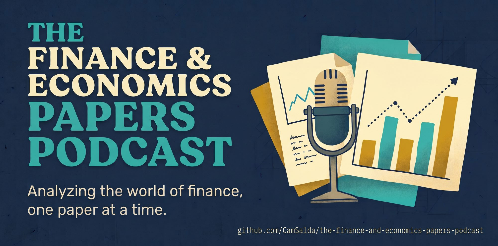
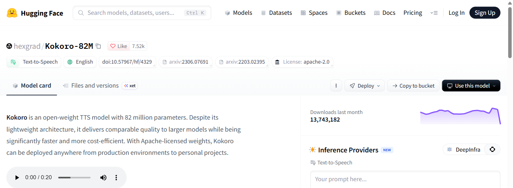
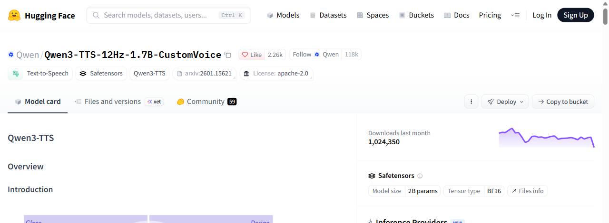
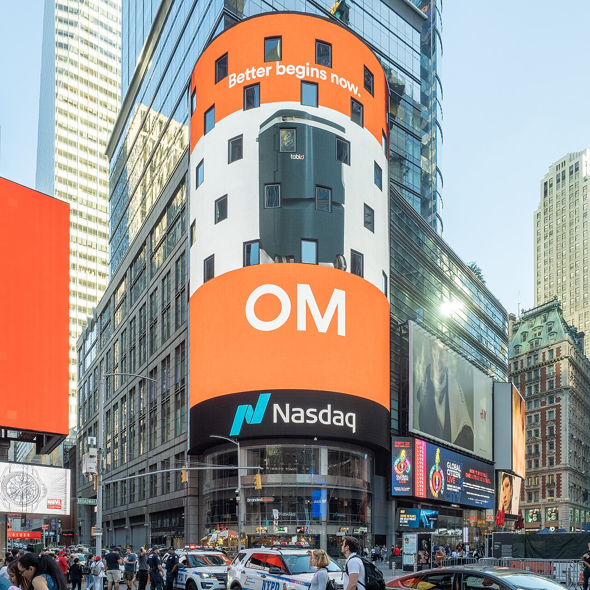
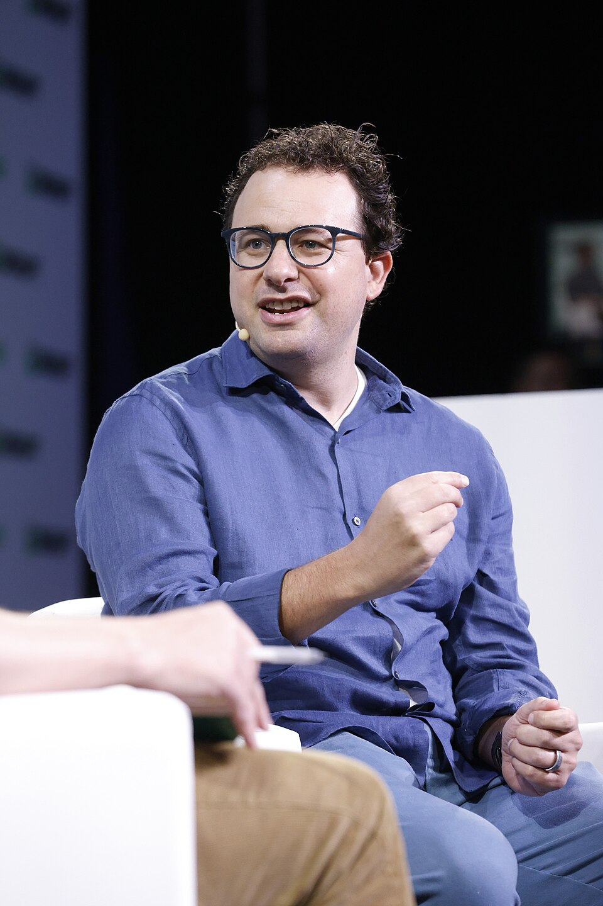
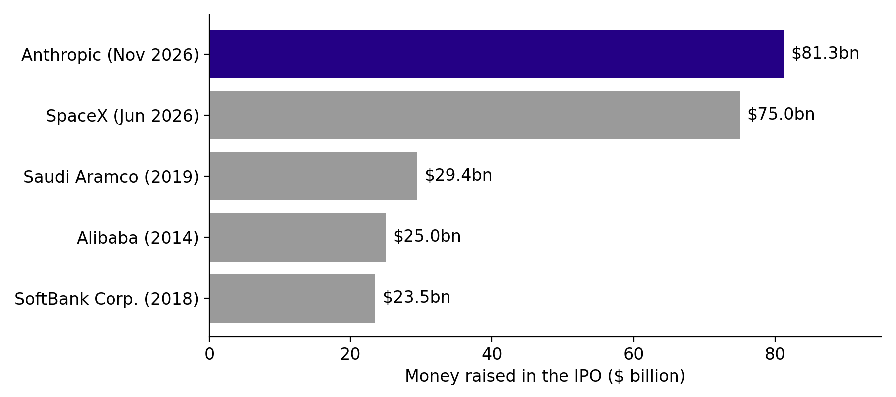
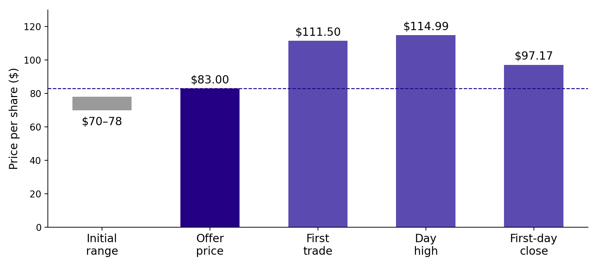

## The next class is the last one

::: {.center}
{fig-align="center" height="220" style="height: 460px; max-height: none"}
:::

## Plan

A.  The Finance and Economics Papers Podcast

B.  The Anthropic IPO in numbers

## A. The Finance and Economics Papers Podcast

::: {.center}
{fig-align="center" height="190" style="height: 380px; max-height: none"}
:::

::: {.tiny}
[github.com/CamSalda/the-finance-and-economics-papers-podcast](https://github.com/CamSalda/the-finance-and-economics-papers-podcast)
:::

## What is it? {.smaller}

- A **free, open-source, educational** podcast. It turns research papers in
  finance and economics into short audio episodes (30 minutes or less).

- Two hosts walk through each paper:
  - **Mei, the guide**, knows the paper and explains every technical term.
  - **Miguel, the student**, asks the questions you would ask in class.

- No equations read aloud. Every episode ends with a one-minute recap and
  comes with its **full script**, which doubles as a transcript.

- Episodes so far range from Mehra and Prescott (1985) on the equity
  premium puzzle to recent work on corporate bonds.

- Everything is under a **Creative Commons (CC BY 4.0)** licence: you can
  listen, share and reuse it, as long as you credit the podcast.

## How an episode is made {.smaller}

- **1. The script.** An AI coding agent (Claude Code, Codex, …) follows a
  written recipe stored in the repository, a "skill". It reads the paper,
  writes the two-host script in plain words, and checks every number against
  the paper.

- **2. The voices.** A short Python program turns the script into audio with
  two **open-source** speech models, one per host.

- **3. The music.** The show's theme is a free track under a Creative Commons
  licence, credited at the end of every episode.

- Everything runs on your own computer. No paid service is needed: only a
  laptop with a graphics card (GPU) for one of the two voices.

- The whole pipeline is public on GitHub: anyone can read it, copy it and
  improve it.

## Open-source models on Hugging Face {.smaller}

::: {.columns}
::: {.column width="50%"}
{height="160" style="height: 245px; max-height: none"}
:::
::: {.column width="50%"}
{height="160" style="height: 245px; max-height: none"}
:::
:::

- **Hugging Face** is the "GitHub of AI models": a platform where labs and
  researchers publish models anyone can download (co-founded by Clem
  Delangue, ESCP MiM 2012, see the Lecture 10 extras).

- **Kokoro** (82 million parameters) voices Mei, **Qwen3-TTS** (Alibaba's
  Qwen team) voices Miguel. Both are **Apache 2.0**: free to use, even
  commercially. Kokoro alone was downloaded over 13 million times last month.

## Listen: the Lecture 11 companion episode {.smaller}

- A special episode that walks through **today's lecture**: venture capital,
  funding rounds, IPOs, SPACs, seasoned offerings, corporate debt, covenants,
  callable and convertible bonds.

- **33 minutes**, with Mei and Miguel. Every number comes from the slides.
  Listen on the metro before the exam, or after class to make it stick.

::: {.content-visible when-format="revealjs"}
<audio controls src="lecture11_podcast.mp3" style="width: 100%;"></audio>
:::

::: {.content-visible unless-format="revealjs"}
- The audio file (`lecture11_podcast.mp3`) and its full script are posted on
  Blackboard with the slides.
:::

- **Do you find it useful?** Tell me, and I can make one for other lectures.

## Use it in your future courses {.smaller}

- The tool is **not limited to finance papers**. Point it at a paper, a
  chapter or your own lecture notes, and it produces a two-host episode and
  its script.

- Use it to **revise**: turn a reading list into episodes you can listen to.

- **Personalise the hosts**: put your own names on an episode and choose
  the voices.

- **Contribute**: pick a paper from the list of more than a hundred upcoming
  episodes, or report an error. Contributions arrive as pull requests on
  GitHub, the same way open-source software is built.

- One rule: **never upload the paper itself**. Papers belong to their
  authors and publishers; episodes link to them instead.

## B. The Anthropic IPO in numbers

::: {.center}
{fig-align="center" height="35" style="height: 60px; max-height: none"}

{fig-align="center" height="190" style="height: 380px; max-height: none"}
:::

::: {.tiny}
Nasdaq MarketSite, Times Square, New York, where Anthropic listed on
19 November 2026. Photo: Wikimedia Commons, CC BY 2.0.
:::

## Who is Anthropic? {.smaller}

::: {.columns}
::: {.column width="30%"}
{height="190" style="height: 380px; max-height: none"}

::: {.tiny}
Dario Amodei, CEO. Photo: TechCrunch, CC BY 2.0.
:::
:::
::: {.column width="70%"}
- An AI lab founded in 2021 by seven former OpenAI employees, led by
  Dario and Daniela Amodei. It makes **Claude**, an AI assistant.

- The **first frontier AI lab to go public**.

- Growth: **\$17.0 billion** of revenue in Q3 2026, up 47% on the previous
  quarter, and an annual run rate of \$81 billion by end of October.

- But it is **not yet profitable**: an operating loss of \$567 million in Q3,
  and nearly **\$1 trillion** of commitments for chips and data centres.
:::
:::

## The biggest IPO ever

::: {.center}
{fig-align="center" height="210" style="height: 430px; max-height: none"}
:::

::: {.tiny}
Source: CBS News, 23 Nov 2026; Saudi Aramco, Alibaba, SoftBank including the
over-allotment (greenshoe) option.
:::

## The deal in numbers {.smaller}

| | |
|---|---|
| Exchange and ticker | Nasdaq, **ANT** |
| Initial price range | \$70 to \$78 per share |
| Final offer price | **\$83** per share |
| Shares sold | 980 million Class A shares |
| Money raised | **\$81.3 billion** (980 million × \$83) |
| Private placement on the side | \$26 billion (AMD, Broadcom, Google, Microsoft, Nvidia) |
| Value of the firm at the offer price | about **\$1.5 trillion** |
| Fees paid to the banks | about \$550 million |
| Shares available to the public | about 7.4% of the firm |

::: {.tiny}
Sources: CBS News, 23 Nov 2026; Yahoo Finance, 19–20 Nov 2026.
:::

## The first day of trading

::: {.center}
{fig-align="center" height="200" style="height: 420px; max-height: none"}
:::

- First trade 34% above the offer price; close **\$97.17**, up **17%**.

::: {.tiny}
Source: CBS News, Yahoo Finance, 19 Nov 2026.
:::
