## Plan {.smaller}

**First Part: Raising Equity Capital**

A.  Equity Financing for Private Companies (Chap. 23.1)

B.  The Initial Public Offering (Chap. 23.2-23.3)

C.  SPACs and the Seasoned Equity Offering (Chap. 23.4-23.5)

**Second Part: Debt Financing**

D.  Corporate Debt (Chap. 24.1)

E.  Other Types of Debt (Chap. 24.2)

F.  Bond Covenants (Chap. 24.3)

G.  Repayment Provisions (Chap. 24.4)

Mostly based on the BDM textbook Chap. 23 and 24.

## {.center}

::: {.content-visible when-format="revealjs"}
::: {.center .huge}
Recap lecture 10
:::
:::

```{=latex}
\vfill
\begin{center}
{\color{escpblue}\Huge\bfseries Recap lecture 10}
\end{center}
\vfill
```

## Recap: two ways to pay out cash {.smaller}

- A firm with spare cash can give it to shareholders in two ways:

  | | Dividend | Repurchase |
  |:--|:--|:--|
  | What happens | cash paid on every share | the firm buys back some shares |
  | Share price | falls by the dividend | stays the same |
  | Number of shares | unchanged | falls |

- Either way, a shareholder ends with the **same wealth**: share plus cash in
  one case, more valuable shares (or cash from selling) in the other.

## Recap: the four dates of a dividend {.smaller}

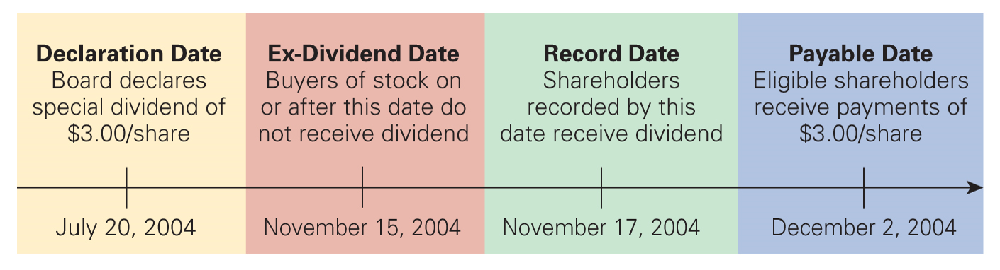{fig-align="center" height="200"}

- **Declaration**: the board announces the dividend. **Ex-dividend**: buyers
  from this day on do not get it, so the price falls by the dividend.
  **Record**: the register fixes who is paid. **Payable**: the cash goes out.

## Recap: the price falls by the dividend {.smaller}

In a perfect market, the price should fall exactly by the amount of dividend paid.

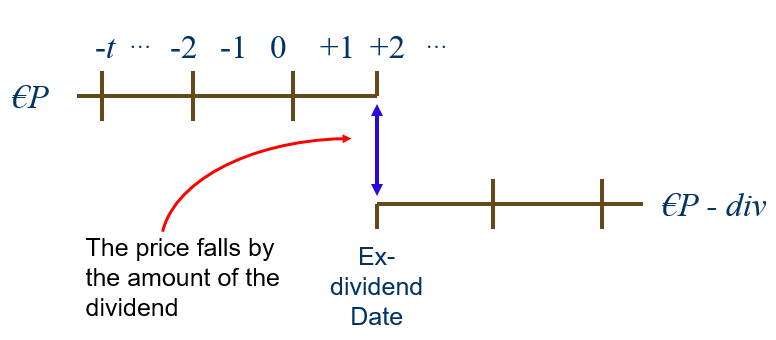{fig-align="center" height="300"}

## Recap: dividend ratios {.smaller}

- **Dividend yield** = Annual dividend / Stock price. In words: the cash
  return you get each year from dividends, per euro invested in the share.

- **Payout ratio** = Cash dividends / Earnings per share. In words: the share
  of the firm's earnings paid out as dividends; the rest is retained.

## Recap: payout policy is irrelevant (MM) {.smaller .center}

```{=latex}
\vfill
```

::: {.box .box-a}
**MM dividend irrelevance (1961).** With investments fixed, in a perfect
market, payout policy does not change the share price. Investors can make
their own **homemade dividends** by selling shares.
:::

::: {.box .box-a}
**Homemade dividends.** In a perfect market, investors can create any payout
pattern they like by buying or selling shares. So they do not pay more for one
policy than for another.
:::

```{=latex}
\vfill
```

## Recap: payout policy in practice {.smaller}

- **Taxes**: where dividends are taxed more than capital gains, repurchases
  are cheaper for shareholders.

- **Clientele effects**: the tax cost of receiving a dividend rather than a
  capital gain differs across investors. Those who pay little or no tax on
  dividends have no reason to avoid them, so each payout policy attracts the
  investors it suits.

- **Pay out or retain?** Pay out the cash the firm cannot invest in
  positive-NPV projects. Retained cash costs tax and invites waste, but
  saves the cost of raising money later.

## Recap: signalling with payout policy {.smaller}

- **Dividends.** Firms smooth their dividends, so a change is news.

  - A policy to pay high dividends can be costly if the firm's finances are
    not solid.

  - Hence, an increase in dividends signals that the managers are confident
    that they can generate high cash flows in the future.

  - Conversely, a decrease in dividends is a bad signal about the managers'
    confidence in the firm's ability to generate high cash flows in the future.

- **Share repurchases.** Managers can increase the value of the firm by
  repurchasing undervalued shares, so a repurchase is a positive signal.


## {.center}

::: {.content-visible when-format="revealjs"}
::: {.center .huge}
Beginning of lecture 11 content
:::
:::

```{=latex}
\vfill
\begin{center}
{\color{escpblue}\Huge\bfseries Beginning of lecture 11 content}
\end{center}
\vfill
```

## Introduction: the life of a firm's financing {.smaller}

- As a firm grows, it changes where it gets its money:

  | Stage | Who provides the money | Section |
  |:--|:--|:--:|
  | Start | founders, family and friends | A |
  | Young private firm | angels, venture capital | A |
  | Going public | many investors, through an IPO | B |
  | Public firm | new shares (SPAC, SEO) | C |
  | Any stage | loans and bonds | D-G |

- At each step, the questions are the same: **how much** is the firm worth,
  **who** gives the money, and **what** do they get in return (a share of
  ownership, or a promise to be repaid).

## A. Equity financing for private companies {.smaller}

- The initial capital that is required to start a business is usually
  provided by the entrepreneur and the immediate family.

- Often, a private company must seek outside sources that can provide
  additional capital for growth.

  - It is important to understand how the infusion of outside capital
    will affect the control of the company.

## Sources of funding {.smaller}

- **Angel investors**:

  - Individual Investors who buy equity in small private firms.

  - Finding angels is typically difficult.

- **Venture capital firms**:

  - A VC firm raises a fund from investors (the **limited partners**: pension
    funds, endowments, wealthy families) and its managers (the **general
    partners**) invest it in start-ups. From the investors' side:

  - Offer limited partners advantages over investing directly in
    start-ups: Limited partners are more diversified and benefit from
    the expertise of the general partners.

  - But general partners charge high fees: Most firms charge 20% of any
    positive return they make (carried interest), and an annual
    management fee of about 2% of the fund's committed capital.

## Sources of funding (con't) {.smaller}

- **Private Equity Firms**:

  - Organized very much like a venture capital firm, but invests in
    equity of existing privately held firms rather than start-up
    companies.

  - May also initiate investments by finding a publicly traded firm and
    purchasing the outstanding equity, thereby taking the company
    private in a leveraged buyout (LBO).

::: {.box .box-a}
**What is an LBO?** A private equity firm buys all the shares of a company and
pays for most of the price with **borrowed money**, often 60% or more. The debt
is then carried by the company itself and repaid out of its own cash flows.
The private equity firm puts in only a small slice of equity, so if the
company does well its return is large (the leverage effect of Lecture 8); if
the company struggles, the heavy debt can push it into financial distress.
:::

## Sources of funding (con't 2) {.smaller}

- **Institutional Investors** (e.g., pension funds, insurance companies,
  endowments, and foundations) may invest directly in private firms or
  indirectly by becoming limited partners in venture capital firms.

- **Corporate Investors**: A corporation that invests in private
  companies. Although most other types of investors in private firms are
  primarily interested in the financial returns of their investments,
  corporate investors might invest for strategic corporate objectives,
  in addition to the financial returns.

## Funding rounds: pre-money and post-money {.smaller}

- A private firm raises money in **rounds** (Series A, B, C...). At each
  round, investors and the firm agree on a value for the firm.

- **Pre-money value**: what the firm is worth **before** the new money.

- **Post-money value**: what it is worth **after**, cash included:
  $$\text{Post-money value} = \text{Pre-money value} + \text{Amount invested}$$

- The new investors get a share of the firm equal to what they paid over the
  post-money value:
  $$\text{New investors' share} = \frac{\text{Amount invested}}{\text{Post-money value}}$$

- This is the "control" question of section A: every round gives away part of
  the ownership.

## Funding rounds: example, step by step {.smaller}

- You put in \$100,000 for 1.5m shares; angels buy 0.5m (for \$100,000, our
  assumption). A VC invests **\$6m** at a **post-money value of \$10m**
  (Example 23.1).

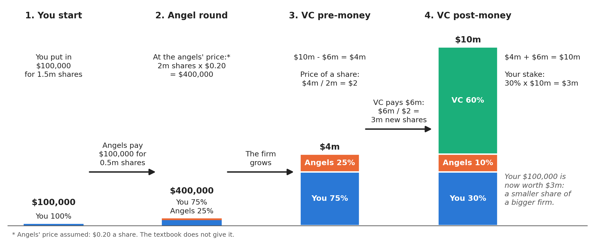{fig-align="center" height="230"}

- Your \$100,000 is now worth **\$3m**, 30 times more, but you control only
  **30%** of the firm.

## Example

::: {.center}
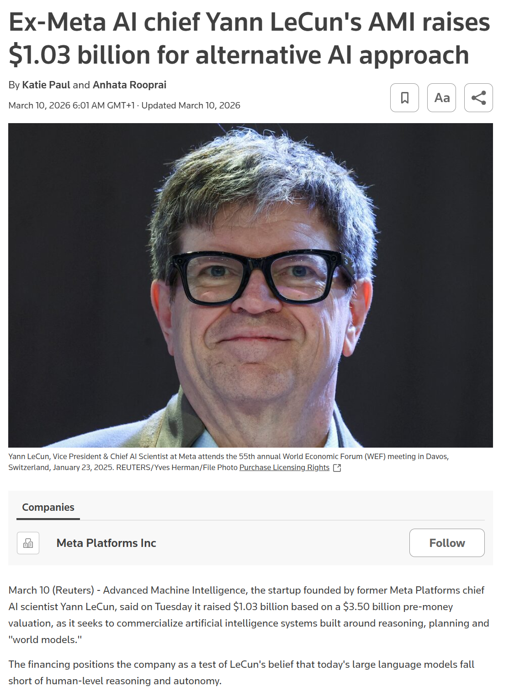{height="200" style="height: 420px; max-height: none"} 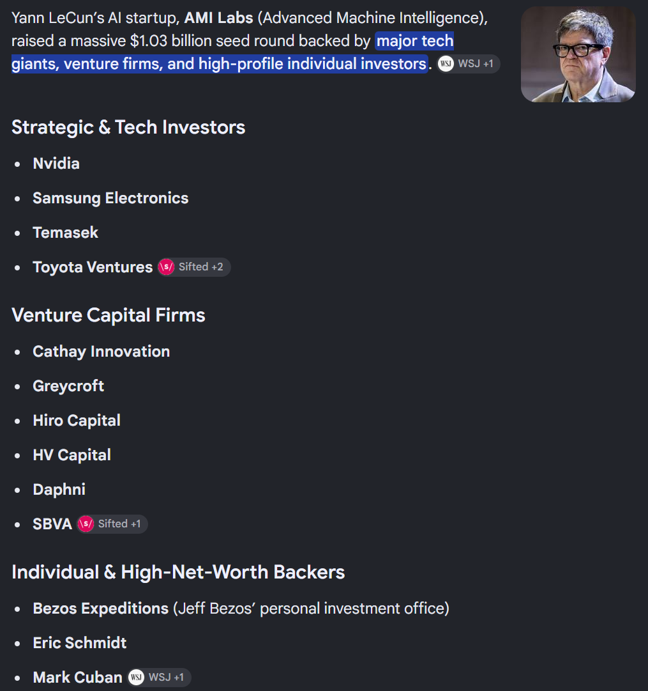{height="200" style="height: 420px; max-height: none"}
:::

## Reading the AMI example {.smaller}

- AMI (Yann LeCun's start-up) raised **\$1.03 billion** at a **pre-money
  value of \$3.50 billion** (March 2026).

- **Post-money value**: $3.50 + 1.03 = \$4.53$ billion.

- **New investors' share**: $1.03 / 4.53 = 22.7\%$.

- **Founders and earlier investors** keep $100\% - 22.7\% = 77.3\%$ of a firm
  now worth \$4.53 billion.

::: {.box .box-a}
Raising money dilutes ownership, but it can make every remaining share worth
more: a smaller slice of a much bigger cake.
:::

## Liquidation preference: who is paid first {.smaller}

- VCs usually buy **convertible preferred shares**: if the firm is sold
  cheaply, they get their money back **before** the founders; if it is sold
  at a high price, they convert into ordinary shares

-Preferences protect
  investors when the firm does badly.

## B. The Initial Public Offering (IPO) {.smaller}

- The process of selling stock to the public for the first time.

- Advantages of going public:

  - Greater liquidity: Private equity investors get the ability to
    diversify.

  - Better access to capital: Public companies typically have access to
    much larger amounts of capital through the public markets.

- Disadvantages of going public:

  - The equity holders become more widely dispersed. This makes it
    difficult to monitor management.

  - The firm must satisfy all the requirements of public companies (SEC
    filings, Sarbanes-Oxley, etc.).

## Types of offerings {.smaller}

- Primary vs. Secondary:

  - Primary Offering: New shares available in a public offering that
    raise new capital.

  - Secondary Offering: Shares sold by existing shareholders in an
    equity offering.


## Types of offerings (con't) {.smaller}

- Best-Efforts vs. Firm Commitment vs. Auction IPOs:

  - Best-Efforts: For smaller IPOs, a situation in which the underwriter
    does not guarantee that the stock will be sold, but instead tries to
    sell the stock for the best possible price. Often such deals have an
    all-or-none clause: either all shares are sold on the IPO or the
    deal is called off.

  - Firm Commitment: An agreement between an underwriter and an issuing
    firm in which the underwriter guarantees that it will sell all of
    the stock at the offer price.

  - Auction IPO: Investors place bids and the IPO price is the highest
    price such that the number of bids at or above that price equal the
    number of offered shares.

- Who bears the risk of unsold shares? **Best efforts**: the firm. **Firm
  commitment**: the bank (the underwriter).


## Example

::: {.center}
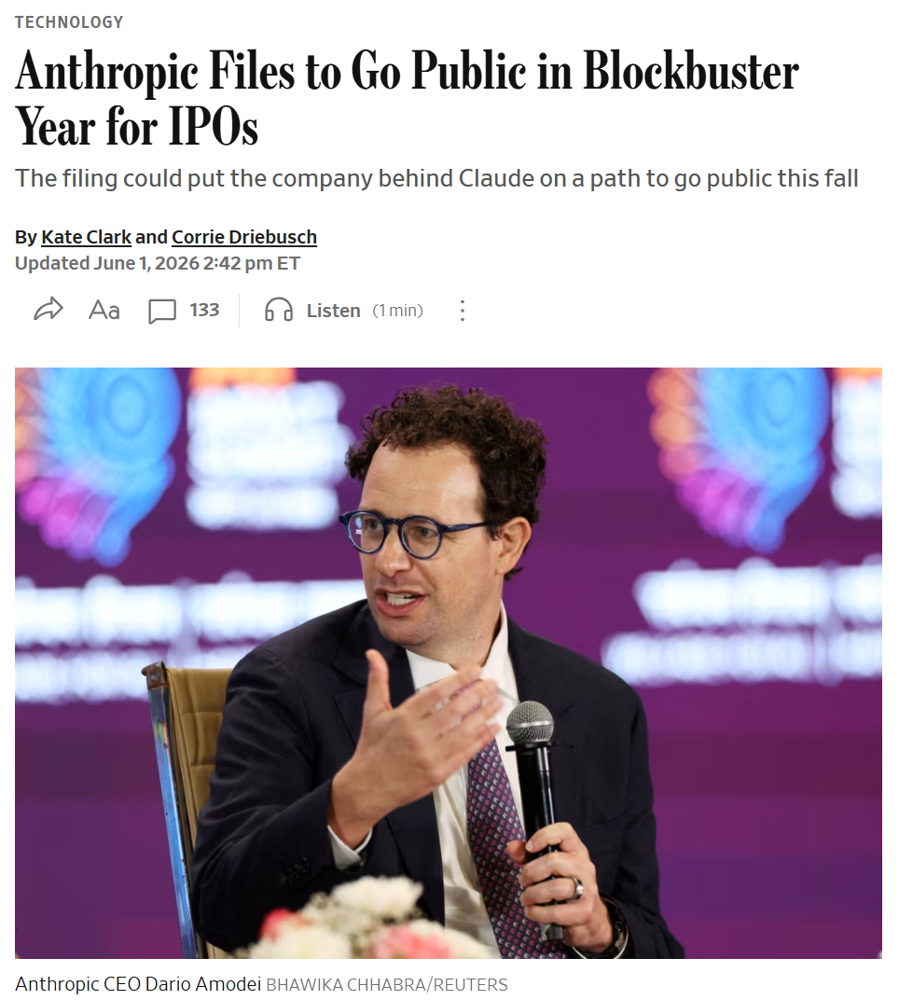{height="200" style="height: 420px; max-height: none"} 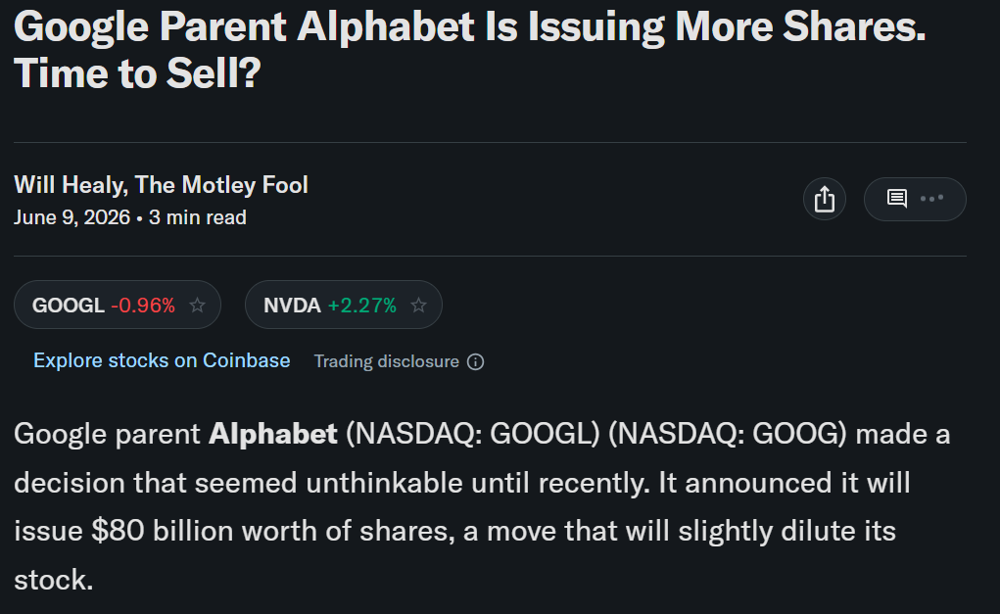{height="125" style="height: 265px; max-height: none"}
:::

## Reading the examples {.smaller}

- **Anthropic** (June 2026): files to go public, an **IPO**: the first sale
  of its shares to the public. It is a **firm commitment** offer: about 22
  banks, led by Goldman Sachs and Morgan Stanley, buy all the shares and
  resell them at a price set by bookbuilding.

- **Alphabet** (June 2026): already public, it sells **\$80 billion** of new
  shares, to pay for AI data
  centres. Existing shareholders are diluted.

- Same tool, new shares, at two stages of a firm's life.

## Largest U.S. IPOs {.smaller}

```{=latex}
\begingroup\footnotesize\setlength{\tabcolsep}{2.5pt}
```

| Company | Date | Exchange | Sector | Lead underwriter | USD m |
|:--------------|:-------|:---------|:-----------|:-----------------|-------:|
| SpaceX | 06/2026 | Nasdaq | Industrials | Goldman Sachs | 75,000 |
| SK hynix | 07/2026 | Nasdaq | Technology | Bank of America | 26,507 |
| Alibaba | 09/2014 | NYSE | Technology | Credit Suisse | 21,767 |
| Visa | 03/2008 | NYSE | Financials | J.P. Morgan | 17,864 |
| ENEL | 11/1999 | NYSE | Utilities | Merrill Lynch | 16,452 |
| Facebook | 05/2012 | Nasdaq | Technology | Morgan Stanley | 16,007 |
| General Motors | 11/2010 | NYSE | Consumer | Morgan Stanley | 15,774 |
| Deutsche Telekom | 11/1996 | NYSE | Telecoms | Goldman Sachs | 13,034 |
| Rivian | 11/2021 | Nasdaq | Consumer | Morgan Stanley | 11,934 |

::: {.footnotesize}
**Source**: Renaissance Capital IPO Home, November 2026, ranks 1 to 9. Deal
sizes exclude the greenshoe.
:::

```{=latex}
\endgroup
```

## Largest U.S. IPOs (con't) {.smaller}

```{=latex}
\begingroup\footnotesize\setlength{\tabcolsep}{2.5pt}
```

| Company | Date | Exchange | Sector | Lead underwriter | USD m |
|:--------------|:-------|:---------|:-----------|:-----------------|-------:|
| AT&T Wireless | 04/2000 | NYSE | Telecoms | Goldman Sachs | 10,620 |
| Kraft Foods | 06/2001 | NYSE | Consumer | Credit Suisse | 8,680 |
| Uber | 05/2019 | NYSE | Technology | Morgan Stanley | 8,100 |
| France Telecom | 10/1997 | NYSE | Telecoms | Merrill Lynch | 7,289 |
| Medline | 12/2025 | Nasdaq | Health care | Goldman Sachs | 6,265 |
| Telstra | 11/1997 | NYSE | Telecoms | Credit Suisse | 5,646 |
| Swisscom | 10/1998 | NYSE | Telecoms | Warburg Dillon Read | 5,582 |
| Cerebras Systems | 05/2026 | Nasdaq | Technology | Morgan Stanley | 5,550 |
| United Parcel Service | 11/1999 | NYSE | Transportation | Morgan Stanley | 5,470 |

::: {.footnotesize}
**Source**: Renaissance Capital IPO Home, November 2026, ranks 10 to 18.
:::

- A typical IPO is far smaller: the median US IPO raised about \$180 million in 2020.

```{=latex}
\endgroup
```

## Mechanics of an IPO

- Choose:

  - Lead Underwriter

    - The primary investment banking firm responsible for managing a
      security issuance.

  - Syndicate

    - A group of underwriters who jointly underwrite and distribute a
      security issuance.

## Top global IPO underwriters, ranked by proceeds

::: {.center}
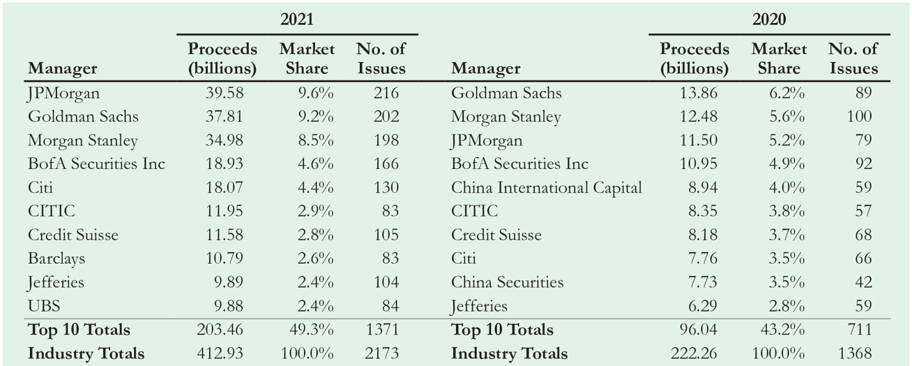{fig-align="center"}
:::

::: {.footnotesize}

*Source:* Global Equity Capital Markets Review, 2021

:::

## The IPO, step by step {.smaller}

1. **Choose the banks**: a lead underwriter and a syndicate.

2. **File with the regulator** (SEC in the US): registration statement and
   preliminary prospectus.

3. **Value the firm** and set a price range.

4. **Road show and book building**: meet large investors, collect their
   orders.

5. **Set the offer price**, final prospectus, shares start trading.

6. **After the IPO**: greenshoe option (first 30 days), then the **lockup**
   ends (90-180 days).

- The next slides take these steps one by one.

## Mechanics of an IPO (con't) {.smaller}

- SEC Filings

  - Registration Statement: Legal document that provides financial and
    other information about a company to investors prior to a security
    issuance.

- Preliminary Prospectus (Red Herring): Part of the registration
  statement prepared by a company prior to an IPO that is circulated to
  investors before the stock is offered.

- Final Prospectus: Part of the final registration statement prepared by
  a company prior to an IPO that contains all the details of the
  offering, including the number of shares offered and the offer price.

## Mechanics of an IPO (con't) {.smaller}

- Valuation:

  - Compute the present value of the estimated future cash flows.

  - Estimate the value by examining comparables (recent IPOs).

- Road Show: During an IPO, when a company's senior management and its
  underwriters travel around promoting the company and explaining their
  rationale for an offer price to the underwriters' largest customers,
  mainly institutional investors such as mutual funds and pension funds.

- Book Building: A process used by underwriters for coming up with an
  offer price based on customers' expressions of interest.

## Mechanics of an IPO (con't) {.smaller}

- Pricing the Deal and Managing Risk

  - Spread: The fee a company pays to its underwriters that is a
    percentage of the issue price of a share of stock.

  - When an underwriter provides a firm commitment, it is potentially
    exposing itself to the risk of selling the shares at less than the
    offer price and thus taking a loss. However, research shows that 75%
    of IPOs experience an increase in share price on the first day (only
    9% experience a decrease).

## Mechanics of an IPO (con't) {.smaller .dense}

- Pricing the Deal and Managing Risk (con't):

  - Over-Allotment Allocation (Greenshoe Provision): an option that
    allows the underwriter to issue more stock, usually amounting to 15%
    of the original offer size, at the IPO offer price.

  - Underwriters initially market both the initial allotment and the
    allotment in the greenshoe provision by short selling the greenshoe
    allotment.

    - If the issue is a success, the underwriter exercises the greenshoe
      option, thereby covering its short position.

    - If the issue is not a success, the underwriter covers the short
      position by repurchasing the greenshoe allotment in the
      aftermarket, thereby supporting the price.

  - **Lockup**: A restriction that prevents insiders from selling their
    shares for some period, usually 90-180 days, after an IPO.


## The four IPO puzzles (Chap. 23.3) {.smaller}

- **Underpricing**: on average the share closes its first day well above the
  offer price, by more than 17% in the US since 1960, so the issuer leaves
  money on the table.

- **Hot and cold markets**: IPOs come in waves, with many firms going public
  when markets are high (1983, 1996, 1999-2000) and almost none after a
  crash (2001-03, 2008).

- **High costs**: an IPO costs about 7% of the money raised in fees alone, far
  more than issuing bonds or seasoned equity.

- **Long-run underperformance**: in the three to five years after an IPO, the
  new shares tend to do worse than the market.

::: {.box .box-a}
None of the four fits a perfect market. The usual explanations are the
winner's curse for underpricing, and managers timing the market for the
other three.
:::

## C. SPACs: going public through the back door {.smaller}

- A **SPAC** (special purpose acquisition company) is an empty company that
  goes public first, with a promise: buy a private firm within two years.
  The private firm then becomes public by **merging** with the SPAC, with no
  IPO of its own (Chap. 23.4).

- **Example**: the electric-car maker Lucid merged with the SPAC CCIV in 2021.

  - Fees: **3.7%** of the money raised, about half the 7% of an IPO.

  - First-day price: \$26.83, against an effective price of \$9.87 a share:
    the shares rose **172%**.

- After the merger, SPAC firms have done badly: on average almost **25%** a
  year below the market. More than a third of 2021 listings were SPACs.

## C. The Seasoned Equity Offering (SEO) {.smaller}

- Public firms use SEOs to raise additional equity (Chap. 23.5).

  - The steps are similar as for an IPO. The main difference is that a
    market price for the stock already exists, so the price-setting
    process is not necessary.

- Two kinds of SEOs exist:

  - **Cash Offer**: new shares are offered to investors at large.

  - **Rights Offer**: new shares are offered only to existing
    shareholders. $\Rightarrow$ protects existing shareholders from
    underpricing and wealth transfer.

## An example of wealth transfer {.smaller}

- Alpha has no debt and only one asset of 100 EUR. Its capital consists
  of 50 stocks (with a unit value of 2 EUR).

- Alpha announces the issuance of 50 new stocks at a price of 1 EUR. The
  low price guarantees the success of the increase in capital.

- After the operation, the company has 150 EUR in assets and its
  liability side consists of 100 shares.

- The price of a stock is thus 1.50 EUR.

- The previous shareholders have thus lost 50 cents, which is the gain
  of the new shareholders.

## Wealth transfer, step by step {.smaller}

| | Before | After the issue |
|:--|:--:|:--:|
| Assets | 100 EUR | 100 + 50 = 150 EUR |
| Number of shares | 50 | 50 + 50 = 100 |
| Price per share | 100 / 50 = 2 EUR | 150 / 100 = 1.50 EUR |

- **Old shareholders**: 50 shares worth $50 \times 2 = 100$ EUR before,
  $50 \times 1.50 = 75$ EUR after. They **lose 25 EUR**.

- **New shareholders**: pay $50 \times 1 = 50$ EUR for shares worth
  $50 \times 1.50 = 75$ EUR. They **gain 25 EUR**.

- Selling shares **below** their value moves wealth from old to new
  shareholders.

## Rights offer: example {.smaller}

- If Alpha instead decides to do a rights offer, each existing
  shareholder receives the right to purchase an additional share for 1
  EUR.

- If all existing shareholders exercise their right, the value of the
  company is 150 EUR and the liability side of the company consists of
  100 shares with a unit value of 1.50 EUR (the stock price has thus
  decreased by 50 cents).

- But existing and new shareholders are the same so the loss of 50 cents
  per stock is compensated by the profit on the new shares.

- **In numbers**: together, the old shareholders had 100 EUR of shares and
  50 EUR of cash = 150 EUR. After: 100 shares $\times$ 1.50 = 150 EUR. **No loss**:
  the 25 EUR stays with the same people.

## Rights offer: the price does not matter {.smaller}

- A firm worth \$1 billion has 100 million shares at \$10. It needs
  **\$200 million** (Example 23.8). Two possible rights offers:

  | | Offer (a) | Offer (b) |
  |:--|:--:|:--:|
  | Terms | 4 rights + \$8 buy 1 share | 5 rights + \$10 buy 2 shares |
  | New shares | 25 million | 40 million |
  | Money raised | $25 \times 8 = \$200$m | $40 \times 5 = \$200$m |
  | Price after | $1{,}200 / 125 = \$9.60$ | $1{,}200 / 140 = \$8.57$ |

- A shareholder with 4 shares and \$8 under offer (a): $4 \times 10 + 8 = \$48$
  before, $5 \times 9.60 = \$48$ after. The same holds under (b).

- With a rights offer the issue price only changes **how** the value is
  split between old and new shares, not **who** owns it.

## Price reaction {.smaller}

- Researchers have found that, on average, the market greets the news of
  an SEO with a price decline (on average, 3-5 %).

- Why?

- This can be explained with the signalling and adverse selection theory
  (Chap. 16):

  - A company concerned about protecting its existing shareholders will
    tend to sell only at a price that correctly values or overvalues the
    firm.

  - Thus investors infer from the decision to sell that the company is
    likely to be overvalued. $\Rightarrow$ Price drop at announcement of
    SEO.

## Price reaction (con't) {.smaller}

- But adverse selection cannot be the whole story:

  - A rights issue mitigates the adverse selection problem. However, the
    stock price decreases even in that case.

  - In addition, as for IPOs, after an SEO the stock price tends to
    underperform the market. This suggests that the price decrease at
    the announcement is insufficient, because prices continue to decline
    thereafter.

## Second Part: Debt Financing

D.  Corporate Debt (Chap. 24.1)

E.  Other Types of Debt (Chap. 24.2)

F.  Bond Covenants (Chap. 24.3)

G.  Repayment Provisions (Chap. 24.4)

## D. Corporate debt

- Characteristics of a debt security:

  - Face value

  - Issue price

  - Coupon rate (fix, variable, indexed, \...)

  - Coupon payment dates

  - Maturity

## Corporate debt: a real bond {.smaller}

- In 2005 the car-rental firm Hertz issued, among others, this bond:

  | Characteristic | Value |
  |:--|:--|
  | Face value (total) | \$1.8 billion, in bonds of \$1,000 |
  | Issue price | 100% of face value (at par) |
  | Coupon rate | 8.875% a year, fixed |
  | Coupon payment dates | every six months |
  | Maturity | 2014 |

- Each \$1,000 bond pays $8.875\% \times 1000 / 2 = \$44.38$ every six
  months, and \$1,000 back in 2014.

- A bond issued **below** face value is an **original issue discount** (OID)
  bond: part of the return comes from the price rising to face value.

## Issuance of debt {.smaller}

- **Private debt**: not publicly traded; larger aggregate market than
  the public debt market. Avoids cost of registration but has the
  disadvantage of being illiquid. Two segments:

  - **Term loans:** fixed term bank loans.

  - **Private placements:** bond issue that does not trade on a public
    market and is sold to a small group of investors.

- **Public debt**: publication of a prospectus, which specifies the
  details of the offering, and includes an indenture (formal debt
  agreement between issuer and bondholder).

## Example {.smaller}

:::: {.columns}
::: {.column width="45%"}
**Private debt example:**

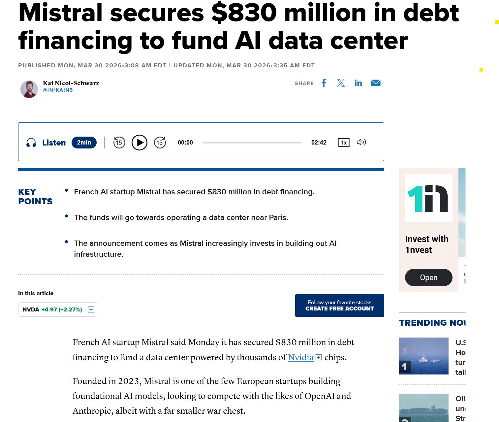{height="300"}
:::

::: {.column width="55%"}
**Public debt example:**

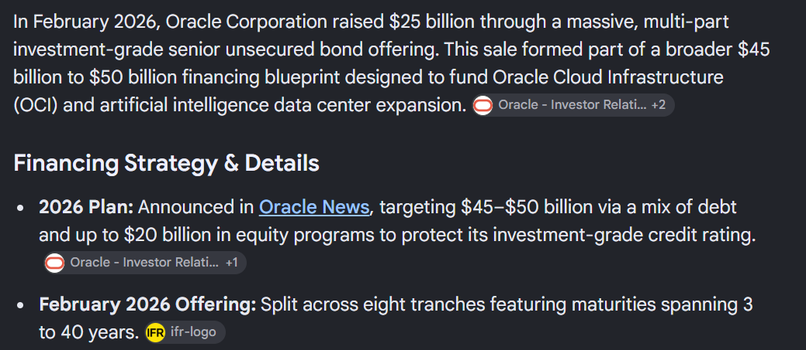{height="205"}
:::
::::

- A young firm borrows privately; a large, well-known firm can tap the public
  market for much bigger amounts.

## Seniority

- Most types of corporate bonds---notes (maturity less than 10 years)
  and debentures---are unsecured.

- Thus the bondholder's priority in claiming assets in the event of
  default---the bond's seniority---is important.

  - Senior vs. junior debt.

- In exchange for more risk, the investors of junior debt are promised
  higher yields.

## Seniority: who is paid first {.smaller}

- If the firm defaults, its assets are shared out in this order:

  1. **Secured debt**: backed by specific assets (a building, the car
     fleet). Mortgage bonds and asset-backed bonds.

  2. **Senior unsecured debt**: notes and debentures with no specific
     asset, paid before other debt.

  3. **Subordinated (junior) debt**: paid only after senior debt.

  4. **Shareholders**: paid last, with what is left.

- **Hertz (2005)**: its senior notes paid **8.875%**, its subordinated notes
  **10.5%**. The lower in the line, the higher the interest rate.

## E. Other types of debt {.smaller .shrink}

- **Sovereign debt**: debt issued by national governments.

- An expanding market, thanks to the increase in public deficits

  - In France, the public debt at the end of 2025 amounted to 115.6% of
    the GDP, or 3,460.5 billion EUR.

  - Up from 112% of GDP and 3,228 billion EUR a year earlier: an increase
    of 232.5 billion EUR in a single year.

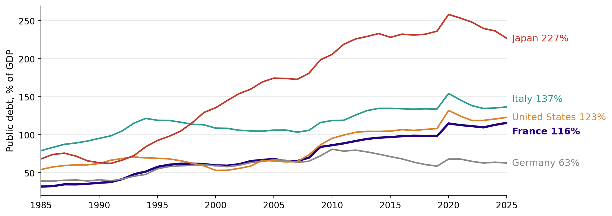{fig-align="center" height="220"}

::: {.tiny}
*Source:* IMF Global Debt Database, 1985–2024; 2025: Eurostat and IMF WEO.
:::

## Existing U.S. Treasury Securities

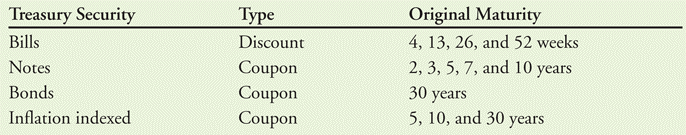{fig-align="center"}

## TIPS (Treasury-Inflation-Protected Securities)

- An inflation-indexed bond issued by the U.S. Treasury with maturities
  of 5, 10, and 20 years. They are standard fixed-rate coupon bonds with
  one difference: The outstanding principal is adjusted for inflation.

- Example:

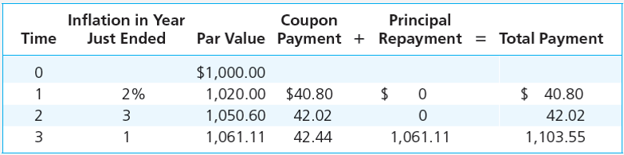{fig-align="center"}

## Other types of debt: Asset-Backed Securities {.smaller}

- Securitization transforms assets in financial securities that can be
  traded on financial markets.

- The largest sector of the asset-backed security market is the
  mortgage-backed security market (i.e., assets backed by home
  mortgages). $\Rightarrow$ Mortgage-Backed Securities.

- **Collateralized Debt Obligations (CDO)**: A re-securitization of
  other asset-backed securities + Often division into tranches that are
  assigned different repayment priority.

## F. Bond covenants {.smaller}

- Restrictive clauses in a bond contract that limit the issuers from
  undercutting their ability to repay the bonds.

- For example, covenants may

  - Restrict the ability of management to pay dividends

  - Restrict the level of further indebtedness

  - Specify that the issuer must maintain a minimum amount of working
    capital

- If the issuer fails to live up to any covenant, the bond goes into
  default.

- **Why accept them?** Covenants protect lenders against managers taking
  the cash out or piling on more debt. Lenders feel safer and ask for a
  **lower interest rate**.

## G. Repayment provisions {.smaller}

- Issuers can repurchase outstanding bonds in the market before
  maturity.

- The bond can also directly allow for early repayment by including a
  **call** provision: **callable bonds**.

- This gives the issuer the right (but not the obligation) to retire all
  outstanding bonds on (or after) a specific date (the call date) for
  the call price.

  - Call price is generally set at or above, and expressed as a
    percentage of, the bond's face value.

- Firms generally call a bond issue if interest rates have fallen.

  - Issuer can lower its borrowing costs by immediately refinancing at a
    lower rate.

  - Note: If rates rise, there is no need to refinance.

##

::: {.center}
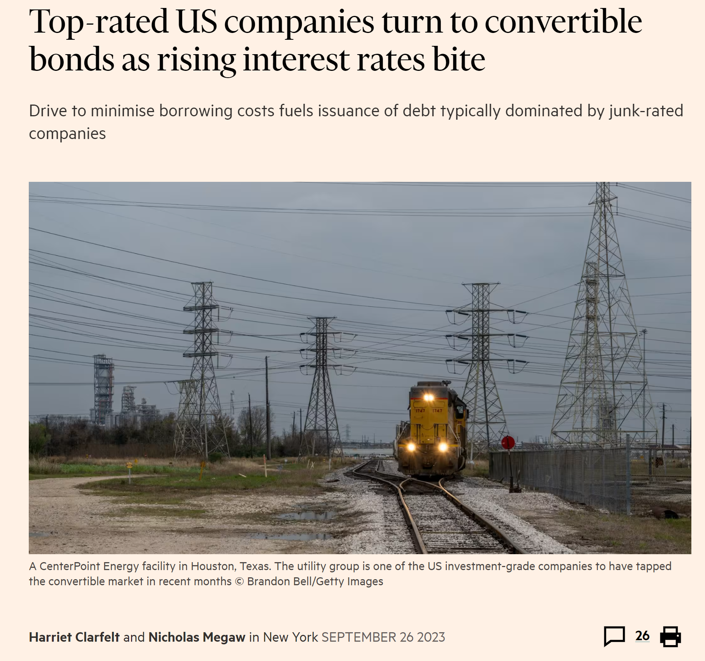{fig-align="center"}
:::


## Bonds with options {.smaller}

- Bonds are commonly sold with options which give the issuer or the
  investor some additional rights.

- Options for the investor

  - Puttable bonds: Give the holder an option to retire or extend the
    bond.

  - Convertible bonds: Can be exchanged for shares of the firm's common
    stock.

- Options for the issuer:

  - Callable bond: Can be repurchased before the maturity date.

- Has a bond with an option a lower or higher yield than an otherwise
  identical bond? Why?

## Bonds with options: the answer {.smaller}

- An option is worth something to whoever **holds** it.

- **Option for the investor** (puttable, convertible): the investor gets an
  extra right, so accepts a **lower yield**.

- **Option for the issuer** (callable): the firm gets an extra right, so it
  must pay a **higher yield**.

## Hybrid bonds: convertible bonds {.smaller}

- A corporate bond with a provision that gives the bondholder an option
  to convert each bond owned into a fixed number of shares of common
  stock.

- Conversion Ratio: The number of shares received upon conversion of a
  convertible bond, usually stated per \$1000 of face value.

- Conversion Price: The face value of a convertible bond divided by the
  number of shares received if the bond is converted.

- Warrant: A call option written by the company itself on new stock

  - When a holder of a warrant exercises it and thereby purchases stock,
    the company delivers this stock by issuing new stock.

  - Convertible debt carries a lower interest rate because it has an
    embedded warrant.

##

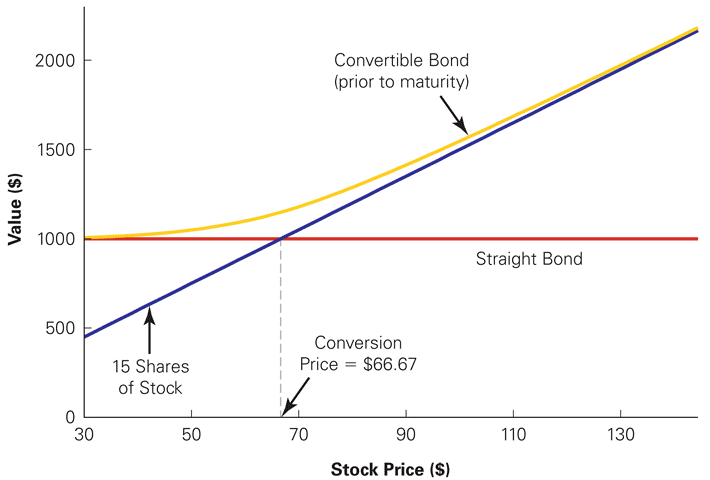{fig-align="center"}

## What to remember {.smaller}

- **A. Private firms** raise money in rounds. Post-money = pre-money +
  invested; new investors own invested / post-money.

- **B. IPO**: underwriters, book building, greenshoe, lockup. IPOs
  are underpriced on average, come in waves and do poorly in the long run.

- **C. SPACs** are a cheaper back door to the market. Poor performance on average.

## What to remember (con't) {.smaller}

- **D. Corporate debt**: private or public; seniority sets who is paid first
  and the interest rate.

- **E. Other debt**: sovereign bonds, TIPS (Treasury Inflation-Protected
  Securities), ABS (asset-backed securities) and CDO (collateralized debt
  obligation) tranches.

- **F. Covenants** protect lenders and lower the rate.

- **G. Options in bonds**: callable means a higher yield; convertible and
  puttable mean a lower yield.

## Quiz

- What are some of the advantages and disadvantages of going public?

- What is the difference between a cash offer and a rights offer for a
  seasoned equity offering?

- What happens if an issuer fails to live up to a bond covenant?

- Why does a convertible bond have a lower yield than an otherwise
  identical bond without the option to convert?

## Quiz: answers {.smaller}

- **Going public.** Advantages: liquidity for early investors, access to
  much more capital. Disadvantages: dispersed owners who find it hard to
  monitor managers, and the cost of public-company rules.

- **Cash vs rights offer.** A cash offer sells to anyone, so a low price
  moves wealth to new buyers. A rights offer sells only to existing
  shareholders, so the value stays with them whatever the price.

- **Covenant breach.** The bond goes into default: lenders can ask for
  their money back or renegotiate.

- **Convertible yield.** The investor also holds an option to become a
  shareholder (a warrant). That option has value, so the investor accepts a
  lower coupon.
