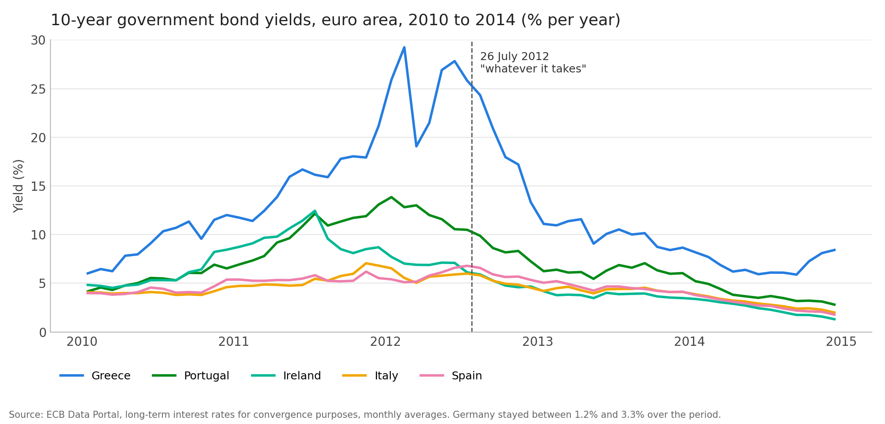
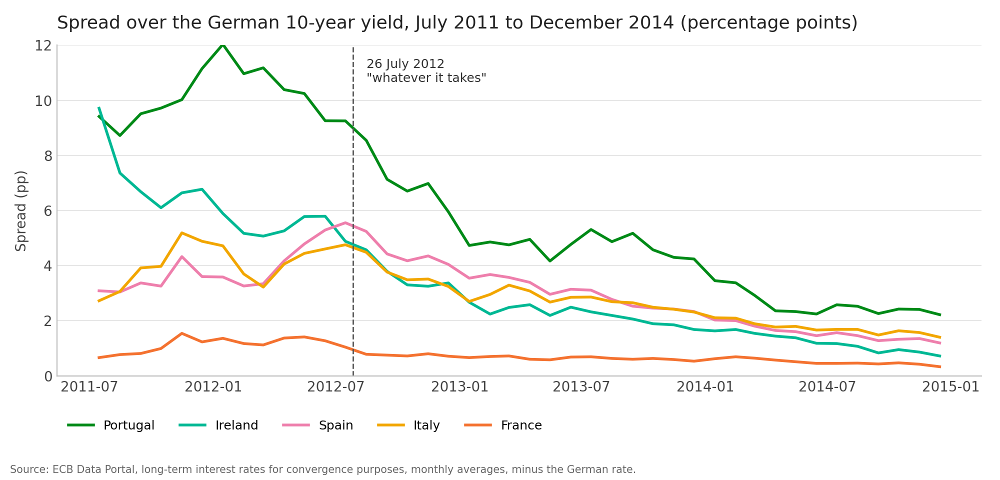
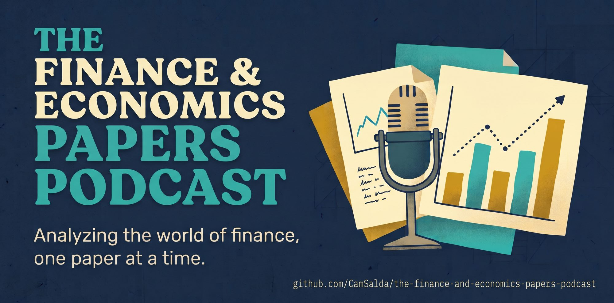
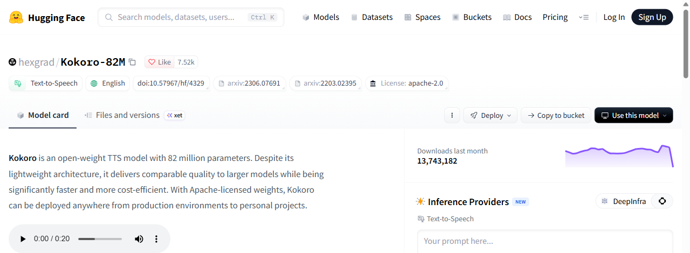
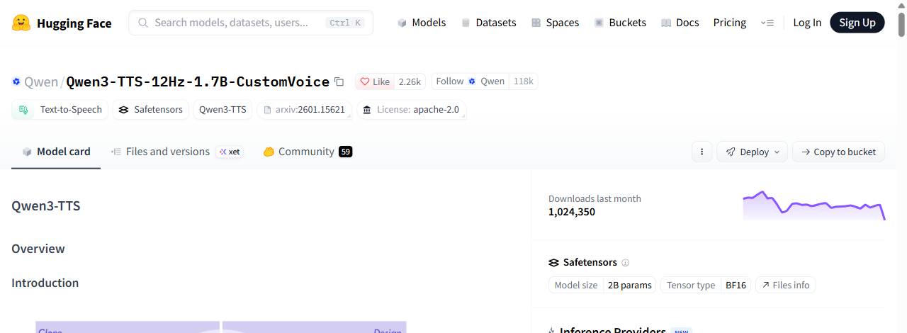

## Plan

A.  "Whatever it takes": the euro crisis and the speech of 26 July 2012

B.  The Draghi report on European competitiveness (2024)

C.  Are leveraged buyouts really that profitable? For whom?

D.  The Finance and Economics Papers Podcast

## A. Summer 2012: the euro under pressure {.smaller .shrink}

::: {.center}
{fig-align="center" height="200" style="height: 290px; max-height: none"}
:::

- By July 2012 Spain borrowed for ten years at more than **7.5%**, Italy at
  about **6.5%**, Germany at **1.2%**. Above 7%, Greece, Ireland and Portugal
  had needed a rescue; Spain and Italy were too big to rescue.

- Investors feared a **break-up of the euro**: a country leaving and repaying
  in a devalued currency. Higher yields made an exit more likely, which pushed
  yields higher still.

## The speech: London, 26 July 2012 {.smaller}

- At an investment conference on the eve of the London Olympics, the ECB
  president Mario Draghi improvised a few sentences that were not in his notes:

::: {.box .box-a}
"Within our mandate, the ECB is ready to do **whatever it takes** to preserve
the euro. And believe me, it will be enough."
:::

- He announced no measure that day. The programme came in two steps:

  - **2 August 2012**: the ECB Governing Council says it may buy government
    bonds on the secondary market.

  - **6 September 2012**: the **Outright Monetary Transactions (OMT)** are
    unveiled: **unlimited** purchases of bonds with one to three years to
    maturity, for countries that accept a reform programme with the European
    rescue fund (ESM). The Bundesbank president cast the only vote against.

- OMT has **never been activated**. The promise alone did the work.

## The reaction: spreads fall, no bond bought {.smaller .shrink}

::: {.center}
{fig-align="center" height="200" style="height: 290px; max-height: none"}
:::

- Spain's ten-year yield fell from above 7.5% in July to below 6% in September
  2012 and about 4% by end 2013. By 2014 spreads were back near pre-crisis
  levels.

## B. The Draghi report (September 2024) {.smaller .shrink}

- In 2023 the Commission president Ursula von der Leyen asked Mario Draghi
  for a diagnosis of Europe's economy. *The future of European
  competitiveness* came out on **9 September 2024**.

- **The diagnosis**: since 2000 the EU has grown more slowly than the United
  States, mostly through weaker productivity; it has no tech giants and
  depends on others for energy, chips and defence.

- **Three priorities**: close the innovation gap with the US and China; pair
  decarbonisation with competitiveness (cheaper energy); more security and
  fewer dependencies.

- **Read it**: [overview page](https://commission.europa.eu/topics/eu-competitiveness/draghi-report_en)
  · [Part A, the strategy (about 65 pages)](https://commission.europa.eu/document/97e481fd-2dc3-412d-be4c-f152a8232961_en)
  · [Part B, in-depth analysis (about 320 pages)](https://commission.europa.eu/document/ec1409c1-d4b4-4882-8bdd-3519f86bbb92_en)

## C. An LBO still needs equity {.smaller .shrink}

- **The idea:** buy a company mostly with debt, repay the debt from its cash
  flows while improving it, and resell it a few years later at a profit.

- **Debt never pays for the whole company.** Lenders want a cushion that
  takes the first losses, and someone must own the firm: the **equity**,
  about 40% of the price.

- Like a house: the bank lends most of the price, you pay the deposit and own it.

- **The lever acts on the equity.** Buy a company for 100 with 60 of debt and
  40 of equity (interest ignored):

  | Company sold for | Lenders get | Equity gets | Return on equity |
  |:--|--:|--:|--:|
  | 130 | 60 | 70 | **+75%** |
  | 100 | 60 | 40 | 0% |
  | 70 | 60 | 10 | **−75%** |

- The company moves 30%, the equity 75% (Lecture 8); lenders always get 60.

## LBOs: three parties, three answers {.smaller .shrink}

| Who | Puts in | Earns |
|:--|:--|:--|
| **Lenders** (banks, private credit) | the debt, about 60% | interest only, paid first |
| **Fund investors** (pension funds, insurers) | the equity, about 40% | what is left after the debt |
| **Private equity firm** (Blackstone, KKR) | 1 to 3% of the equity | **fees** |

- **For the fund investors: about the stock market.** Buyout funds beat the
  S&P 500 by about 3% a year before 2006, and have matched it since.

- **For the private equity firm: a gold mine.** Blackstone earned **5.7
  billion dollars** from fees in 2025. Private equity billionaires on the
  Forbes list went from 3 in 2005 to 17.

## Why the private equity firm earns so much {.smaller .shrink}

- The standard contract is **"2 and 20"**: **2%** of the money committed
  every year, whatever happens, plus **20%** of the gains above about 8% a
  year. A 10 billion fund pays 200 million a year in fees alone.

- **Four reasons the business is so profitable**:

  1. **Fixed fees, few people.** About two-thirds of a buyout firm's revenue
     does not depend on performance. A bigger fund barely needs more staff.

  2. **Leverage.** Debt magnifies the gain on the equity (Lecture 8), and the
     interest is tax-deductible (Lecture 9).

  3. **Managerial skill.** New managers paid in shares, a hands-on board,
     cost cuts and growth plans: the company is run better.

  4. **Spotting opportunities.** Buying undervalued firms, borrowing when
     debt is cheap, selling when prices are high. Rising valuations produced
     over half of buyout returns.

::: {.tiny}
Sources: Metrick and Yasuda, *Review of Financial Studies* (2010); Kaplan and
Strömberg, *Journal of Economic Perspectives* (2009); Harris, Jenkinson and
Kaplan, *Journal of Finance* (2014); Phalippou, *An Inconvenient Fact* (2020);
Bain, *Global Private Equity Report 2026*; Blackstone, Q4 2025 results.
:::

## Are the golden years of buyouts over? {.smaller .shrink}

- **Returns have fallen.** Buyouts beat the S&P 500 by about 3% a year
  before 2006 and roughly match it since. Over the last decade, US stocks
  beat US buyouts; Europe is the exception.

- **Cash comes back slowly.** Companies are held about 7 years instead of 5
  to 6, and payouts to investors are at their lowest since 2008-09.

- **Why.** More money chasing the same deals, debt costlier since 2022, no
  more boost from rising valuations: a deal now needs about 12% profit growth
  a year, against 5% before.

- **Not settled.** Unsold companies are valued by the funds themselves, and
  the answer depends on the benchmark: S&P 500, world index, or small
  indebted firms.

::: {.tiny}
Sources: Harris, Jenkinson and Kaplan, *Journal of Finance* (2014); Phalippou,
*An Inconvenient Fact* (2020); Bain, *Global Private Equity Report 2026*.
:::

## D. The Finance and Economics Papers Podcast

::: {.center}
{fig-align="center" height="190" style="height: 380px; max-height: none"}
:::

::: {.tiny}
[github.com/CamSalda/the-finance-and-economics-papers-podcast](https://github.com/CamSalda/the-finance-and-economics-papers-podcast)
:::

## What is it? {.smaller}

- A **free, open-source, educational** podcast. It turns research papers in
  finance and economics into short audio episodes (30 minutes or less).

- Two hosts walk through each paper:
  - **Mei, the guide**, knows the paper and explains every technical term.
  - **Miguel, the student**, asks the questions you would ask in class.

- No equations read aloud. Every episode ends with a one-minute recap and
  comes with its **full script**, which doubles as a transcript.

- Episodes so far range from Mehra and Prescott (1985) on the equity
  premium puzzle to recent work on corporate bonds.

- Everything is under a **Creative Commons (CC BY 4.0)** licence: you can
  listen, share and reuse it, as long as you credit the podcast.

## How an episode is made {.smaller}

- **1. The script.** An AI coding agent (Claude Code, Codex, …) follows a
  written recipe stored in the repository, a "skill". It reads the paper,
  writes the two-host script in plain words, and checks every number against
  the paper.

- **2. The voices.** A short Python program turns the script into audio with
  two **open-source** speech models, one per host.

- **3. The music.** The show's theme is a free track under a Creative Commons
  licence, credited at the end of every episode.

- Everything runs on your own computer. No paid service is needed: only a
  laptop with a graphics card (GPU) for one of the two voices.

- The whole pipeline is public on GitHub: anyone can read it, copy it and
  improve it.

## Open-source models on Hugging Face {.smaller}

::: {.columns}
::: {.column width="50%"}
{height="160" style="height: 245px; max-height: none"}
:::
::: {.column width="50%"}
{height="160" style="height: 245px; max-height: none"}
:::
:::

- **Hugging Face** is the "GitHub of AI models": a platform where labs and
  researchers publish models anyone can download (co-founded by Clem
  Delangue, ESCP MiM 2012, see the Lecture 10 extras).

- **Kokoro** (82 million parameters) voices Mei, **Qwen3-TTS** (Alibaba's
  Qwen team) voices Miguel. Both are **Apache 2.0**: free to use, even
  commercially. Kokoro alone was downloaded over 13 million times last month.

## Listen: the Lecture 1 companion episode {.smaller}

- **Every lecture of this course now has a companion episode**, posted on
  **Blackboard** with its full script.

- An example: the episode for **Lecture 1**, capital markets and the pricing
  of risk. **26 minutes**, with Mei and Miguel. Every number comes from the
  slides.

::: {.content-visible when-format="revealjs"}
<audio controls src="../Lecture1/lecture1_podcast.mp3" style="width: 100%;"></audio>
:::

::: {.content-visible unless-format="revealjs"}
- The audio file (`lecture1_podcast.mp3`) and its full script are posted on
  Blackboard with the slides.
:::

- Listen on the metro before the exam: one episode per lecture, the whole
  course in your ears.

## Use it in your future courses {.smaller}

- The tool is **not limited to finance papers**. Point it at a paper, a
  chapter or your own lecture notes, and it produces a two-host episode and
  its script.

- Use it to **revise**: turn a reading list into episodes you can listen to.

- **Personalise the hosts**: put your own names on an episode and choose
  the voices.

- **Contribute**: pick a paper from the list of more than a hundred upcoming
  episodes, or report an error. Contributions arrive as pull requests on
  GitHub, the same way open-source software is built.

- One rule: **never upload the paper itself**. Papers belong to their
  authors and publishers; episodes link to them instead.
