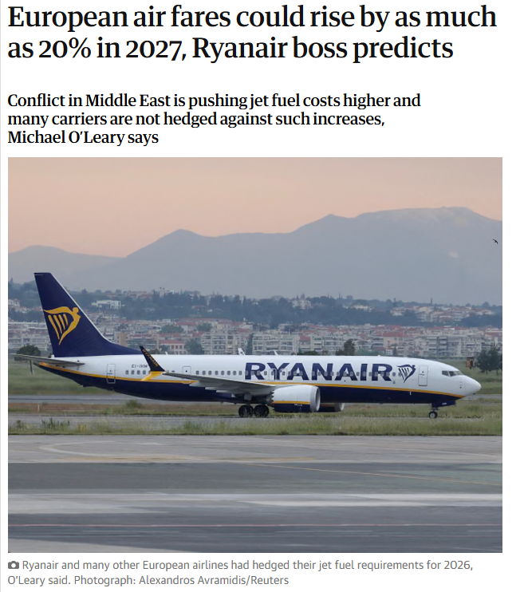
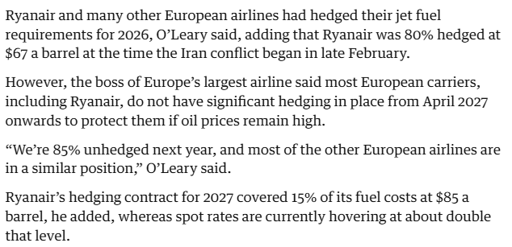
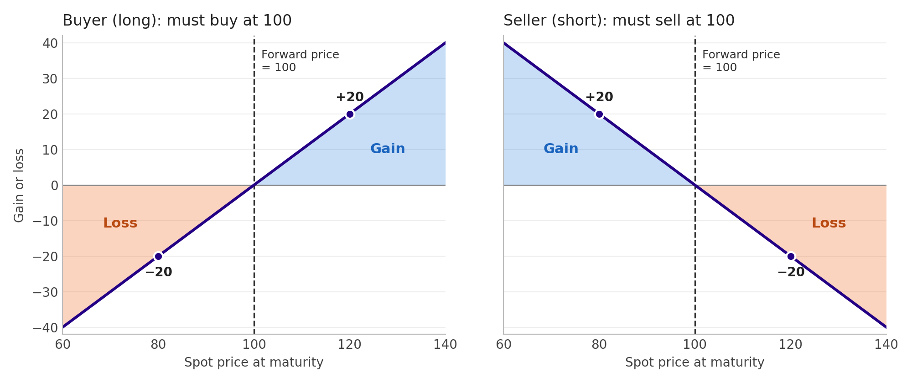
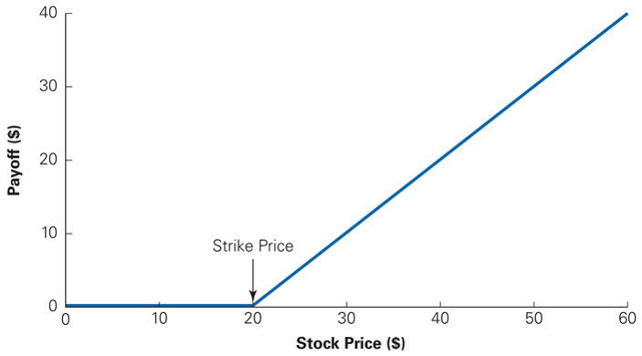
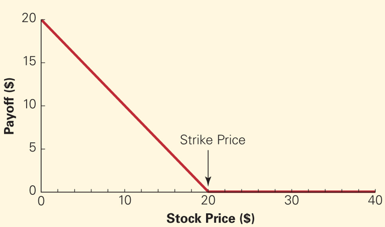
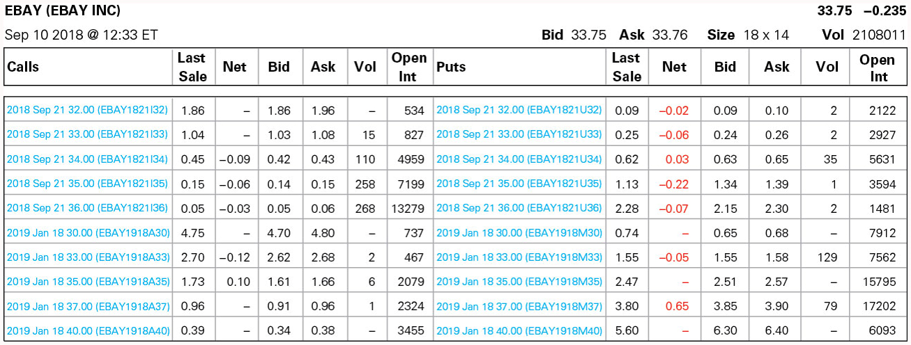
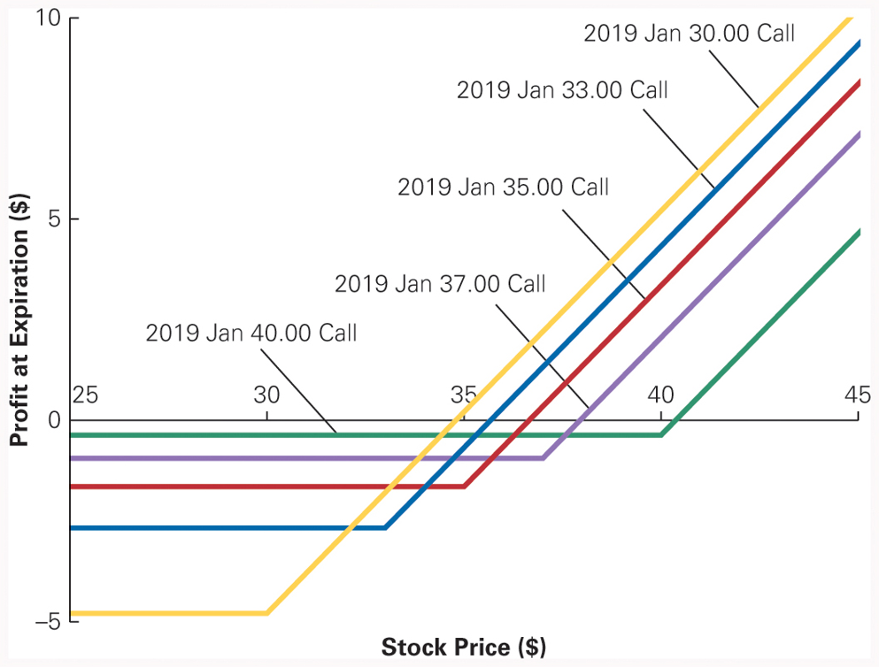
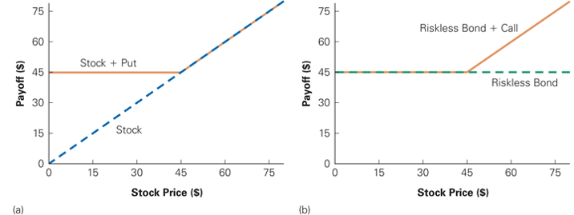

## Plan

A.  Futures & forwards: simple financial derivatives

B.  Option basics (Chap. 20.1)

C.  Option payoffs at expiration (Chap. 20.2)

Mostly based on the BDM textbook Chap. 20.

The second part of today's session is the final exam briefing (separate
deck).

## {.center}

::: {.content-visible when-format="revealjs"}
::: {.center .huge}
Recap lecture 11
:::
:::

```{=latex}
\vfill
\begin{center}
{\color{escpblue}\Huge\bfseries Recap lecture 11}
\end{center}
\vfill
```

## Recap: raising equity {.smaller}

- **Private firms** raise money in **funding rounds**. Post-money value =
  pre-money value + money invested. The new investors own: money invested /
  post-money value.

- **IPO**: the firm sells shares to the public for the first time. An
  **underwriter** (a bank) runs the sale, sets the price through **book
  building**, can sell extra shares (**greenshoe**), and insiders cannot sell
  for months (**lockup**).

- Three facts: IPOs are **underpriced** on average (the price jumps on the
  first day), they come in **waves**, and they do **poorly in the long run**.

## Recap: SPACs and seasoned offerings {.smaller}

- **SPAC**: a listed shell full of cash merges with a private firm, a back
  door to the market. Cheaper and faster than an IPO, poor returns on average.

- **Seasoned equity offering (SEO)**: a firm that is already listed sells new
  shares.

  - **Cash offer**: sold to anyone. If the price is low, wealth moves from the
    old shareholders to the new buyers.

  - **Rights offer**: sold to the existing shareholders only, so the value
    stays with them whatever the price.

- The share price falls on the announcement: investors read a sale of shares
  as a sign that managers think the shares are expensive.

## Recap: corporate debt {.smaller}

- **Private debt** (bank loans, private placements) or **public debt** (bonds
  sold to the market).

- **Seniority**: who is paid first if the firm fails. Secured debt, then
  senior unsecured, then subordinated. Lower in the ladder means a higher
  interest rate.

- **Covenants**: promises written in the bond contract (limits on dividends,
  on new debt). They protect lenders, so the firm borrows at a lower rate.
  Breaking one is a default.

- Other debt: sovereign bonds, **TIPS** (inflation-protected), **ABS**
  (asset-backed securities) and **CDO** (collateralized debt obligation)
  tranches.

## Recap: bonds with options {.smaller}

- **Callable bond**: the firm may repay early. The right belongs to the firm,
  so investors ask for a **higher yield**.

- **Puttable bond**: the investor may ask for early repayment.
  **Convertible bond**: the investor may swap the bond for shares. The right
  belongs to the investor, so the investor accepts a **lower yield**.

- Last week the options were hidden inside bonds. **Today we open the box and
  study the option itself.**

## {.center}

::: {.content-visible when-format="revealjs"}
::: {.center .huge}
Beginning of lecture 12 content
:::
:::

```{=latex}
\vfill
\begin{center}
{\color{escpblue}\Huge\bfseries Beginning of lecture 12 content}
\end{center}
\vfill
```

## Introduction

- A company is exposed to many different risks:

  - Changes in demand

  - Changes in the cost of commodities

  - Loss of key employees

  - New competitors entering the market

  - Operational risks, etc.

## Introduction

- Important question for the company:

  - Should investors support these risks? or

  - Should the company reduce/manage the risks?

- Managers have different tools to reduce risks:

  - Prevention.

  - Hedging:

    - with insurance contracts.

    - in financial markets.

## Insurance vs. hedging with derivatives

- Some risks are easy to insure:

  - Accidents, illness, fire.

- For other risks it is hard or impossible to find insurance:

  - Climate risk,

  - Risk of natural disasters,

  - Cost of commodities.

- In particular, it is usually easier to hedge a "non diversifiable" or
  "hard to diversify" risk with a financial derivative than with an
  insurance contract.

## Financial derivatives {.smaller}

- The value of financial derivatives depends on another value (the
  underlying).

  - Think of a derivative as a side bet whose value is read off another
    price.

- The underlying is mostly the price of a financial security.

- Example:

  - Credit default swaps (CDS),

  - Swaps,

  - Futures/forwards,

  - Options.

## A. Futures \& forwards: simple financial derivatives {.smaller}

- A forward is a legal agreement between a seller and a buyer:

  - The buyer agrees to buy something at a specified price and a
    specified date,

  - The seller agrees to sell something at a specified price and a
    specified date.

- A market for standardised forward contracts equipped with a clearing
  house is called a futures market.

  - For futures there are margin requirements and the clearing house is
    the counterparty so that there is no credit risk in the futures
    market.

## A forward, step by step {.smaller}

- An airline agrees **today** to buy jet fuel in three months at a **forward
  price of 100** per unit. No money changes hands today.

- In three months the airline pays 100 whatever the market ("spot") price is:

  | Spot price in three months | 80 | 100 | 120 |
  |:---------------------------|---:|----:|----:|
  | The buyer pays 100 for fuel worth | 80 | 100 | 120 |
  | **Buyer's gain** = spot − forward | −20 | 0 | +20 |
  | **Seller's gain** = forward − spot | +20 | 0 | −20 |

- The contract fixes the price today, so the price risk moves from the buyer
  to the seller. One side's gain is the other side's loss, and **both sides
  can lose**.

## Forward/futures: terminology {.smaller .shrink}

| | **Spot: buy today** | **Forward/futures: agree today, trade later** |
|:-----------------|:-----------------------|:-------------------------------------------|
| **What is traded** | an asset, e.g. jet fuel | the same asset: the **underlying** |
| **Price** | today's **spot price** |**forward price**: fixed today, paid later |
| **Exchange date** | today | **expiration date** (or transaction date) |
| **Buyer** | pays, gets the asset | **long** position: must buy at the forward price |
| **Seller** | delivers the asset | **short** position: must sell at the forward price |

## Hedging in real life: Ryanair's jet fuel {.smaller .shrink}

::: {.columns}
::: {.column width="40%"}
{height="165" style="height: 330px; max-height: none"}
:::
::: {.column width="60%"}
{height="95" style="height: 230px; max-height: none"}
:::
:::

- **2026: hedged.** 80% of its fuel locked in at **\$67** a barrel before the
  Iran conflict. **2027: mostly not.** Only 15% locked in, at \$85, with the
  spot price about double.

- A hedge fixes the price only for the quantity and dates it covers: fares
  could rise by up to 20%.

::: {.tiny}
Source: The Guardian.
:::

## The value of a forward contract {.smaller .shrink}

The value of the forward contract at maturity depends on the price of the
underlying at maturity (the spot price):

{fig-align="center" height="170" style="height: 300px; max-height: none"}

- **Buyer (long):** above 100, pays 100 for something worth more: gains.
  Below 100, could have bought cheaper in the market: loses.

- **Seller (short):** the mirror image. Loses above 100, gains below.

## Closing a position {.smaller}

- The buyer makes a profit if the price of the underlying increases.

- The seller makes a profit if the price of the underlying decreases.

- The futures contract can be held until expiry. The expiration dates
  are usually in March, June, September, and December.

- The position can be closed before the expiration date: an investor
  with a long position can take a short position on the same contract.

## At the maturity of the contract

- The settlement can be made in cash (**cash settlement**).

  - Example: stock index.

- Or by the delivery of the underlying asset, real or financial
  (**physical delivery**).

  - Example: bonds, commodities.

## Example: an exporter hedges the dollar {.smaller .shrink}

- A French wine maker sells to a US importer and will be paid **1.1 million
  dollars in three months**. Today 1 euro = 1.10 dollars, so that is worth
  1 million euros.

- **The risk**: if the dollar weakens, the same dollars buy fewer euros.

- **The hedge**: today, it signs a forward to **sell 1.1 million dollars in
  three months at 1.10**. It takes the short position on dollars.

  | 1 euro = … dollars in three months | 1.00 | 1.10 | 1.25 |
  |:--|--:|--:|--:|
  | Without the forward, it gets | 1.10 m€ | 1.00 m€ | 0.88 m€ |
  | **With the forward, it gets** | **1.00 m€** | **1.00 m€** | **1.00 m€** |

- The forward fixes the euros it will receive. It gives up the gain if the
  dollar strengthens, in exchange for no loss if it weakens.

## B. Option basics {.smaller}

- The major drawback of forward and future contracts is the possibility
  to experience a negative payoff.

- A forward contract that does not force the two parties to execute is
  called an "option."

- Thus, an option corresponds to a forward contract which only has a
  non-negative payoff (positive or zero).

- Because an option is a bet in which you cannot lose, you need to pay
  the price of the option to enter the bet.

## Call \& put options {.smaller}

- **Call**: gives the owner the right, but not the obligation, to buy a
  fixed quantity of the underlying asset at a certain price at (or
  before) a certain date.

  - Exercise price or strike price: The price at which an option holder
    buys or sells a share of stock when the option is exercised.

  - Expiration date: The last date on which an option holder has the
    right to exercise the option.

- **Put**: gives the owner the right, but not the obligation, to sell a
  fixed quantity of the underlying asset at the strike price at (or
  before) the expiration date.

- The price of an option or the option premium is paid by the buyer to
  the seller to acquire the right.

::: {.footnotesize}
**Reminder (Lecture 11):** the greenshoe is a call option!!!. For about 30 days after
the IPO, the underwriter has the right,to buy extra
shares from the firm at the offer price.
:::

## Call and put side by side {.smaller}

| | **Call** | **Put** |
|:--|:--|:--|
| The right to… | buy at the strike price $K$ | sell at the strike price $K$ |
| Used when the share price is… | above $K$ | below $K$ |
| The buyer gains when the price… | rises | falls |
| The buyer pays today | the premium | the premium |
| The seller… | must sell at $K$ if asked | must buy at $K$ if asked |

- The premium is the price of a right. The seller is paid today to take on
  an obligation for later.

## Terminology {.smaller}

- Exercising an option: when a holder of an option enforces the
  agreement and buys or sells a share of stock at the agreed-upon price.

- The option buyer (holder): holds the right to exercise the option and
  has a long position in the contract.

- The option seller (writer):

  - Sells (or writes) the option and has a short position in the
    contract.

  - Because the long side has the option to exercise, the short side has
    an obligation to fulfill the contract if it is exercised.

## Terminology (con't) {.smaller}

- The intrinsic value of an option corresponds to the gain realised by
  the owner in the case of an immediate exercise.

  - At-the-money: describes an option whose exercise price is equal to
    the current stock price.

  - In-the-money: describes an option whose value, if immediately
    exercised, would be positive.

  - Out-of-the-money: describes an option whose value, if immediately
    exercised, would be negative.

  - Deep in-the-money (out-of-the-money): describes an option that is
    in-the-money (out-of-the-money) and for which the strike price and
    the stock price are very far apart.


## Terminology (con't 2) {.smaller}

- **European option:** options that allow their holders to exercise the
  option only on the expiration date.

- **American option:** options that allow their holders to exercise the
  option on any date up to, and including, the expiration date.

  - Note: The names American and European have nothing to do with the
    location where the options are traded.

- **Asian option:** based on an average, e.g., the average monthly
  return of the CAC40 over the next five years.

- **Bermuda option:** can be exercised only on specific dates.

## Rationale of option strategies

- Buyer (**long position**) of a **call** expects an increase in the
  price of the underlying.

- Seller (**short position**) of a **call** expects a decrease in the
  price of the underlying.

- Buyer (**long position**) of a **put** expects a decrease in the price
  of the underlying.

- Seller (**short position**) of a **put** expects an increase in the
  price of the underlying.

## Who gains when the price moves {.smaller}

| Position | The price **rises** | The price **falls** |
|:--|:--|:--|
| Buy a call (long call) | gains | loses only the premium |
| Sell a call (short call) | loses, with no limit | keeps the premium |
| Buy a put (long put) | loses only the premium | gains |
| Sell a put (short put) | keeps the premium | loses, up to the strike |

- The buyer of an option can never lose more than the premium paid.

- The seller keeps the premium when nothing happens, and pays when the buyer
  exercises.

## A piece of notation: max {.smaller}

- In the next slides you will meet formulas like
  $\max\left(S_{T} - K; \ 0\right)$. That $\max$ is the only new piece of
  notation.

- $\max$ of two numbers means: **look at both and keep the bigger one**.
  Nothing else.

  - $\max(3;\ 7) = 7$ and $\max(7;\ 3) = 7$: the order does not matter.

  - $\max(-5;\ 0) = 0$: when one of the two is zero, a negative number
    never wins.

- So $\max(\text{something};\ 0)$ is just a way of saying **"never let this go
  below zero"**.

## Why an option needs it {.smaller}

- At expiration, the holder of the option **chooses** whether to use it.
  Nobody chooses to lose money, so the option is used only when it pays.

- Take a call with a strike price of $K = 20$, that is the right to buy the
  share for 20:

  - If the share is worth 25, you buy at 20 something worth 25: you gain 5.

  - If the share is worth 15, buying at 20 would be a bad deal, so you walk
    away and get 0.

- "Take the better of the two" is exactly what $\max$ writes down:
  $$C_{T} = \max\left(S_{T} - K; \ 0\right)$$

## The same thing in numbers {.smaller}

- Strike price $K = 20$. The share price at expiration is $S_{T}$:

  | Share price $S_{T}$ | 10 | 15 | 20 | 25 | 30 |
  |:--------------------|---:|---:|---:|---:|---:|
  | $S_{T} - K$         | −10 | −5 | 0 | 5 | 10 |
  | **Call payoff** $\max(S_{T}-K;\ 0)$ | 0 | 0 | 0 | 5 | 10 |
  | **Put payoff** $\max(K-S_{T};\ 0)$ | 10 | 5 | 0 | 0 | 0 |


## That is why the graph has an elbow {.smaller}

- The payoff diagrams you will see are just a picture of this choice:

  - On the flat part, $\max$ is picking the zero: the option is not worth
    using.

  - On the sloped part, $\max$ is picking $S_{T} - K$: the option is worth
    using, and every extra euro on the share is an extra euro of payoff.

- The two parts meet exactly at the strike price. That is the kink.

## C. Option payoffs at expiration {.smaller .shrink}

- The value of a call at expiration is $$\begin{equation*}
  C_{T} = \max \left(S_{T} - K; \ 0 \right),
  \end{equation*}$$ where $S_{T}$ is the price of the underlying at
  expiration and $K$ is the strike price of the option.

- Example: payoff of a **call option** with $K = 20$:

::: {.center}
{height="220" style="height: 290px; max-height: none"}
:::

## Option payoffs at expiration: put {.smaller}

- The value of a put at expiration is $$\begin{equation*}
  P_{T} = \max \left(K - S_{T}; \ 0 \right).
  \end{equation*}$$

- Example for $K = 20$:

::: {.center}
{height="320"}
:::

## The seller's side: the mirror image {.smaller}

- The seller (writer) of an option takes the other side of the contract:
  whatever the buyer receives, the seller pays. The seller's payoff is
  **minus** the buyer's payoff.

- Strike price $K = 20$ again, share price $S_{T}$ at expiration:

  | Share price $S_{T}$ | 10 | 15 | 20 | 25 | 30 |
  |:--------------------|---:|---:|---:|---:|---:|
  | Buyer of the call | 0 | 0 | 0 | 5 | 10 |
  | **Seller of the call** | 0 | 0 | 0 | −5 | −10 |
  | Buyer of the put | 10 | 5 | 0 | 0 | 0 |
  | **Seller of the put** | −10 | −5 | 0 | 0 | 0 |

- The seller of a put can lose at most the strike price: the share cannot
  fall below zero. The seller of a call has **no floor**: the share price can
  rise without limit.

## Option pricing model: call {.smaller .dense}

- The most commonly used model to value European options is the
  Black-Scholes formula: $$\begin{equation*}
  C_t = S_t N\left(d_{1}\right) - K e^{-r_f(T-t)} N\left(d_{2}\right),
  \end{equation*}$$ where $$\begin{aligned}
  d_{1} & = \frac{ln\left(S_{t}/K\right)+\left(r_f+0.5\sigma^{2}\right) \left(T-t\right)}{\sigma \sqrt{T-t}}, \\
  d_{2} & = d_{1} - \sigma \sqrt{T-t},
  \end{aligned}$$ $S_{t}$ is the current price of the underlying, $T-t$
  is the time to expiration, $K$ is the strike price, $r_f$ is the
  risk-free rate, $\sigma$ is the volatility, and $N\left(\cdot\right)$
  is the cumulative distribution function of the standardized normal
  distribution.

- Remarks:

  - N($d_{2}$) = "risk-neutral" probability that the call is "in the
    money" at expiration.

  - N($d_1$) = "delta" of the option
    ($\Delta = \partial C_{t} / \partial S_{t}$).

  - There is a similar formula for the price of European put options
    which can be found, e.g., with the put-call parity.

## Black-Scholes without the maths {.smaller .shrink}

- In words: **call price = (what you may receive) − (what you may pay)**. You
  may receive the share, worth $S_t$. You may pay the strike $K$, at
  expiration, so it is discounted. Each piece is weighted by a number between
  0 and 1, $N(d_1)$ or $N(d_2)$, which plays the role of a probability.

- Five inputs, and the direction each one pushes the price of a call:

  | Input | When it goes up, the call price… |
  |:--|:--|
  | Share price $S_t$ | rises: more to gain |
  | Strike price $K$ | falls: you pay more to exercise |
  | Time to expiration $T - t$ | rises: more time for the share to move |
  | Volatility $\sigma$ | rises: bigger gains possible, downside capped at zero |
  | Risk-free rate $r_f$ | rises: paying $K$ later costs less today |

- Remember the five inputs and the direction of each effect.

## Options: history {.smaller}

- Options have existed for a long time but they have gained in
  popularity since 1973. In that year:

  - the first regulated option market was introduced (the Chicago Board
    Options Exchange, or CBOE)

  - two academic articles pioneering option pricing were published.

- In Europe, the two main derivative exchanges are the NYSE Liffe and
  Eurex.

- A large number of options are not traded on exchanges but rather in
  over the counter markets.

## Where options trade in Europe today {.smaller .shrink}

- **Eurex, Frankfurt.** Created in 1998 by merging the German (DTB) and Swiss
  (SOFFEX) futures exchanges; owned by Deutsche Börse. Known for Euro-Bund
  futures (10-year German government bonds) and futures and options on the
  Euro Stoxx 50 and the DAX. One of the largest derivatives exchanges in the
  world.

- **ICE Futures Europe, London: the former NYSE Liffe.** LIFFE opened in
  1982, was bought by Euronext in 2002, became NYSE Liffe in 2007, and has
  belonged to the US group ICE since 2013. Interest-rate futures (Euribor),
  FTSE 100 options, and commodities such as cocoa, coffee and sugar.

- **Euronext, Paris.** Independent again since 2014. Futures and options on
  the **CAC 40**.

- All three work as described in section A: an electronic order book,
  standardised contracts, and a clearing house that stands between buyer and
  seller.

## Option quotes: example of CBOE {.smaller}

::: {.center}
{height="270"}
:::

Suppose that you have decided to buy a call with a strike of 30 and
expiration in January.

- Is this option "in-the-money" or "out-of-the-money"?

- From the table, compute the return (in %) obtained by an investor who
  chooses to buy the call today and hold it to expiry, assuming that the
  stock price reaches 40\$ at the expiration of the call option.

## Option quotes: the answer, step by step {.smaller}

1. **Moneyness.** The share trades at 33.75 and the strike is 30. The right
   to buy at 30 something worth 33.75 is worth using: the call is
   **in-the-money** (intrinsic value 33.75 − 30 = 3.75).

2. **Cost.** A buyer pays the **ask** price: **4.80** per share.

3. **Payoff at expiration** if the share is at 40: max(40 − 30; 0) = **10**.

4. **Profit** = payoff − premium = 10 − 4.80 = **5.20**.

5. **Return** = profit / cost = 5.20 / 4.80 = **108.33%**.

- Compare with buying the share instead: 40 / 33.75 − 1 = **18.52%**. Same
  news, about six times the return: an option is a **leveraged** bet. And if
  the share ends below 30, the option expires worthless: a return of
  **−100%**.

## Profit from holding a call option to expiration {.smaller .shrink}

::: {.center}
{fig-align="center" height="185" style="height: 300px; max-height: none"}
:::

- **Each line is a call with a different strike price**, from 30 to 40.

- Below the strike, you lose what you paid for the option. Above it, every
  extra dollar on the share is an extra dollar of profit.

- A low strike costs more but pays sooner. A high strike costs less but
  needs a bigger rise.

## Option usage in practice: portfolio insurance

- Options can be used to protect a portfolio against a decline in its
  value.

- Consider a portfolio which only contains Amazon stocks. The investor
  is worried that the stock price may decline. At the same time, he is
  reluctant to sell his stocks because he also thinks there is a
  reasonable likelihood that the stock price will increase in the
  future.

## Option usage in practice: portfolio insurance (con't) {.smaller .shrink}

{fig-align="center"}

::: {.scriptsize}

The plots show two different ways to insure against the possibility of
the price of Amazon stock falling below \$45:

(a) Orange line shows value on expiration date of a long position in
    Amazon stock and a European put option with a strike of \$45 (blue
    dashed line is the stock payoff).

(b) Orange line shows value on expiration date of a long position in a
    zero-coupon risk-free bond with a face value of \$45 and a European
    call option on Amazon with a strike price of \$45 (green dashed line
    is the bond payoff).

:::

## What to remember {.smaller}

- **A. Forwards and futures.** A promise to buy or sell at a fixed price on
  a fixed date. No premium, and both sides can lose. Futures are standardised
  forwards with a clearing house.

- **B. Options.** A right, not an obligation. A **call** is the right to buy
  at the strike, a **put** the right to sell. The buyer pays a premium; the
  seller is paid to take on an obligation. In, at or out of the money.
  European (expiration date only) or American (any day until then).

- **C. Payoffs.** Call: max($S_T$ − $K$; 0). Put: max($K$ − $S_T$; 0). The
  seller's payoff is the mirror image. Profit = payoff − premium. Portfolio
  insurance: share + put = bond + call.

## Quiz

- Does the holder of an option have to exercise it?

- Explain how you can use put options to create portfolio insurance. How
  can you create portfolio insurance using call options?

- You bought the January 30 call at 4.80 and the share ends at 32. What are
  your payoff, your profit and your return?

## Quiz: answers {.smaller}

- **No.** The holder has a right, not an obligation, and exercises only when
  it pays. The seller, on the other hand, must deliver if asked.

- **Put insurance**: keep the shares and buy a put whose strike is the floor
  you want. **Call insurance**: buy a risk-free bond that pays the floor at
  expiration, plus a call with the same strike. Both give the floor and keep
  the upside.

- **January 30 call at 32.** Payoff = max(32 − 30; 0) = 2. Profit = 2 − 4.80
  = −2.80. Return = −2.80 / 4.80 = **−58.33%**. The option was in the money,
  and you still lost money: the premium matters.
