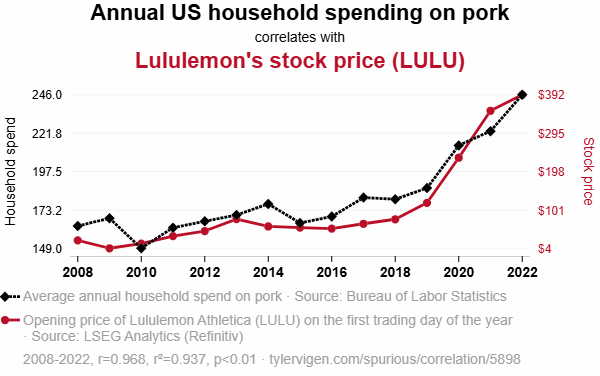
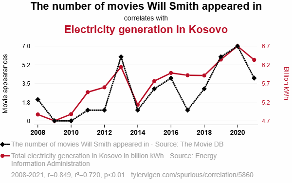
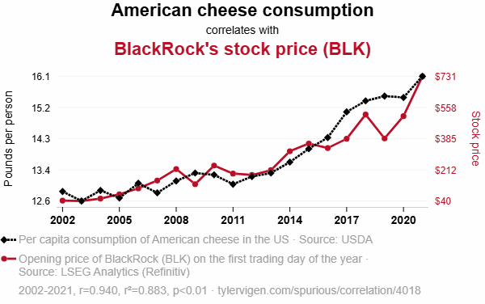
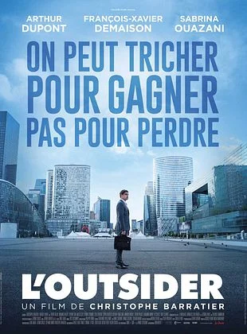
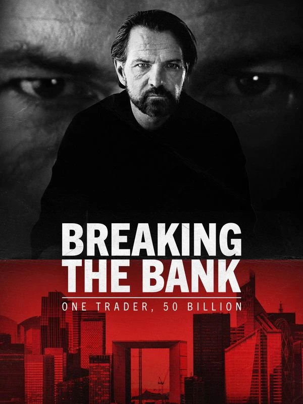

## A. Spurious correlations: data snooping in action {.center}

## Remember data snooping? {.smaller}

- If you test **hundreds** of characteristics on the same past data
  some will "beat the market" by pure luck. That is **data snooping**.

- When evaluating statistical relations on several data sets, some patterns will
apper by luck.

- The website **Spurious Correlations**
  ([tylervigen.com](https://www.tylervigen.com/spurious-correlations)) does
  this on purpose: it keeps the pairs of series with a correlation close to 1.
  Reminder from Lecture 2:
  $$\text{Corr}(X,Y) = \frac{\text{Cov}(X,Y)}{\sigma_{X}\,\sigma_{Y}}$$
  The covariance rescaled by the two volatilities, so it lies between $-1$
  and $+1$.

::: {.box .box-a}
Search long enough and you will always find a pattern. Finding one proves
nothing about the future.
:::

## Pork spending and Lululemon {.smaller}

::: {.center}
{fig-align="center" style="max-height: 480px"}
:::

- Correlation **0.97**.

## Will Smith and electricity in Kosovo {.smaller}

::: {.center}
{fig-align="center" style="max-height: 480px"}
:::

- Correlation of **0.85**.

## American cheese and BlackRock {.smaller}

::: {.center}
{fig-align="center" style="max-height: 480px"}
:::

- Correlation of **0.94**. Both series simply grow over time, so they look alike.

::: {.box .box-a}
A high correlation raises a question. Only an economic reason can answer it.
:::
## B. L'Outsider: one trader, 50 billion euros {.center}

## The Kerviel case in one slide {.smaller}

- **Jérôme Kerviel**, a junior trader at **Société Générale** in La Défense.
  His job: small, low-risk bets on European stock indices.

- In 2007 he secretly built up bets worth about **EUR 50 billion**, hidden
  with fake trades that cancelled them out on paper.

- January 2008: the bank discovers the positions and sells them in a few
  days, in a falling market. The loss: **EUR 4.9 billion**.

- 2010: he is sentenced to prison and ordered to repay the EUR 4.9 billion.
  2016: an appeal court cuts that to EUR 1 million, because the bank's own
  controls had failed.

::: {.box .box-a}
50 billion is what was **at risk**. 4.9 billion is what was actually **lost**.
:::

## How big is EUR 50 billion? {.smaller}

- **More than the whole bank.** In 2007, all of Société Générale's shares
  together were worth **EUR 43.16 billion** (its market capitalization), less
  than the bets of this one trader.

- **More than the yearly output of whole countries.** EUR 50 billion (about USD
  54 billion) is more than everything produced in one year (GDP, 2024) in:

  - **Estonia**: about USD 43 billion
  - **Cyprus**: about USD 37 billion
  - **Iceland**: about USD 34 billion

## The film and the documentary {.smaller}

:::: {.columns}
::: {.column width="25%"}
{width="100%"}
:::

::: {.column width="25%"}
{width="100%"}
:::

::: {.column width="50%"}
- ***L'Outsider*** (2016), by Christophe Barratier, with Arthur Dupont as
  Kerviel. Tagline: "You can cheat to win, not to lose."

- ***Kerviel: un trader, 50 milliards*** (*Breaking the Bank: One Trader,
  50 Billion*, 2024): a four-part documentary on HBO Max, with Kerviel and
  his former bosses.

:::
::::
