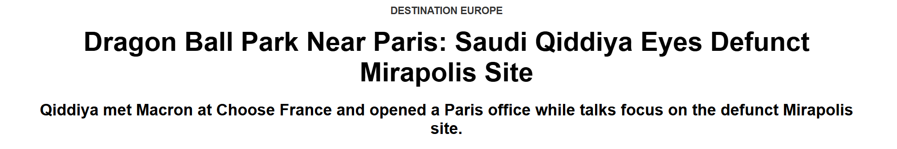
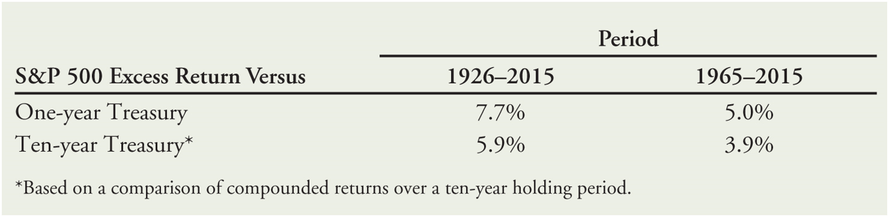
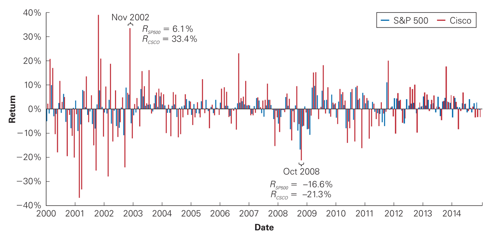
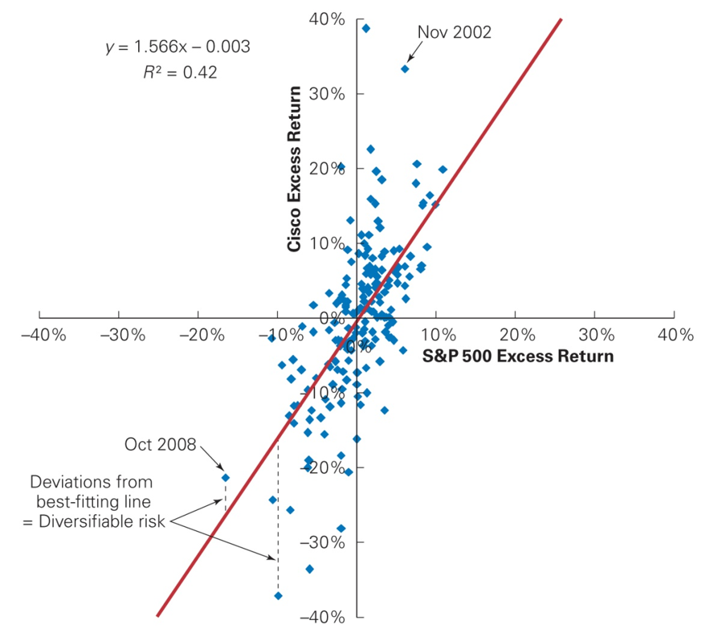
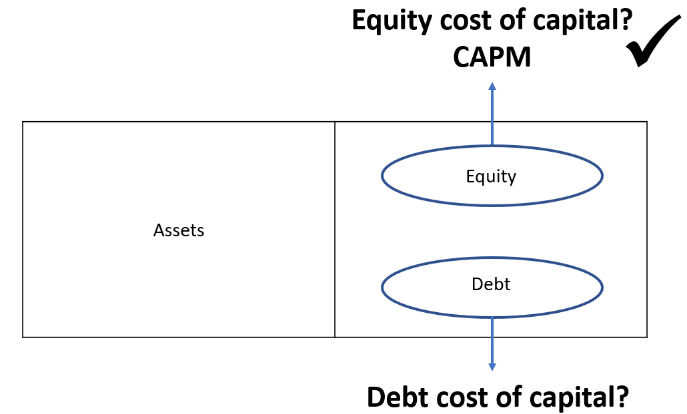
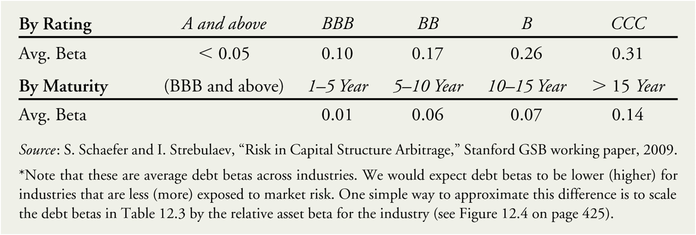
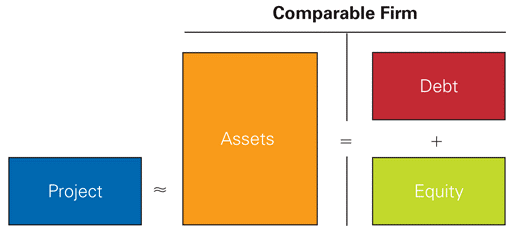
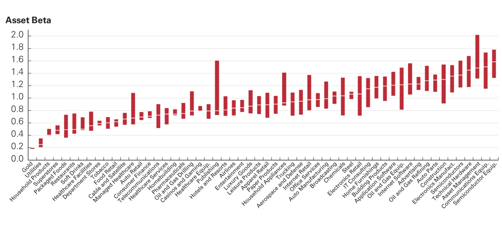

## Plan

- Recap from lecture 5

- How to measure the cost of money for a project

- Build the CAPM recipe, one input at a time

- Price the debt, then a non-traded project

- Adjust for risk and financing: the WACC

Mostly based on the BDM textbook Chap. 12.

## {.center}

::: {.content-visible when-format="revealjs"}
::: {.center .huge}
Recap lecture 5
:::
:::

```{=latex}
\vfill
\begin{center}
{\color{escpblue}\Huge\bfseries Recap lecture 5}
\end{center}
\vfill
```

## Recap of Lecture 5 {.smaller}

Let's do a recap:

- Alpha, and what "beating the market" means

- Every buyer needs a seller: the average investor has an alpha of zero

- Investors' mistakes, and fund managers' fees

- Size, value and momentum: patterns the CAPM misses

- Why the CAPM stays the standard anyway

## Recap: the CAPM and the alpha {.smaller}

- The **CAPM** (Lecture 4) gives the return a stock must pay for its beta, the
  **required return**:
  $$r_{i} = r_{f} + \beta_{i}\,\big(E(R_{M}) - r_{f}\big)$$

- **Alpha** is the expected return of a stock minus the return the CAPM
  requires for its beta:
  $$\alpha_{i} = \underbrace{E(R_{i})}_{\text{expected return}} - \underbrace{\big(r_{f} + \beta_{i}\,(E(R_{M}) - r_{f})\big)}_{\text{required return}}$$

- **Positive alpha**: the stock pays more than its risk requires, it sits above
  the Security Market Line. **Negative alpha**: below the line.

- Under the CAPM, every stock is on the line: **every alpha is zero.**

## Recap: beating the market {.smaller}

- A positive alpha attracts buyers, the price rises, the expected return falls:
  **competition pushes alphas back to zero.**

- Every buyer needs a seller, so every positive alpha is someone else's negative
  alpha. **Holding the market guarantees an alpha of zero**, with no skill and
  no information.


- Yet a survey of 392 chief financial officers found:

::: {.center}
| Method                         | Share of firms  |
|:-------------------------------|:---------------:|
| CAPM                           | 73.5%           |
| Historical average returns     | 40%             |
| A model with several factors   | about one third |
:::

::: {.box .box-a}
The CAPM is simple and well founded, and the discount rate is only one
imprecise input. Today we use it to compute the cost of capital.
:::

## {.center}

::: {.content-visible when-format="revealjs"}
::: {.center .huge}
Beginning of lecture 6 content
:::

::: {.center .small}
Lecture 5 ended on: firms use the CAPM for the cost of capital. Today we do
exactly that, step by step.
:::
:::

```{=latex}
\vfill
\begin{center}
{\color{escpblue}\Huge\bfseries Beginning of lecture 6 content}

\vspace{1.5em}
\begin{minipage}{0.8\textwidth}
\small\centering
Lecture 5 ended on: firms use the CAPM for the cost of capital. Today we do
exactly that, step by step.
\end{minipage}
\end{center}
\vfill
```

## Some questions to start

-   What is an investment project?

-   What makes it different from ordinary spending?

-   You are the manager of a big company, and you want to execute a big
    investment project, how can you get the money?

## Example 1 {.smaller}

::: {.center}
{height="70"}
:::

::: {.center}
{height="230"}
:::

:::: {.columns}
::: {.column width="55%"}
{height="55"}
:::

::: {.column width="45%"}
{height="105"}
:::
::::

- **EUR 1 billion.** Who pays, and what do they want back?

## Example 2 {.smaller}

:::: {.columns}
::: {.column width="50%"}
{height="290"}
:::

::: {.column width="50%"}
{height="235"}
:::
::::

- **EUR 800 million, halted.** Was the expected return worth what the money
  costs?

## What this lecture is about {.smaller}

- There are two ways to raise that money, and today we study how to measure
  the cost of each one:

  - **Equity**: sell a share of the company to investors.

  - **Debt**: borrow the money and pay it back with interest.

- First we will evaluate their cost independently, then we are going to see how companies combine them.

- You then compare the cost of capital with the return your project is
  expected to earn: if the project earns less than the money costs, it is not
  worth doing.

::: {.box .box-a}
**Cost of capital** = the return investors could earn elsewhere on an
investment with the same risk.
:::

## Outline

A.  The equity cost of capital: the recipe (Chap. 12.1)

B.  Inputs 1 to 3: the market portfolio, the risk-free rate, the premium (Chap. 12.2)

C.  Input 4: beta (Chap. 12.3)

D.  The debt cost of capital (Chap. 12.4)

E.  A project's cost of capital (Chap. 12.5)

F.  Project risk and financing: the WACC (Chap. 12.6)

G.  Why we keep the CAPM (Chap. 12.7)

## {.center}

::: {.content-visible when-format="revealjs"}
::: {.center .huge}
The cost of equity
:::
:::

```{=latex}
\vfill
\begin{center}
{\color{escpblue}\Huge\bfseries The cost of equity}
\end{center}
\vfill
```

## A. The recipe: the CAPM formula {.smaller}

- The cost of capital of any investment is the expected return of the
  investments available in the market **with the same beta**.

- The CAPM, from Lecture 4, tells us what that return is:
  $$r_{E} = r_{f} + \beta_{E} \times \left(E[R_{Mkt}] - r_{f}\right)$$

- In words: the risk-free rate, plus beta times the premium the market pays.

::: {.box .box-a}
Investors require the same risk premium they would earn by taking the same
market risk through the market portfolio itself.
:::


## Example 12.1: Disney and Domino's {.smaller}

- Disney (DIS): volatility 20%, beta 1.29. Domino's Pizza (DPZ): volatility
  30%, beta 0.62. Risk-free rate 3%, expected market return 8%.

- **Total risk** is volatility: Domino's (30%) has more than Disney (20%).

- **Market risk** is beta: Disney (1.29) has more than Domino's (0.62).

- **Equity cost of capital.** The market premium is $8\% - 3\% = 5\%$.

  - Disney: $r_{DIS} = 3\% + 1.29 \times 5\% = 9.45\%$.

  - Domino's: $r_{DPZ} = 3\% + 0.62 \times 5\% = 6.10\%$.

- Domino's is the more volatile stock, yet its capital is cheaper. Only market
  risk is paid for, because the rest can be diversified away.

## Exercise: Saint-Gobain and ENGIE {.smaller}

- SGO (Saint-Gobain): volatility = 30%; beta = 1.45

- ENGI (ENGIE): volatility = 38%; beta = 0.82

- Which of these stocks carries more total risk?

- Which has more market risk?

- Assume that the risk-free rate is 3% and that the expected return of
  the market portfolio is 8%. Calculate and compare the equity cost of
  capital for Saint-Gobain and ENGIE.

## Exercise: Saint-Gobain and ENGIE (con't) {.smaller}

- **Total risk**: ENGIE, 38% against 30%.

- **Market risk**: Saint-Gobain, beta 1.45 against 0.82.

- **Market risk premium**: $8\% - 3\% = 5\%$.

- **Equity cost of capital**:

  - Saint-Gobain: $r_{SGO} = 3\% + 1.45 \times 5\% = 10.25\%$.

  - ENGIE: $r_{ENGI} = 3\% + 0.82 \times 5\% = 7.10\%$.

- Same lesson as Disney and Domino's: the more volatile stock (ENGIE) has the
  lower cost of capital, because less of its risk is market risk.


## The inputs we need {.smaller}

- The formula is easy. The work is in the inputs:

  1. **The market portfolio** $R_{Mkt}$: the portfolio of all stocks that the
     CAPM compares every investment with. The other inputs are measured
     against it (section B).

  2. **The risk-free rate** $r_{f}$ (section B).

  3. **The market risk premium** $E[R_{Mkt}] - r_{f}$: what the market
     portfolio pays above the risk-free rate (section B).

  4. **The beta** $\beta_{E}$: how much the stock moves with the market
     portfolio (section C).

## B. Input 1: the market portfolio {.smaller}

- The CAPM needs a market portfolio: **every stock, held in proportion to its
  market value.** Big firms weigh more, small firms less.

- The market value of a firm is its market capitalisation:
  $$\text{Market value of firm } i = \text{number of shares} \times \text{price per share}$$

- The weight of firm $i$ in the market portfolio is then
  $$x_{i} = \frac{\text{market value of firm } i}{\text{market value of all firms together}}$$

- A portfolio built this way is called **value-weighted**.

## Value-weighted means passive {.smaller}

- Holding every firm in proportion to its market value is the same as owning
  **the same fraction of every firm**: say 0.01% of Nvidia, 0.01% of LVMH, and
  so on. An equal-ownership portfolio.

- When prices move, the market weights move, but so does the value of what you
  hold, and by exactly the same amount. **No trading is needed** to stay
  value-weighted.

- Trading is needed only when a firm issues or buys back shares, or enters or
  leaves the market.

::: {.box .box-a}
The market portfolio is a **passive** portfolio: cheap to hold, which is one
reason it is the benchmark.
:::

## In practice: an index and an ETF {.smaller}

- Nobody builds the true market portfolio. In practice we use a **market
  index** as a proxy:

  - The **S&P 500**: 500 of the largest US firms, value-weighted. Only 500 of
    some 4,000 listed firms, but about 80% of the US market value.

  - In Europe: the **Euro Stoxx 50**, the **CAC 40**, or a broad world index.

- How to invest in it: buy an **index fund** or an **exchange-traded fund
  (ETF)**, a security that trades like a share but holds the whole index.

- Keep in mind: the index is a proxy. How well the CAPM works depends on how
  closely the proxy tracks the true market.

## Input 2: which risk-free rate? {.smaller}

- The CAPM's $r_{f}$ is the rate at which investors can save and borrow
  without risk. We take it from **government bond yields**.

- **Which maturity?** Match it to the investment: a short rate for a short
  project, a long rate for a long one. For a firm's cost of capital, most
  analysts use **10- to 30-year** bonds.


## Input 3: the market risk premium {.smaller}

- The premium $E[R_{Mkt}] - r_{f}$ is how much the market is expected to pay
  above the risk-free rate. It sets the price of market risk.

- It cannot be observed, so it has to be estimated. Two ways:

  1.  **The historical approach**: what the market actually paid over the
      risk-free rate in the past.

  2.  **The fundamental approach**: the return that justifies today's index
      level, given what firms are expected to pay out.

- Same number seen from two ends: past realised returns, or expected future
  cash flows.

## The historical approach {.smaller}

{fig-align="center" width="70%"}

- The average excess return of the S&P 500 over the risk-free rate.

- **Lower against 10-year bonds** than against 1-year bills: long rates are
  usually higher than short rates.

- **Lower since 1965**: more people invest in stocks, diversifying is cheaper
  (funds, ETFs), and market volatility has fallen. Most analysts now use
  **4-6% over bills, 3-5% over long bonds**.

- Drawbacks: imprecise (even since 1926 the margin of error is about
  $\pm 4\%$) and backward looking.

## The fundamental approach {.smaller}

- Look forward instead: given what firms are expected to pay out, which
  discount rate makes today's index level fair?

- With the constant growth model of Chap. 9, the expected return of the market
  is $$r_{Mkt} = \underbrace{\frac{\text{Div}_{1}}{P_{0}}}_{\text{dividend yield}} + \underbrace{g}_{\text{expected dividend growth}}$$

- $\text{Div}_{1}$: next year's dividend; $P_{0}$: today's index level; $g$:
  the rate at which dividends are expected to grow.

- Example: dividend yield 2%, expected growth 6%: $r_{Mkt} = 8\%$.

- Constant growth is a poor assumption for one firm, a reasonable one for the
  whole market. Studies using it find a premium of **3-5%**.

## Where the formula comes from {.smaller .dense}

- The price of a stock is the present value of the dividends it pays:
  $$P_{0} = \frac{\text{Div}_{1}}{1+r} + \frac{\text{Div}_{2}}{(1+r)^{2}} + \frac{\text{Div}_{3}}{(1+r)^{3}} + \dots$$

- If each dividend is $(1+g)$ times the one before, and growth stays below the
  discount rate, the whole sum collapses to
  $$P_{0} = \frac{\text{Div}_{1}}{r-g}$$

- Read the other way round, solving for $r$:

::: {.box .box-a}
$$r = \frac{\text{Div}_{1}}{P_{0}} + g$$
:::

- Intuition: investors earn what the asset pays out today, plus the rate at
  which that payout grows. The step-by-step derivation is in the Appendix.

## C. Input 4: beta, what we are estimating {.smaller}

- The third input. **Beta** measures how much a stock moves when the market
  moves: a beta of 2 means a 1% move in the market comes with a 2% move in
  the stock, on average.

- From Lecture 2, beta is the covariance of the stock with the market, scaled
  by the variance of the market:
  $$\beta_{i} = \frac{\text{Cov}\left(R_{i}, R_{Mkt}\right)}{\text{Var}\left(R_{Mkt}\right)}$$

- Ideally we would want the **future** beta. We cannot see it, so we estimate
  it from **past returns**, which works because betas are fairly stable over
  time.

- Data providers use two to five years of weekly or monthly returns, with the
  S&P 500 (or a local index) as the market.

## Step 1: look at the returns over time {.smaller}

{fig-align="center" style="max-height: 440px"}

- Cisco's monthly returns against the S&P 500. Cisco moves in the same
  direction as the market, with **bigger swings**: its beta is above 1.

## Step 2: plot the stock against the market {.smaller}

::: {.center}
{fig-align="center" style="max-height: 380px"}
:::

- Each dot is one month: the market's excess return across, Cisco's up. Draw
  the best-fitting line. **Its slope is the beta.** The distance of each dot
  from the line is the diversifiable, firm-specific part of the return.

## Step 3: the regression, in words {.smaller}

- The best-fitting line is found by **linear regression**. It writes each
  month's excess return of the stock as three parts:
  $$R_{i} - r_{f} = \alpha_{i} + \beta_{i} \left( R_{Mkt} - r_{f}\right) + \epsilon_{i}$$

- $\beta_{i}$, the **slope**: the part explained by the market. The number we
  want.

- $\alpha_{i}$, the **intercept**: the stock's alpha from Lecture 5, how far
  its average return sat above or below the Security Market Line. The CAPM
  says it should be close to zero.

- $\epsilon_{i}$, the **leftover**: firm-specific noise, zero on average. It is
  the diversifiable risk.

## {.center}

::: {.content-visible when-format="revealjs"}
::: {.center .huge}
The cost of debt
:::
:::

```{=latex}
\vfill
\begin{center}
{\color{escpblue}\Huge\bfseries The cost of debt}
\end{center}
\vfill
```

## D. The other half of the balance sheet {.smaller}

::: {.center}
{fig-align="center" style="max-height: 400px"}
:::

- Sections A to C priced the equity. A firm also borrows, and lenders expect a
  return too: the **debt cost of capital** $r_{D}$. We will need it to price a
  project in section E.

## Promised is not expected {.smaller}

- The **yield to maturity** (YTM) of a bond is the return an investor earns
  **if every promised payment is made** (Chap. 6).

- If the borrower is very unlikely to default, the yield is a fine estimate of
  the expected return.

- If default is a real possibility, the yield is a **promised** return, and
  the **expected** return is lower: some of the time, the investor will not be
  paid in full.

::: {.box .box-a}
Using the yield as the cost of debt is a common mistake. It is only right for
very safe debt.
:::

## One-year bond, two outcomes {.smaller}

- Invest 1 euro in a one-year bond with yield $y$. The bond promises $1 + y$.

- **No default**, with probability $1 - p$: you receive $1 + y$.

- **Default**, with probability $p$: you lose a fraction $L$ of what was
  promised, and receive $1 + y - L$.

- The expected return is the average of the two, weighted by their
  probabilities:
  $$r_{D} = (1-p)\, y + p\,(y - L) = y - p \times L$$

- In words: **the yield, minus the probability of default times the loss when
  it happens.**

## How often does debt default? {.smaller}

```{=latex}
\begingroup\footnotesize\setlength{\tabcolsep}{4pt}
```

|Rating:|AAA|AA|A|BBB|BB|B|CCC|CC-C|
|:--|--:|--:|--:|--:|--:|--:|--:|--:|
|**Default rate:**|||||||||
|Average|0.0%|0.1%|0.2%|0.5%|2.2%|5.5%|12.2%|14.1%|
|In recessions|0.0%|1.0%|3.0%|3.0%|8.0%|16.0%|48.0%|79.0%|

```{=latex}
\endgroup
```

::: {.footnotesize}
*Source*: "Corporate Defaults and Recovery Rates, 1920–2011," *Moody's Global
Credit Policy*, February 2012.
:::


## Second route: a debt beta {.smaller}

- We could also use the CAPM for debt: $r_{D} = r_{f} + \beta_{D} \times$
  market risk premium.

- Most bonds and all bank loans trade rarely, so a firm's own debt beta cannot
  be estimated from returns. Instead, use **average debt betas by rating**:

{fig-align="center" width="85%"}

- Debt betas are low, but rise with lower ratings and longer maturities.


## Exercise: Lafarge {.smaller}

- In January 2014, the bond of Lafarge (coupon rate of 4.75%) with
  maturity 30/09/2020, rated BB, had a yield to maturity of 3.7%. The
  expected loss rate is 60%.

- The risk-free rate was 0.6%. The market risk premium was 3.1%.

- Estimate the expected return of Lafarge debt, by both routes.

## Exercise: Lafarge (con't) {.smaller}

- **Route 1, yield minus expected loss.** A BB bond defaults 2.2% of the time
  in a normal year; loss rate 60%:
  $$r_{D} = 3.7\% - 2.2\% \times 0.60 = 3.7\% - 1.32\% = 2.38\%$$

- **Route 2, the CAPM.** The average beta of BB debt is 0.17:
  $$r_{D} = 0.6\% + 0.17 \times 3.1\% = 0.6\% + 0.53\% = 1.13\%$$


## E. A project is not traded {.smaller}

- A stock has a price history, so we could estimate its beta. **A new project
  has none.**

- So we borrow the beta of a **comparable firm**: a listed firm in the same
  business. Often that is the firm doing the project.

- Two cases:

  - **Case 1**: the comparable has no debt. Its beta is the project's beta.

  - **Case 2**: the comparable has debt. We first have to **unlever** it.

::: {.box .box-a}
**Assumption until section F:** the firm pays for the project with
**shareholders' money only**; it borrows nothing for it. The debt in Case 2
belongs to the *comparable firm*; our project still uses none.
:::

## Case 1: a comparable with no debt {.smaller}

- If the comparable firm has no debt, owning its shares is the same as owning
  its assets: all the cash the assets produce goes to the shareholders.

- So the firm's **equity beta is the beta of its assets**, and we can use it
  directly as the project beta:
  $$r_{\text{project}} = r_{f} + \beta_{\text{comparable}} \times \text{market risk premium}$$

- Behind the formula: instead of doing the project, your investors could simply
  buy shares of the comparable. The project must offer at least that return.


## Exercise: 1000mercis {.smaller}

- You wish to launch a data marketing firm using as reference the company
  1000mercis.com (ALMIL).

- ALMIL has no debt and its beta is 0.59.

- The risk-free rate is 3% and the market risk premium is 5%.

- To construct your business plan, you need to estimate the cost of
  capital of the project.

## Exercise: 1000mercis (con't) {.smaller}

- **Step 1**: no debt, so the asset beta of 1000mercis is its equity beta,
  0.59.

- **Step 2**: the project's cost of capital:
  $$r_{\text{project}} = 3\% + 0.59 \times 5\% = 5.95\%$$

- A low beta, so a low bar: data marketing revenues do not swing much with the
  economy. Any cash-flow forecast in the business plan should be discounted at
  about 6%.

## Case 2: the comparable has debt {.smaller}

::: {.center}
{fig-align="center" style="max-height: 300px"}
:::

- With debt, the cash the assets produce is split between lenders and
  shareholders. The shares alone are **riskier than the assets**, so the equity
  beta overstates the project's risk.

- To own the assets, hold **the debt and the equity together**. The risk of
  that combination is the risk of the assets.

## The unlevered cost of capital {.smaller}

- The return on the assets is the return of a portfolio made of the firm's
  equity and debt.

- With $E$ the market value of the equity and $D$ the market value of the debt:
  $$r_{U} = \frac{E}{E+D}\, r_{E} + \frac{D}{E+D}\, r_{D}$$

- $r_{U}$ is the **unlevered** (or asset) cost of capital: what investors
  require to hold the whole business, regardless of how it is financed.

## The unlevered beta {.smaller}

- Betas combine in exactly the same way as returns (Lecture 4: the beta of a
  portfolio is the weighted average of the betas):
  $$\beta_{U} = \frac{E}{E+D}\, \beta_{E} + \frac{D}{E+D}\, \beta_{D}$$

- $\beta_{U}$ is the **unlevered** (or asset) beta. It is the project beta we
  were looking for.

- Then back to the recipe of section A:
  $$r_{\text{project}} = r_{f} + \beta_{U} \times \text{market risk premium}$$

- Two routes to the same number: average the returns ($r_{U}$), or average the
  betas ($\beta_{U}$) and apply the CAPM.

## Unlevering: the intuition {.smaller}

- The firm's assets are owned by two groups: the shareholders, who hold $E$ of
  firm value, and the lenders, who hold $D$. Between them they own the whole
  business.

- Whatever the assets earn is shared out between those two groups. So the
  return on the assets is simply the average of what each group gets, weighted
  by the share of the firm each one holds.

- The same is true of risk, which is why the betas combine in exactly the same
  way.

- Borrowing does not make the business itself any riskier: it only decides who
  carries that risk. Lenders take the safer part (low $\beta_{D}$), so the
  shareholders are left holding the riskier part (high $\beta_{E}$).

- To find the risk of the underlying business, we therefore have to put the two
  pieces back together, i.e. **unlever** the comparable firm.


## Exercise: Danone {.smaller}

- A company wants to launch a new biscuit. It has identified Danone (BN)
  as the most representative company for its project.

- The market capitalisation of Danone is 30 billion EUR with a beta of
  0.4. The debt of Danone amounts to 10 billion EUR with an average YTM
  of 3.5%. The default risk on the bond is assumed to be negligible.

- Estimate the cost of capital of your firm's investment assuming that
  the risk-free rate is 3% and the market risk premium is 5%.

## Exercise: Danone (con't) {.smaller}

- **Step 1, the equity cost of capital**: $r_{E} = 3\% + 0.4 \times 5\% = 5\%$.

- **Step 2, the debt cost of capital**: negligible default risk, so
  $r_{D} = \text{YTM} = 3.5\%$.

- **Step 3, the weights**: $E + D = 40$; equity $30/40 = 75\%$, debt
  $10/40 = 25\%$.

- **Step 4, average the returns**:
  $r_{U} = 0.75 \times 5\% + 0.25 \times 3.5\% = 3.75\% + 0.875\% = 4.625\%$.

- **Or average the betas**, with $\beta_{D} = 0$:
  $\beta_{U} = 0.75 \times 0.4 = 0.30$. Then $r_{U} = 3\% + 0.30 \times 5\% = 4.5\%$.

- The biscuit project should be discounted at about **4.5-4.6%**: a safe,
  low-beta business.

## Cash is negative debt {.smaller}

- Many firms hold more cash than they need. Cash is a risk-free asset sitting
  on the balance sheet, and it makes the firm's shares **safer** than its
  actual business.

- If a firm holds 1 euro of cash and owes 1 euro of risk-free debt, the two
  cancel: the interest earned pays the interest owed. So we measure leverage
  with **net debt**:
  $$\text{Net debt} = \text{Debt} - \text{Excess cash}$$

- Use net debt in place of $D$ in the unlevering formulas. If a firm has more
  cash than debt, net debt is **negative**, and the beta of its business ends
  up **above** its equity beta.


## Exercise: Accenture {.smaller}

- At the end of 2010, Accenture (ACN) had a market capitalisation of 25
  billion EUR, no debt and 4 billion EUR in cash.

- If its equity beta was 1, estimate the beta of its assets.

## Exercise: Accenture (con't) {.smaller}

- **Step 1, net debt**: $0 - 4 = -4$ billion.

- **Step 2, the value of the business**: $25 - 4 = 21$ billion.

- **Step 3, unlever**, with cash risk-free:
  $$\beta_{U} = \frac{25}{21} \times 1 + \frac{-4}{21} \times 0 = 1.19$$

- The consulting business is riskier (1.19) than Accenture's shares (1.0): the
  cash dilutes the risk the shareholders see.


## Industry asset betas {.smaller}

{fig-align="center" style="max-height: 440px"}

- Median and quartiles of asset betas by industry (US, textbook Figure 12.4).

## Industry asset betas (con't) {.smaller}

- Companies which are very sensitive to the market and economic
  conditions have high betas, more stable or counter-cyclical companies
  have low betas.

  - Cyclical companies: construction, car manufacturing, technology

  - Stable companies: utilities, household products.

  - Counter-cyclical companies: gold mines, education

- Attention: cyclical does not mean volatile.

  - Example: film producers have very risky cash-flows but these
    cash-flows have a low correlation with market returns.

## Differences in project risk {.smaller}

- The case of conglomerates

  - Firm asset betas reflect the market risk of the average project in a
    firm.

  - Identify a set of "pure play" comparables for each division to estimate
    appropriate divisional or project specific costs of capital.

- Operating leverage: reflects the proportions of fixed costs relative to the
  variable costs.

  - A higher proportion of fixed costs will increase a project's beta
    (ceteris paribus).

## Common mistake: execution risk {.smaller}

- A new product can fail because of delays or marketing mistakes: **execution
  risk**. Firms are tempted to punish it with a higher discount rate.

- That is wrong. Execution risk is **firm-specific**, so diversifiable, and
  the cost of capital only pays for market risk.

- Put it in the **cash flows** instead. A project expected to pay 100 next
  year, with a 20% chance of paying nothing, has an expected cash flow of
  $0.8 \times 100 = 80$. Discount 80 at the unchanged cost of capital.

::: {.box .box-a}
Risk that can be diversified goes into the expected cash flows, never into the
discount rate.
:::

## Does the financing change the cost? {.smaller}

- So far we assumed the project was financed with equity only (section E).
  Now we drop that assumption: what if the firm borrows to finance it?

In next lecture we will evaluate two scenarios:

- **In perfect capital markets** (no taxes, no transaction costs): nothing
  changes.

- **With corporate taxes**.

- Debt gets cheaper for the firm, and the project's cost of capital falls with
  it.

## The WACC {.smaller}

- The **weighted average cost of capital** is cost of capital when we combine equity and
debt to finance the project:
  $$r_{WACC} = \frac{E}{E+D}\, r_{E} + \frac{D}{E+D}\, r_{D}\,(1 - \tau_{C})$$


## The unleveraged version
- It can also be expressed as:
  $$r_{WACC} = r_{U} - \frac{D}{E+D}\, \tau_{C}\, r_{D}$$

- With $r_{U}$ the unlevered cost of capital

- In words: **the unlevered cost of capital, minus the tax saving on the
  debt.**

- For this reason $r_{U}$ is also called the **pre-tax WACC**.

## Unlevered cost or WACC: which one? {.smaller}

::: {.center}
| | Unlevered cost $r_{U}$ (pre-tax WACC) | WACC |
|:--|:--|:--|
| **What it is** | The return investors require to hold the firm's assets | The after-tax cost of capital to the firm |
| **Use it for** | A project with the same risk as the firm, financed with **equity only** | A project with the same risk **and the same debt mix** as the firm |
| **Size** | Higher | Lower, by the tax saving on interest |
:::

- Lectures 9-10 return to this: how much debt a firm should carry, and what the
  tax saving is really worth.

## Exercise: Michelon {.smaller}

- Michelon has a market capitalisation of 100 million EUR and a debt of
  25 million EUR.

- The equity cost of capital of the firm is 10%, whereas the cost of its
  debt is 6%.

- The corporate tax rate is 33%.

- What is the unlevered cost of capital of Michelon?

- What is its WACC?

## Exercise: Michelon (con't) {.smaller}

- **Step 1, the weights**: equity $100/125 = 80\%$, debt $25/125 = 20\%$.

- **Step 2, the unlevered cost of capital**:
  $r_{U} = 0.8 \times 10\% + 0.2 \times 6\% = 8\% + 1.2\% = 9.2\%$.

- **Step 3, the WACC**, long form:
  $0.8 \times 10\% + 0.2 \times 6\% \times (1 - 0.33) = 8\% + 0.80\% = 8.80\%$.

- **Check with the short form**:
  $9.2\% - 0.2 \times 0.33 \times 6\% = 9.2\% - 0.40\% = 8.80\%$.

- Same firm as Dunlap, a higher tax rate: a bigger tax saving, so a lower WACC
  (8.80% against 8.9%).

## G. Conclusion about the use of the CAPM {.smaller}

- Limitations

  - Betas are unobservable.

  - Expected returns are unobservable.

  - The market index is not representative of the true market portfolio.

- Advantages

  - Revenue and other cash flow projections are far more speculative than the
    cost of capital estimation.

  - Practical and straightforward to implement.

  - Discipline and rigor.


## What to remember {.smaller}

- **The recipe**: $r_{E} = r_{f} + \beta_{E} \times$ market risk premium.
  Risk-free rate from long government bonds, premium of 3-5%, beta from a
  regression.

- **Yield is not the cost of debt.** $r_{D} = \text{YTM} - p \times L$, or
  the CAPM with a debt beta by rating.

- **A project has no beta of its own.** Unlever a comparable:
  $\beta_{U} = \frac{E}{E+D}\beta_{E} + \frac{D}{E+D}\beta_{D}$, with net
  debt for $D$.

- **The WACC** is the unlevered cost minus the tax saving on debt:
  $r_{WACC} = r_{U} - \frac{D}{E+D}\tau_{C} r_{D}$. Use it only for projects
  with the firm's risk and the firm's debt mix.

- **The discount rate is the least uncertain input of an NPV.** Spend your
  worry on the cash flows.

## Quiz

- Which three inputs do you need to estimate a firm's equity cost of capital
  with the CAPM, and where does each come from?

- Why does the yield to maturity of a firm's debt generally overstate its
  debt cost of capital?

- Why does the equity beta of a levered firm differ from the beta of its
  assets, and why does that matter for a project?

- Under what conditions can a project be evaluated with the firm's WACC
  rather than its unlevered cost of capital?

## Quiz: answers {.smaller}

- **Three inputs.** The risk-free rate (long government bond yield), the
  market risk premium (historical average or dividend yield plus growth, about
  3-5%), and the beta (slope of the regression of the stock's excess returns on
  the market's).

- **Yield versus cost of debt.** The yield assumes every promised payment is
  made. With default risk, some payments will be missed, so the expected return
  is the yield minus the probability of default times the loss rate.

- **Equity beta versus asset beta.** Debt takes the safer part of the firm's
  cash flows, so the equity carries more risk than the assets. A project is
  like the assets, so the comparable's equity beta must be unlevered first.

- **When to use the WACC.** When the project has the same market risk **and**
  the same debt mix as the firm, so that the tax saving built into the WACC is
  the one the project actually generates. Otherwise, start from $r_{U}$.

## Appendix: why the constant growth formula works {.smaller}

- Write the dividends out, each one $(1+g)$ times the one before:
  $$P_{0} = \frac{\text{Div}_{1}}{1+r} + \frac{\text{Div}_{1}(1+g)}{(1+r)^{2}} + \frac{\text{Div}_{1}(1+g)^{2}}{(1+r)^{3}} + \dots$$

- Every term is the previous one multiplied by the same fraction. Give that
  fraction a name, $x = \frac{1+g}{1+r}$, and take the first term out:
  $$P_{0} = \frac{\text{Div}_{1}}{1+r} \times \left(1 + x + x^{2} + x^{3} + \dots\right)$$

- So the whole question is: what does $1 + x + x^{2} + x^{3} + \dots$ add up to?

## Appendix: why the constant growth formula works (con't) {.smaller}

- Call that sum $S = 1 + x + x^{2} + x^{3} + \dots$ Multiplying it by $x$ just
  shifts it along by one term:
  $$x \, S = x + x^{2} + x^{3} + x^{4} + \dots$$

- Subtracting the second line from the first, everything cancels except the
  leading 1, so $S - x\,S = 1$ and
  $$S = \frac{1}{1-x}.$$

- This only works if the terms keep shrinking, i.e. as long as growth is below
  the discount rate.

- Putting $x = \frac{1+g}{1+r}$ back and simplifying gives the formula:
  $$P_{0} = \frac{\text{Div}_{1}}{1+r} \times \frac{1}{1-\frac{1+g}{1+r}} = \frac{\text{Div}_{1}}{r-g}$$
