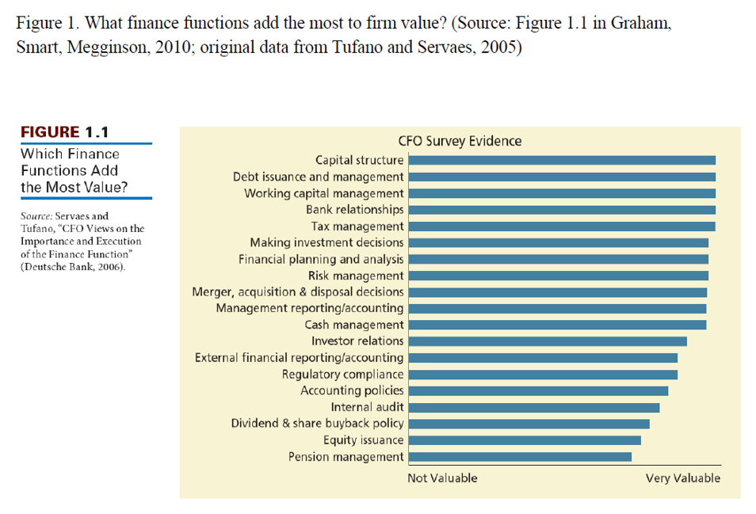
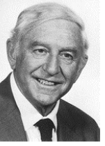
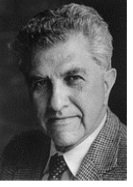
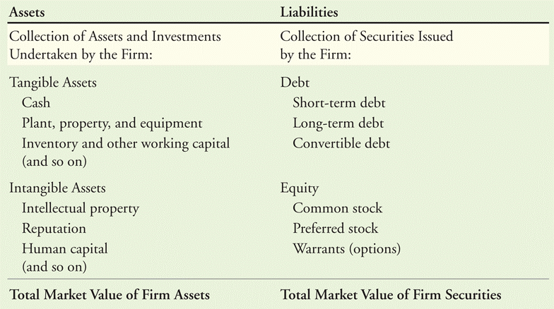

## Plan {.smaller}

- Recap from lecture 6

- Ask whether financing a project with debt or with equity changes what it is
  worth

- Follow one entrepreneur who finances the same project two ways, and see why
  debt makes the equity riskier

- Meet Modigliani and Miller's first proposition, and the arbitrage behind it

- Read a market value balance sheet and follow a leveraged recapitalization

Mostly based on the BDM textbook Chap. 14.1-14.2.

## {.center}

::: {.content-visible when-format="revealjs"}
::: {.center .huge}
Recap lecture 6
:::
:::

```{=latex}
\vfill
\begin{center}
{\color{escpblue}\Huge\bfseries Recap lecture 6}
\end{center}
\vfill
```

## Recap of Lecture 6 {.smaller}

Let's do a recap:

- The investment decision: expected return against cost of capital

- Projects are financed with equity, debt, or a mix of the two

- The cost of equity: the CAPM formula and each of its components

- The cost of debt: yield versus expected return, and the debt beta

- A project's cost of capital: comparables with and without debt, unlevering

- The weighted average cost of capital (WACC)

## Recap: the investment decision {.smaller}

::: {.box .box-a}
A project is worth doing when its **expected return** is at least its **cost of
capital**: the return investors could earn elsewhere at the same risk.
:::

- The money for a project comes from **equity** (selling a share of the firm),
  from **debt** (borrowing), or from a **mix** of the two.

- Each source has its own cost, because each investor bears a different risk.
  Lecture 6 was about measuring these costs:

  - the cost of equity $r_{E}$, with the CAPM;

  - the cost of debt $r_{D}$: the yield minus the expected loss from default,
    or the CAPM with a debt beta;

  - their combination for the whole firm or a project: $r_{U}$ and the WACC.

## Recap: the cost of equity {.smaller}

::: {.box .box-a}
The CAPM: what shareholders require for the market risk they bear (Chap. 12.1).
$$r_{E} = r_{f} + \beta_{E}\,\big(E[R_{M}] - r_{f}\big)$$
:::

- **Each component**, and where it comes from (Chap. 12.2-12.3):

  - **The market portfolio** $R_{M}$: all stocks weighted by market value; in
    practice an index.

  - **The risk-free rate** $r_{f}$: long government bond yields.

  - **The market risk premium** $E[R_{M}] - r_{f}$: about 3-5%, from past
    excess returns or from dividend yield plus growth.

  - **The beta** $\beta_{E}$: the slope of the stock's excess returns against
    the market's, from a few years of data.


## Recap: the cost of debt {.smaller}

::: {.box .box-a}
The yield to maturity is a **promised** return. When the borrower may default,
the **expected** return is lower (Chap. 12.4):
$$r_{D} = \text{YTM} - p \times L$$
:::

- $p$ is the probability of default and $L$ the loss rate when it happens. For
  a safe borrower $p$ is close to zero and $r_{D}$ is the yield.

- **Second route: a debt beta.** Use the CAPM, $r_{D} = r_{f} + \beta_{D} \times$
  premium, with average betas by rating: near zero for investment grade, up to
  0.3 for the riskiest bonds.

## Recap: a project's cost of capital {.smaller}

::: {.box .box-a}
A project has no beta of its own: borrow it from a listed **comparable** in
the same business (Chap. 12.5).
:::

- **Comparable without debt**: its equity beta is the project beta. Done.

- **Comparable with debt**: its shares are riskier than its assets, so first
  **unlever**. The assets belong to shareholders and lenders together, so their
  cost of capital is the weighted average of the two:
  $$r_{U} = \frac{E}{E+D}\, r_{E} + \frac{D}{E+D}\, r_{D}
  \qquad
  \beta_{U} = \frac{E}{E+D}\, \beta_{E} + \frac{D}{E+D}\, \beta_{D}$$


- Cash counts as **negative debt**: use net debt = debt - cash for $D$.

## Recap: the WACC {.smaller}

::: {.box .box-a}
When a firm borrows, interest is tax deductible, so the effective cost of debt
is $r_{D}(1 - \tau_{C})$ and the **weighted average cost of capital** is
(Chap. 12.6)
$$r_{WACC} = \frac{E}{E+D}\, r_{E} + \frac{D}{E+D}\, r_{D}\,(1 - \tau_{C})$$
:::

- $\tau_{C}$ is the corporate tax rate. Without the tax term the formula is the
  unlevered cost of capital $r_{U}$ of the previous slide, also called the
  **pre-tax WACC**.


## {.center}

::: {.content-visible when-format="revealjs"}
::: {.center .huge}
Beginning of lecture 7 content
:::

::: {.center .small}
Lecture 6 measured the cost of equity and the cost of debt. Today we ask whether borrowing more makes a firm worth more.
:::
:::

```{=latex}
\vfill
\begin{center}
{\color{escpblue}\Huge\bfseries Beginning of lecture 7 content}

\vspace{1.5em}
\begin{minipage}{0.8\textwidth}
\small\centering
Lecture 6 measured the cost of equity and the cost of debt, and debt looked
cheaper. Today we ask whether borrowing more therefore makes a firm worth more.
\end{minipage}
\end{center}
\vfill
```


## What CFOs think matters most {.smaller}

::: {.content-visible when-format="revealjs"}
::: {.center}
{fig-align="center" height="430"}
:::
:::

::: {.content-visible when-format="beamer"}
- In a survey of CFOs (Servaes and Tufano, 2006), **capital structure** ranks
  first among the finance functions that add value to the firm, ahead of
  investment decisions and risk management.
:::

- **Capital structure** is the mix of debt and equity a firm uses to finance
  its assets.


## Modigliani, and Miller {.smaller}

::: {.content-visible when-format="revealjs"}
::::: {.columns}
::: {.column width="30%"}
{height="220"}

Franco Modigliani (1918-2003), Nobel prize 1985
:::

::: {.column width="30%"}
{height="220"}

Merton H. Miller (1923-2000), Nobel prize 1990
:::

::: {.column width="40%"}
::: {style="text-align: left"}
- "The Cost of Capital, Corporation Finance and the Theory of Investment,"
  *American Economic Review*, 1958.

- Their two propositions tell us what leverage does to the value of the firm
  (today) and to its cost of capital (Lecture 8).
:::
:::
:::::
:::

::: {.content-visible when-format="beamer"}
- Franco Modigliani (1918-2003), Nobel prize 1985, and Merton H. Miller
  (1923-2000), Nobel prize 1990.

- "The Cost of Capital, Corporation Finance and the Theory of Investment,"
  *American Economic Review*, 1958.

- Their two propositions tell us what leverage does to the value of the firm
  (today) and to its cost of capital (Lecture 8).
:::

## Outline

A.  Financing a project with equity (Chap. 14.1)

B.  Adding debt: levered equity and a common fallacy (Chap. 14.1)

C.  Perfect markets and Modigliani-Miller Proposition I (Chap. 14.2)

D.  Homemade leverage and arbitrage (Chap. 14.2)

E.  The market value balance sheet (Chap. 14.2)

## Introduction

- Should you finance new projects with debt or equity?

- What is the optimal capital structure for a company?

- We will begin by assuming that there are no taxes and no transaction costs
  (and that markets are perfect).


## Introduction {.smaller}

- Dan Harris is the CFO of Electronic Business Services (EBS). The firm plans a
  big expansion and must **raise 50 million** from outside investors.

- Selling shares: given the firm's risk, equity investors want a 10% premium
  over the 5% risk-free rate. The **cost of equity is 15%**.

- Some executives object: EBS has never borrowed and has a strong balance sheet,
  so it could **borrow at 6%**. Why pay 15% when money is available at 6%?

- Three questions for Dan:

  1. Does the low interest rate make borrowing the better choice?

  2. Does the choice change the NPV of the expansion?

  3. Does it change the value of the firm, and its share price?

::: {.box .box-a}
**In a perfect capital market the answer is no, no and no.** Today we see why.
The next lectures see what changes in the real world.
:::

## The Modigliani-Miller conclusion {.smaller}

- Modigliani and Miller asked a simple question: in a **perfect capital
  market** (no taxes, no transaction costs, fair prices), does the way a firm
  finances itself change what it is worth?

::: {.box .box-a}
**MM Proposition I** In a perfect capital market, the total value of a firm’s
securities is equal to the market value of the total cash flows generated by its
 assets, and is not affected by its choice of capital structure.
:::

- **Why:** the firm's assets produce the same cash flows however they are
  financed. Debt and equity only decide **who receives** those cash flows:
  lenders, shareholders, or both. The total to share stays the same.

- **How we will see it:** we follow one project, first financed with equity
  only (section A), then partly with debt (section B), and compare its value
  in the two cases. Section C states the result in general.

## A. Financing a project with equity {.smaller}

- An entrepreneur (call the firm Tour moche SA) has a project: invest **800**
  today; next year it pays **1400** if the economy is strong or **900** if it is
  weak. Both outcomes are equally likely.

  | Year 0: investment | Year 1: strong (prob. 0.5) | Year 1: weak (prob. 0.5) |
  |:------------------:|:--------------------------:|:------------------------:|
  | $-800$             | $1400$                     | $900$                    |

- The cash flows depend on the economy, so they carry market risk. The
  risk-free rate is 5% and the appropriate risk premium is 10%: the project's
  **cost of capital is 15%**.

- Two steps: what is the project worth, and, if the entrepreneur finances it by
  selling only equity, what return do the **investors who buy those shares**
  earn?

## Why is the cost of capital 15%? {.smaller}

The cost of capital is the return investors could earn elsewhere on an
investment with the same risk (Lecture 6). We build it in three steps:

1. **Start from the risk-free rate: 5%.** Investors can earn 5% with no risk
   at all, for example on government bonds. Any project must offer at least
   that.

2. **Add a premium for risk: 10%.** The project pays 1400 in a strong economy
   and 900 in a weak one: its risk moves with the economy and cannot be
   diversified away. Investors bear it only if paid extra, the **risk
   premium**. Here it is given; in practice it comes from the CAPM (Lecture 6).

3. **Add the two:** 5% + 10% = **15%**. This is the rate we use to discount the
   project's cash flows on the next slide.

## Step 1: what is the project worth? {.smaller}

- Expected cash flow next year: $0.5 \times 1400 + 0.5 \times 900 = 1150$.

- Discounted at 15%:
  $$\text{PV} = \frac{1150}{1.15} = 1000
  \qquad\qquad
  \text{NPV} = -800 + 1000 = 200$$

- If the firm has no debt, shareholders receive all the cash flows. So the
  entrepreneur can sell the **whole equity for 1000**, pay the 800 investment,
  and **keep 200**: the NPV goes to the current owner.

- Equity in a firm with no debt is called **unlevered equity**.

## Step 2: returns to unlevered equity {.smaller}

- The shares cost 1000 today and pay 1400 or 900 next year:

  | Unlevered equity | Year 0 | Strong | Weak | Return strong | Return weak |
  |:-----------------|:------:|:------:|:----:|:-------------:|:-----------:|
  | Value            | 1000   | 1400   | 900  | $+40\%$       | $-10\%$     |

- Expected return: $0.5 \times 40\% + 0.5 \times (-10\%) = 15\%$.

- The risk of the unlevered equity **is** the risk of the project, so 15% is
  exactly the fair return for the risk shareholders take.

::: {.box .box-a}
With equity only: the firm is worth 1000, the shareholders expect 15%, the
entrepreneur pockets 200.
:::

## B. The same project, financed another way {.smaller}

- Same project.

- Now the entrepreneur **borrows 500** and sells equity for the rest.

- Can she borrow at the risk-free rate, 5%? Yes: even in a weak economy the
  project pays 900, more than enough to repay. The loan is **risk free**.

- Next year the firm will owe the lenders $500 \times 1.05 = 525$, whatever
  the economy does:

  | Levered firm   | Year 0  | Strong  | Weak    |
  |:---------------|:-------:|:-------:|:-------:|
  | Debt           | 500     | **525** | **525** |

- *What is left for the shareholders?*

## Lenders are paid first {.smaller}

- Lenders must be paid **before** shareholders receive anything. Shareholders
  get what remains:

  - strong economy: $1400 - 525 = 875$

  - weak economy: $900 - 525 = 375$

- Equity in a firm that also has debt is called **levered equity**.

  | Levered firm   | Year 0  | Strong  | Weak    |
  |:---------------|:-------:|:-------:|:-------:|
  | Debt           | 500     | 525     | 525     |
  | Levered equity | $E = ?$ | **875** | **375** |

- *What would investors pay today for those two cash flows? That is $E$, the
  value of the levered equity. Three steps to find it.*

## Step 1 of 6: add up what everyone receives {.smaller}

- Put the lenders and the shareholders together:

  - strong economy: $525 + 875 = 1400$

  - weak economy: $525 + 375 = 900$

- Together they receive **exactly the project's cash flows**:

  | Levered firm   | Year 0  | Strong   | Weak    |
  |:---------------|:-------:|:--------:|:-------:|
  | Debt           | 500     | 525      | 525     |
  | Levered equity | $E = ?$ | 875      | 375     |
  | Firm           | ?       | **1400** | **900** |

- Nothing is created and nothing is lost: an investor who owns **both** the
  debt and the equity owns the project.

## Step 2 of 6: the Law of One Price {.smaller}

- **The Law of One Price**: two investments that pay the same cash flows in
  every state of the economy must sell for the same price.

- The project's cash flows (1400 or 900) are worth **1000** today, from
  section A.

- Debt plus levered equity pays those same cash flows, so debt plus levered
  equity is also worth 1000:
  $$D + E = 1000 \qquad \Rightarrow \qquad E = 1000 - 500 = 500$$

  | Levered firm   | Year 0   | Strong | Weak |
  |:---------------|:--------:|:------:|:----:|
  | Debt           | 500      | 525    | 525  |
  | Levered equity | **500**  | 875    | 375  |
  | Firm           | **1000** | 1400   | 900  |

## Step 3 of 6: is the entrepreneur worse off? {.smaller}

- The levered equity sells for 500, half of the 1000 the unlevered equity
  fetched. Does she lose?

  |                       | Equity only | Debt and equity |
  |:----------------------|:-----------:|:---------------:|
  | Sold to shareholders  | 1000        | 500             |
  | Borrowed from lenders | 0           | 500             |
  | **Total raised**      | **1000**    | **1000**        |
  | Invested              | 800         | 800             |
  | **Kept (the NPV)**    | **200**     | **200**         |

- She raises the same 1000 and keeps the same 200. The equity is worth less
  because it **receives** less; the rest went to the lenders.

::: {.box .box-a}
The entrepreneur is **indifferent** between the two ways of financing the
project.
:::

## The common fallacy: a tempting shortcut {.smaller}

Before Modigliani and Miller, many people reasoned like this:

1. **What do shareholders expect next year?** Half the time they get 875,
   half the time 375. On average:
   $$0.5 \times 875 + 0.5 \times 375 = 625$$

2. **What is that worth today?** Discount it at 15%, the rate we used for the
   firm without debt:
   $$625 / 1.15 = 543$$

3. **Conclusion:** the equity is worth 543, more than the 500 we found with the
   Law of One Price. So borrowing would create value out of nothing.

::: {.box .box-a}
This contradicts Step 2: debt and equity together are worth 1000. One of the
three steps must be wrong. Which one?
:::

## Step 4 of 6: what shareholders actually earn {.smaller}

- Let us not guess the discount rate. Compute the return the shareholders
  earn, state by state. They pay **500** today:

  - strong economy: they receive 875, a return of $875 / 500 - 1 = +75\%$

  - weak economy: they receive 375, a return of $375 / 500 - 1 = -25\%$

- Expected return: $0.5 \times 75\% + 0.5 \times (-25\%) = 25\%$.

- Compare with the equity of the firm without debt (section A):

  | Equity           | Pays today | Strong  | Weak    | Expected return |
  |:-----------------|:----------:|:-------:|:-------:|:---------------:|
  | Without debt     | 1000       | $+40\%$ | $-10\%$ | 15%             |
  | With debt of 500 | 500        | $+75\%$ | $-25\%$ | **25%**         |

## Why 25%: same economy, bigger swings {.smaller}

- The economy is the same in both cases. What changed is how much the
  shareholders' return **moves** with it:

  - without debt, the return goes from $-10\%$ to $+40\%$: a swing of
    **50 points**;

  - with debt, from $-25\%$ to $+75\%$: a swing of **100 points**.

- Levered equity is **riskier**, so investors require a higher expected return.
  15% was the price of the first risk; 25% is the price of the second.

- **The shortcut's mistake was step 2**: discounting at 15%. Discount at the
  right rate and the puzzle disappears:
  $$625 / 1.25 = 500$$

::: {.box .box-a}
Debt does not change what the project pays. It changes who bears the risk:
lenders take none, so shareholders take all of it, on a smaller investment.
:::

## Step 5 of 6: measuring the extra risk {.smaller}

- In a two-state world, a security's exposure to the economy is simply the gap
  between its return in the strong and in the weak state (the two-state version
  of beta). Its **risk premium** is its expected return minus the 5% risk-free
  rate.

  | Security         | Return strong $-$ return weak | Risk premium (expected $-$ 5%) |
  |:-----------------|:-----------------------------:|:------------------------------:|
  | Debt             | $5\% - 5\% = 0\%$             | $0\%$                          |
  | Unlevered equity | $40\% - (-10\%) = 50\%$       | $10\%$                         |
  | Levered equity   | $75\% - (-25\%) = 100\%$      | $20\%$                         |

- Levered equity has **twice** the exposure of unlevered equity and earns
  **twice** the risk premium. The extra return is exactly the pay for the
  extra risk.

- The debt is risk free, yet the equity got riskier: leverage raises the risk
  of equity **even when there is no risk of default**.

## Step 6 of 6: cheap debt, dearer equity {.smaller}

- Looked at on its own, debt is cheap: 5% against 25% for the equity.

- But the firm uses both. Its **average cost of capital**, weighting each source
  by its value, is
  $$\frac{500}{1000} \times 5\% + \frac{500}{1000} \times 25\% = 15\%$$

- The same 15% as with equity alone.

::: {.box .box-a}
Each euro of debt replaces expensive equity with cheap debt, and at the same
time makes the remaining equity riskier and dearer, by exactly enough to keep
the average at 15%. Lecture 8 turns this into a formula.
:::

## Exercise: borrow only 200 {.smaller}

- Same project, same entrepreneur. This time she borrows only **200** at 5%
  and sells equity for the rest.

- According to Modigliani and Miller, what is the equity worth today?

- What do the shareholders receive next year, in a strong and in a weak
  economy?

- What return do they earn in each case, and what is their expected return?

- What is the firm's average cost of capital?

## Exercise: borrow only 200 (con't) {.smaller}

- **Step 1, the equity value.** Debt plus equity is still worth 1000, so
  $E = 1000 - 200 = 800$.

- **Step 2, the cash flows.** The firm owes $200 \times 1.05 = 210$.
  Shareholders get $1400 - 210 = 1190$ or $900 - 210 = 690$.

- **Step 3, the returns.** On 800 paid today:
  $1190 / 800 - 1 = +48.75\%$ or $690 / 800 - 1 = -13.75\%$.
  Expected: $0.5 \times 48.75\% + 0.5 \times (-13.75\%) = 17.5\%$.

- **Step 4, the average cost of capital.**
  $0.8 \times 17.5\% + 0.2 \times 5\% = 15\%$. Again.

- Less debt than before, so the equity is less risky than with 500 of debt
  (17.5% against 25%), but riskier than with none (15%).

## What section B showed {.smaller}

1. Lenders are paid first; shareholders get what remains.

2. Debt and equity together receive **the project's cash flows**.

3. By the Law of One Price, debt and equity together are worth **what the
   project is worth**: 1000, whatever the mix. The entrepreneur is indifferent.

4. Shareholders of a firm with debt earn a **higher expected return**, 25%
   instead of 15%.

5. Because they bear **more risk**: twice the exposure, twice the premium.

6. The **average cost of capital** does not move: cheap debt is offset by
   dearer equity.

::: {.box .box-a}
Next: Modigliani and Miller show this is a general result, not a feature of
our example.
:::

## C. What is a perfect capital market? {.smaller}

- Our example made three hidden assumptions. Modigliani and Miller spell them
  out; together they define a **perfect capital market**:

  1. **Investors and firms can trade the same securities at fair prices**, equal
     to the present value of their cash flows. (Our entrepreneur borrowed at
     the same 5% as anyone else.)

  2. **No taxes, transaction costs or issuance costs.** (Nothing leaked out when
     she sold the equity or took the loan.)

  3. **Financing does not change the project's cash flows**, and does not
     reveal new information about them. (The project paid 1400 or 900
     regardless of how it was financed.)

- Remove any one of them and the conclusion can change. That is the subject next lectures.

## MM Proposition I {.smaller}

::: {.box .box-a}
**MM Proposition I.** In a perfect capital market, the total value of a firm's
securities is equal to the market value of the total cash flows generated by
its assets, and is not affected by its choice of capital structure.
:::

- In plain words: **the pie is the same size however you slice it.** The
  project's cash flows are the pie; debt and equity are the slices.

- In our example the pie was worth 1000 with no debt, with 200 of debt, and
  with 500 of debt. Only the slices changed.

- The proposition says nothing about which slice is better for a given
  investor; it says the entrepreneur cannot raise more than 1000 by cutting
  differently.


## Why MM I holds: two ways to see it {.smaller}

- **The Law of One Price.** Without taxes or transaction costs, everything the
  firm's assets produce is paid to its security holders, and nothing else is.
  Same total cash flows, so same total value, whatever the mix of securities.

- **The separation principle.** When securities are fairly priced, buying or
  selling them is a **zero-NPV** transaction. The repayments a firm promises on
  its debt are worth exactly the loan it receives today. So borrowing creates
  no gain and no loss, and the value of the firm comes from its investments
  alone.

- Miller's version: the pizza delivery man asks Yogi Berra whether he wants his
  pizza cut into four or eight slices. Yogi: "Cut it in eight pieces, I'm
  feeling hungry tonight." Cutting the pizza differently does not make more
  pizza.

## MM and the real world {.smaller}

- Students often ask why MM matters if real markets are not perfect.

- Galileo showed that **without friction**, all bodies fall at the same speed.
  Drop a feather and a stone and it does not hold. The reason is not that
  Galileo was wrong, but that **air friction** slows some objects more than
  others.

- MM is the same kind of result. In practice capital structure **does** affect
  value. MM tells us that any such effect must come from a **friction** in the
  capital market: taxes, bankruptcy costs, information problems.

::: {.box .box-a}
MM tells us where to look: at the frictions, not at the mix itself. Lectures 9
to 11 are about those frictions.
:::

## D. Homemade leverage: the answer first {.smaller}

- Suppose investors would prefer a different capital structure from the one the
  firm has chosen.

- An investor who wants more leverage can borrow and buy the shares: this is
  **homemade leverage**. One who wants less can hold the firm's debt as well as
  its shares.

- Condition: investors can borrow at the same rate as the firm. In a perfect
  market the rate depends only on the risk of the loan, not on who borrows.

- Three steps: make levered equity yourself, undo the firm's leverage yourself,
  and see what happens if the two firms are not priced the same.

## Step 1: make levered equity yourself {.smaller}

- The firm has no debt. An investor who would like levered equity buys the
  unlevered shares with a **margin loan** of 500 at 5%:

  | Portfolio            | Year 0: cost | Strong  | Weak    |
  |:---------------------|:------------:|:-------:|:-------:|
  | Unlevered equity     | $1000$       | $1400$  | $900$   |
  | Margin loan          | $-500$       | $-525$  | $-525$  |
  | **Total**            | **$500$**    | **$875$** | **$375$** |

- The shares are enough collateral, so the loan is risk free and costs 5%.

- The portfolio pays **exactly what levered equity pays**, for a cost of 500.
  By the Law of One Price, levered equity must also be worth 500.

## Step 2: undo the firm's leverage {.smaller}

- Now the firm has borrowed 500, but the investor would prefer unlevered
  equity. He buys **both** the debt and the levered equity:

  | Portfolio            | Year 0: cost | Strong   | Weak    |
  |:---------------------|:------------:|:--------:|:-------:|
  | Debt                 | $500$        | $525$    | $525$   |
  | Levered equity       | $500$        | $875$    | $375$   |
  | **Total**            | **$1000$**   | **$1400$** | **$900$** |

- Same cash flows as unlevered equity, for 1000.

::: {.box .box-a}
Either way, the investor picks the leverage he wants. The firm's choice
changes nothing for him, so he will not pay more for one structure than for
the other.
:::


## E. The market value balance sheet {.smaller}

::: {.box .box-a}
The market value of **all** the securities a firm has
issued equals the market value of **all** its assets. At market values,
$$\text{Equity} = \text{Assets} - \text{Debt and other liabilities}.$$
:::

::: {.center}
{fig-align="center" height="270"}
:::

- Unlike accounting: **every** asset counts, at **market value** (often hard to
  estimate).


## A leveraged recapitalization {.smaller}

- MM I also applies **after** the firm is created. Harrison Industries is an
  all-equity firm with 50 million shares at 4 each: equity, and assets, are
  worth **200 million**.

- Harrison **borrows 80 million** and uses the cash to **buy back 20 million
  shares**: a leveraged recapitalization. Two stages, in millions:

  | Market value balance sheet | Initial | After borrowing | After repurchase |
  |:---------------------------|:-------:|:---------------:|:----------------:|
  | Cash                       | 0       | 80              | 0                |
  | Existing assets            | 200     | 200             | 200              |
  | **Total assets**           | **200** | **280**         | **200**          |
  | Debt                       | 0       | 80              | 80               |
  | Equity                     | 200     | 200             | 120              |
  | Shares outstanding (M)     | 50      | 50              | 30               |
  | Value per share            | 4.00    | 4.00            | 4.00             |


## What to remember {.smaller}

- **MM Proposition I.** In a perfect capital market the total value of a firm's
  securities equals the value of its assets, whatever the capital structure.

- **Perfect market** means: securities trade at fair prices, no taxes or
  transaction costs, and financing changes neither the investment cash flows
  nor the information about them.

- **Leverage makes equity riskier**, even when the debt is risk free. Debt is
  cheaper on its own but raises the cost of equity.

- **Homemade leverage**: investors can borrow or lend to get the leverage they
  want, so the firm's choice is worth nothing to them.

- **Equity = assets $-$ liabilities** at market values. Issuing debt to buy back
  shares at fair prices does not change the share price.


## Quiz

- Why is the levered equity of Tour moche SA worth 500 and not 543?

- Name the three conditions of a perfect capital market.

- The entrepreneur borrows 750 instead of 500. What is the value of the equity,
  what are its cash flows, and what is its expected return?

- A firm borrows to buy back shares in a perfect market. What happens to its
  share price? To its market capitalisation?

## Quiz: answers {.smaller}

- **500, not 543.** The 543 discounts the expected levered cash flow of 625 at
  the unlevered rate of 15%. Levered equity is riskier and requires 25%:
  $625 / 1.25 = 500$. The 500 also follows from the Law of One Price:
  $1000 - 500$.

- **Perfect market.** Fair prices for all securities; no taxes, transaction or
  issuance costs; financing does not change the investment cash flows nor
  reveal information about them.

- **Borrow 750.** Equity is worth $1000 - 750 = 250$. The firm owes $750 \times
  1.05 = 787.5$, so equity receives $1400 - 787.5 = 612.5$ or $900 - 787.5 =
  112.5$: returns $+145\%$ or $-55\%$, expected **45%**. Risk premium 40%, four
  times the unlevered premium, for four times the sensitivity.

- **Buyback.** The share price does not change (zero-NPV trade). Market
  capitalisation falls by the amount borrowed: fewer shares, same price.
