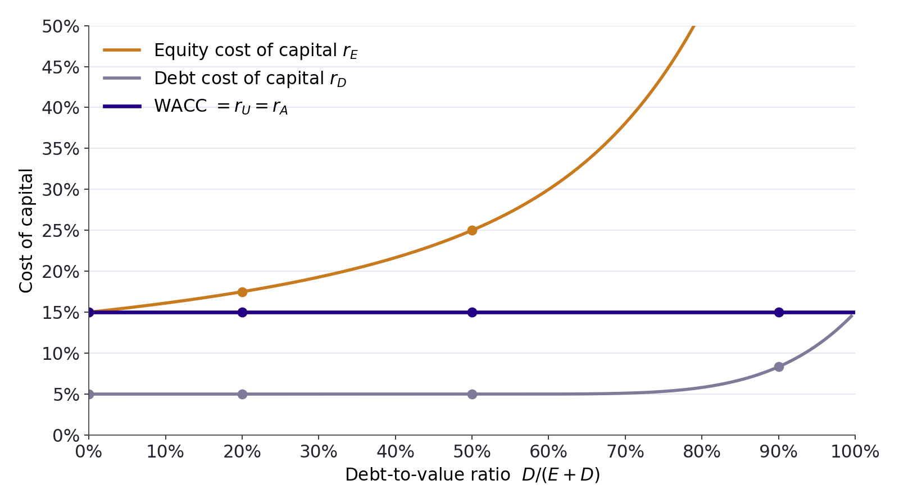
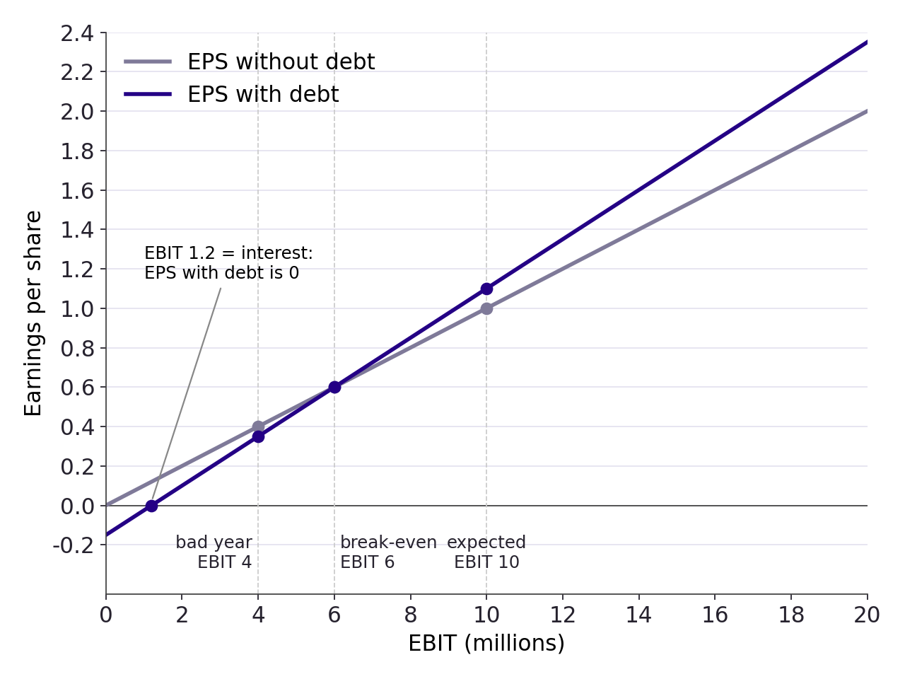

## Plan

- Recap from lecture 7

- Ask how much leverage raises the cost of equity: Modigliani-Miller
  Proposition II

- See why the weighted average cost of capital does not move

- Write the same result with betas, and use it to price projects from
  comparables

- Dismantle two popular arguments for debt: earnings per share and dilution

- Practice on three exercises

Mostly based on the BDM textbook Chap. 14.3-14.5.

## {.center}

::: {.content-visible when-format="revealjs"}
::: {.center .huge}
Recap lecture 7
:::
:::

```{=latex}
\vfill
\begin{center}
{\color{escpblue}\Huge\bfseries Recap lecture 7}
\end{center}
\vfill
```

## Recap of Lecture 7 {.smaller}

Let's do a recap:

- One project, and what it is worth

- Unlevered and levered equity

- The 543 fallacy

- Perfect capital markets and MM Proposition I

- Homemade leverage and arbitrage

- The market value balance sheet and a leveraged recap

- And from Lecture 6: the unlevered cost of capital

## Recap: one project, and what it is worth {.smaller}

::: {.box .box-a}
Invest **800** today; receive **1400** (strong economy) or **900** (weak), each
with probability one half. Cost of capital 15% (Chap. 14.1).
:::

- Expected cash flow $0.5 \times 1400 + 0.5 \times 900 = 1150$.

- Present value $1150 / 1.15 = 1000$. NPV $= -800 + 1000 = 200$.

- Sell the whole equity for 1000, pay the 800, keep the 200: the NPV goes to
  the entrepreneur.

- The cash flows do not depend on how the 800 is raised. Everything that follows
  is about how the 1000 is **split**, not about how big it is.

## Recap: unlevered and levered equity {.smaller}

- Borrow 500 at 5%: the firm owes 525, and shareholders get what is left.

  | Security         | Year 0 | Strong | Weak | Return strong | Return weak | Expected |
  |:-----------------|:------:|:------:|:----:|:-------------:|:-----------:|:--------:|
  | Debt             | 500    | 525    | 525  | $5\%$         | $5\%$       | $5\%$    |
  | Levered equity   | 500    | 875    | 375  | $+75\%$       | $-25\%$     | $25\%$   |
  | Unlevered equity | 1000   | 1400   | 900  | $+40\%$       | $-10\%$     | $15\%$   |

::: {.box .box-a}
Leverage raises the risk of equity **even when the debt is risk free**:
$+75\%$ / $-25\%$ against $+40\%$ / $-10\%$. Shareholders are paid for it:
25% expected instead of 15%.
:::

- Debt and levered equity together receive exactly the project's cash flows,
  so by the Law of One Price $D + E = 1000$ and $E = 500$.

## Recap: the 543 fallacy {.smaller}

- The levered equity pays 625 on average. Discounting it at the unlevered rate
  gives $625 / 1.15 = 543$, more than 500. **Wrong**: 15% is the rate for
  unlevered risk. Levered equity requires 25%, and $625 / 1.25 = 500$.

- Two-state "beta": return strong minus return weak. Debt 0%, unlevered equity
  50%, levered equity 100%. Twice the risk, twice the premium (20% against 10%).

- The average cost of the two sources is unchanged:
  $$\tfrac{500}{1000} \times 5\% + \tfrac{500}{1000} \times 25\% = 15\%.$$

::: {.box .box-a}
Debt is cheaper, but equity gets dearer by exactly enough. **Today we put a
formula on "exactly enough".**
:::

## Recap: perfect markets and MM I {.smaller}

- A capital market is **perfect** when (Chap. 14.2):

  1. securities trade at competitive prices equal to the present value of their
     cash flows;

  2. there are no taxes, transaction costs or issuance costs;

  3. financing decisions change neither the cash flows of the investments nor
     the information about them.

::: {.box .box-a}
**MM Proposition I.** In a perfect capital market, the total value of a firm's
securities equals the market value of the cash flows generated by its assets,
and is not affected by its choice of capital structure.
:::

- Miller's pizza: cutting it in eight slices instead of four does not make more
  pizza. Any real effect of capital structure must come from a **friction**.

## Recap: homemade leverage and arbitrage {.smaller}

- Investors can **redo** the firm's leverage (buy unlevered shares with a margin
  loan) or **undo** it (hold the debt and the levered equity together). The
  firm's choice gives them nothing they cannot make at home.

- If two identical firms were priced differently, there would be free money.
  Firm U at 990 and firm L at $510 + 500 = 1010$:

  | Trade                    | Year 0 | Strong  | Weak   |
  |:-------------------------|:------:|:-------:|:------:|
  | Borrow 500               | $+500$ | $-525$  | $-525$ |
  | Buy U's equity           | $-990$ | $+1400$ | $+900$ |
  | Sell L's equity          | $+510$ | $-875$  | $-375$ |
  | **Total**                | **$+20$** | **$0$** | **$0$** |

::: {.box .box-a}
Everyone trades this way until the two firms are worth the same. That is what
makes MM I hold.
:::

## Recap: the market value balance sheet {.smaller}

::: {.box .box-a}
Market value of equity $=$ market value of all assets $-$ market value of debt
and other liabilities. All assets, including intangibles, at market values.
:::

- **Harrison Industries**: 50 million shares at 4, no debt. It borrows 80
  million and buys back 20 million shares.

- Equity falls from 200 to 120, but only 30 million shares remain:
  $120 / 30 = 4$. **The share price does not move.**

- Issuing debt and buying back equity at fair prices is a **zero-NPV**
  transaction. Market capitalisation falls because there are fewer shares, not
  because each is worth less.

## Recap: the unlevered cost of capital (L6) {.smaller}

::: {.box .box-a}
The assets are owned by shareholders and lenders together, so their expected
return is the **weighted average** of what each group earns (Chap. 12.5):
$$r_{U} = \frac{E}{E+D}\, r_{E} + \frac{D}{E+D}\, r_{D}
\qquad\qquad
\beta_{U} = \frac{E}{E+D}\, \beta_{E} + \frac{D}{E+D}\, \beta_{D}$$
:::

- $E$, $D$: market values of equity and debt. $r_{E}$, $r_{D}$: their costs of
  capital. $r_{U}$: the **unlevered** cost of capital, the return of the
  business itself.

- **Danone**: equity 30 billion at 5%, debt 10 billion at 3.5%, so
  $r_{U} = 0.75 \times 5\% + 0.25 \times 3.5\% = 4.6\%$.

- Lecture 6 went **from $r_{E}$ to $r_{U}$**, to price a project. Today we go
  the other way: given the business ($r_{U}$) and the leverage, **what must
  $r_{E}$ be?**

## {.center}

::: {.content-visible when-format="revealjs"}
::: {.center .huge}
Beginning of lecture 8 content
:::

::: {.center .small}
Lecture 7 showed that leverage does not change what the firm is worth. But debt
costs 5% and equity 15%, so how can the average not fall? Because the cost of
equity rises exactly enough. Today we see by how much.
:::
:::

```{=latex}
\vfill
\begin{center}
{\color{escpblue}\Huge\bfseries Beginning of lecture 8 content}

\vspace{1.5em}
\begin{minipage}{0.8\textwidth}
\small\centering
Lecture 7 showed that leverage does not change what the firm is worth. But debt
costs 5\% and equity 15\%, so how can the average not fall? Because the cost of
equity rises exactly enough. Today we see by how much.
\end{minipage}
\end{center}
\vfill
```

## Introduction {.smaller}

- **A common argument.** "Debt costs 5%, equity 15%. Replace half of the equity
  by debt and the average cost of capital drops from 15% to 10%. So why not
  borrow as much as possible, at least while the debt stays safe?"

- **A banker's version.** In 2010 Josef Ackermann, then CEO of Deutsche Bank,
  warned that stricter capital requirements (less leverage) would "depress ROE
  to levels that make investment into the banking sector unattractive".

- Both arguments sound right. Both are wrong for the same reason.

::: {.box .box-a}
Leverage changes the **risk** of equity, and therefore the return shareholders
require. Today we put a number on how much, and show that the saving on cheap
debt is given back, cent for cent, through dearer equity.
:::

## Outline

A.  MM Proposition II: leverage and the cost of equity (Chap. 14.3)

B.  The WACC does not move (Chap. 14.3)

C.  Levered and unlevered betas (Chap. 14.3)

D.  Two fallacies: earnings per share and dilution (Chap. 14.4)

E.  Conservation of value (Chap. 14.5)

F.  Exercises

## A. MM Proposition II: the answer first {.smaller}

::: {.box .box-a}
**The answer first. MM Proposition II.** The cost of levered equity is the
unlevered cost of capital plus a premium that grows with the debt-to-equity
ratio:
$$r_{E} = r_{U} + \frac{D}{E}\,\big(r_{U} - r_{D}\big)$$
:::

- In words: cost of equity $=$ cost of the business $+$ (debt $\div$ equity)
  $\times$ (cost of the business $-$ cost of debt).

- The second term is the **price of leverage**. It is zero without debt and
  grows with every euro of debt per euro of equity.

- Three steps to get there:

  1. write MM Proposition I as an equation;

  2. compute the return of a portfolio of the firm's debt and equity;

  3. solve for the return of equity.

## Step 1: MM I as an equation {.smaller}

- Let $E$ be the market value of the levered equity, $D$ the market value of
  the debt, $U$ what the equity would be worth if the firm had no debt, and $A$
  the market value of the firm's assets.

- MM Proposition I says that the securities are worth the assets, with or
  without leverage:
  $$E + D = U = A$$

- Our entrepreneur: $500 + 500 = 1000$.

- Read the first equality through homemade leverage: holding **both** the debt
  and the levered equity gives exactly the cash flows of the unlevered equity
  (Lecture 7, Step 2 of homemade leverage).

## Step 2: the return of the portfolio {.smaller}

- The return of a portfolio is the weighted average of the returns of what is
  in it (Lecture 2). A portfolio holding all the debt and all the equity has
  weights $E/(E+D)$ and $D/(E+D)$, and earns the unlevered return:
  $$\frac{E}{E+D}\, R_{E} + \frac{D}{E+D}\, R_{D} = R_{U}$$

- $R_{E}$, $R_{D}$, $R_{U}$ are the **realised** returns of levered equity,
  debt and unlevered equity.

- **Check with the entrepreneur**, weights one half each:

  - strong economy: $0.5 \times 75\% + 0.5 \times 5\% = 40\%$

  - weak economy: $0.5 \times (-25\%) + 0.5 \times 5\% = -10\%$

  Exactly the returns of unlevered equity.

## Step 3: solve for the return of equity {.smaller}

- Multiply both sides by $(E+D)/E$ and move the debt term across:
  $$R_{E} = R_{U} + \frac{D}{E}\,\big(R_{U} - R_{D}\big)$$

- The return on levered equity is the return without leverage **plus an extra
  kick**. When the business does well ($R_{U} > R_{D}$) the kick is positive;
  when it does badly ($R_{U} < R_{D}$) the kick is negative. The size of the
  kick is $D/E$.

- The equation holds for realised returns, so it holds for **expected** returns
  too. Replace $R$ by $r$:

::: {.box .box-a}
**MM Proposition II** (Chap. 14.3): $\;r_{E} = r_{U} + \dfrac{D}{E}\,(r_{U} - r_{D})$.
The cost of levered equity increases with the market-value debt-to-equity ratio.
:::

## MM II with the entrepreneur's numbers {.smaller}

- Unlevered cost of capital $r_{U} = 15\%$, debt cost $r_{D} = 5\%$.

  | Debt $D$ | Equity $E$ | $D/E$ | $r_{E} = r_{U} + \frac{D}{E}(r_{U} - r_{D})$ | Lecture 7 said |
  |:--------:|:----------:|:-----:|:---------------------------------------------:|:--------------:|
  | 500      | 500        | 1     | $15\% + 1 \times (15\% - 5\%) = 25\%$          | 25%            |
  | 200      | 800        | 0.25  | $15\% + 0.25 \times (15\% - 5\%) = 17.5\%$     | 17.5%          |

- Both numbers match what we found last week by looking at the cash flows
  state by state. Now we have them **without** listing the states.

- The formula also says what happens at **any** level of debt: with 750 of
  debt ($D/E = 3$), $r_{E} = 15\% + 3 \times 10\% = 45\%$, the quiz answer of
  Lecture 7.

## B. The WACC does not move: the answer first {.smaller}

::: {.box .box-a}
**The answer first.** In a perfect market the weighted average cost of capital
is the unlevered cost of capital, whatever the mix (Chap. 14.3):
$$r_{WACC} = \frac{E}{E+D}\, r_{E} + \frac{D}{E+D}\, r_{D} = r_{U} = r_{A}$$
:::

- This is Step 2 read with expected returns: the portfolio of all the firm's
  securities has the risk of the assets, so it earns the return of the assets.

- In Lecture 6 we called this the **pre-tax WACC**, and the WACC had a
  $(1 - \tau_{C})$ on the debt term. Here there are no taxes, so the two
  coincide.

- Consequence: the enterprise value is the free cash flow discounted at the
  WACC (Chap. 9). The cash flows do not depend on financing, and neither does
  the WACC, so **neither does the value of the firm**. That is MM I again.

## The WACC at four debt levels {.smaller}

- The entrepreneur's project with more and more debt (Figure 14.1b):

  | $E$  | $D$ | $r_{E}$ | $r_{D}$  | $r_{WACC} = \frac{E}{E+D} r_{E} + \frac{D}{E+D} r_{D}$ |
  |:----:|:---:|:-------:|:--------:|:------------------------------------------------------:|
  | 1000 | 0   | 15.0%   | 5.0%     | $1.0 \times 15\% + 0 \times 5\% = 15\%$                |
  | 800  | 200 | 17.5%   | 5.0%     | $0.8 \times 17.5\% + 0.2 \times 5\% = 15\%$            |
  | 500  | 500 | 25.0%   | 5.0%     | $0.5 \times 25\% + 0.5 \times 5\% = 15\%$              |
  | 100  | 900 | 75.0%   | 8.3%$^*$ | $0.1 \times 75\% + 0.9 \times 8.3\% = 15\%$            |

- The cost of equity climbs steeply, but more weight goes on the cheap source:
  the average stays at **15%**.

::: {.tiny}
$^*$ With 900 of debt the firm defaults in the weak state: lenders are promised
16.67% but expect 8.33%.
:::

## The WACC in a picture {.smaller}

::: {.center}
{fig-align="center" style="max-height: 440px"}
:::

- As the share of debt rises, **both** the equity and the debt become riskier
  and dearer. Because more weight goes on the cheaper debt, the average does
  not move.

## Example: NRG reduces its leverage {.smaller}

- **Example 14.5.** NRG Energy has a debt-to-equity ratio of 2, a debt cost of
  6% and an equity cost of 12%. With $D/E = 2$, debt is two thirds of the firm
  and equity one third.

- **Unlevered cost of capital** (and WACC):
  $$r_{U} = \tfrac{1}{3} \times 12\% + \tfrac{2}{3} \times 6\% = 8\%.$$

- NRG issues equity to repay debt until $D/E = 1$. Safer debt now costs 5.5%.
  **New cost of equity**: $r_{E} = 8\% + 1 \times (8\% - 5.5\%) = 10.5\%$.

- **New WACC**: $0.5 \times 10.5\% + 0.5 \times 5.5\% = 8\%$. Unchanged.

- If NRG repaid all its debt, its equity would cost $r_{U} = 8\%$: the WACC
  again.

::: {.box .box-a}
Less leverage: cheaper equity, dearer average? No. The WACC, the cash flows and
therefore the **enterprise value** are the same in all three cases.
:::

## Back to EBS: is debt better than equity? {.smaller}

- Dan Harris can raise the 50 million at 15% (equity) or 6% (debt). With
  perfect capital markets:

  - borrowing at 6% raises the cost of equity above 15%, by MM II;

  - the **WACC does not change**, so the NPV of the expansion does not change;

  - the value of the firm and its share price do not depend on the choice.

- A tempting objection: "if the debt is risk free, there is no chance of
  default, so the risk of equity does not change". **Wrong**: the entrepreneur's
  debt was risk free and the equity still went from 15% to 25%. Leverage
  concentrates the **business** risk on fewer euros of equity.

- The same holds with any number of securities. **Example 14.6**: 440 of equity
  at 18.18%, 500 of debt at 5% and 60 of warrants at 75% give
  $0.44 \times 18.18\% + 0.5 \times 5\% + 0.06 \times 75\% = 15\%$.

## C. Levered and unlevered betas {.smaller}

::: {.box .box-a}
**The answer first.** Betas obey the same rule as expected returns
(Chap. 14.3):
$$\beta_{U} = \frac{E}{E+D}\, \beta_{E} + \frac{D}{E+D}\, \beta_{D}
\qquad\qquad
\beta_{E} = \beta_{U} + \frac{D}{E}\,\big(\beta_{U} - \beta_{D}\big)$$
:::

- $\beta_{U}$ is the **unlevered** (or asset) beta: the market risk of the
  business, as if it had no debt. $\beta_{E}$ is the **levered** (or equity)
  beta: business risk plus the risk added by leverage. $\beta_{D}$ is the debt
  beta.

- Why the same rule? The beta of a portfolio is the weighted average of the
  betas in it (Lecture 4), and the portfolio of all the firm's securities has
  the risk of the assets.

- When a firm changes its capital structure without changing its investments,
  **$\beta_{U}$ stays put and $\beta_{E}$ moves.**

## If the debt is risk free {.smaller}

- With risk-free debt, $\beta_{D} = 0$ and the second formula simplifies to
  $$\beta_{E} = \beta_{U} \times \frac{E + D}{E} = \beta_{U}\,\Big(1 + \frac{D}{E}\Big).$$

- Intuition: each euro of equity controls $(E+D)/E$ euros of assets, so it
  carries that many times the business risk.

- **Example.** A firm with a debt-to-equity ratio of 2 has an equity beta of
  1.7 and risk-free debt. Its asset beta is $1.7 / (1 + 2) = 0.57$.

- A firm in the same industry with a debt ratio $D/(D+E) = 0.5$, that is
  $D/E = 1$, would have an equity beta of $0.57 \times (1 + 1) = 1.13$.

- The relation between leverage and equity betas is due to Hamada (*Journal of
  Finance*, 1972).

## Example: CVS raises its leverage {.smaller}

- **Example 14.7.** The drug retailer CVS has an equity beta of 0.8 and a
  debt-to-equity ratio of 0.1. Its debt beta is zero.

- **Unlever**: equity is $1/1.1$ of the firm, so
  $$\beta_{U} = \frac{1}{1.1} \times 0.8 + \frac{0.1}{1.1} \times 0 = 0.73.$$

- CVS borrows until $D/E = 0.5$, with the debt still risk free. **Relever**:
  $$\beta_{E} = 0.73 + 0.5 \times (0.73 - 0) = 1.09.$$

- The equity beta, and with it the cost of equity, rises with leverage. If the
  debt had taken on some market risk ($\beta_{D} > 0$), the equity would bear
  less of it and $\beta_{E}$ would rise by less.

## Cash as negative debt {.smaller}

- Cash and risk-free securities on the balance sheet are the opposite of
  leverage: they make the equity **safer** than the business. Measure leverage
  with **net debt** $=$ debt $-$ cash.

- **Example 14.8.** Cisco, March 2022: market capitalisation 230 billion, debt
  12 billion, cash 25 billion, equity beta 0.95, debt beta about zero.

- Net debt $12 - 25 = -13$ billion. Enterprise value $230 - 13 = 217$ billion.

- Unlevered beta, using net debt in place of $D$:
  $$\beta_{U} = \frac{230}{217} \times 0.95 + \frac{-13}{217} \times 0 = 1.01.$$

- With a risk-free rate of 2.75% and a market risk premium of 5%, the cost of
  capital of Cisco's business is $2.75\% + 1.01 \times 5\% = 7.8\%$. Because of
  its cash, Cisco's shares are **less** risky than its business.

## The cost of capital of an industry {.smaller}

- Industry average betas are often used, because the firm is not listed or
  because an average over several firms is a better estimate than one beta.

- **Attention:** firms in the same industry have different leverage. Average
  the **unlevered** betas, never the equity betas.

- Steps:

  1. Identify a sample of comparable firms.

  2. For each, find the equity beta, the debt-to-equity ratio and, if possible,
     the debt beta.

  3. Unlever each firm's beta.

  4. Average the unlevered betas.

  5. Relever the average to the target firm's own debt-to-equity ratio.

## Beta of an industry: example {.smaller}

- Four listed firms in the same industry, all with risk-free debt:

  | Firm    | Equity beta | $D/E$  | Asset beta $= \beta_{E} / (1 + D/E)$ |
  |:--------|:-----------:|:------:|:------------------------------------:|
  | A       | 1.1         | 23.31% | 0.892                                |
  | B       | 1.3         | 44.35% | 0.901                                |
  | C       | 1.3         | 2.15%  | 1.273                                |
  | D       | 0.8         | 3.03%  | 0.776                                |
  | Average |             |        | **0.960**                            |

- Firm P is not listed, operates in the same industry and has $D/E = 0.2$.
  What is its equity beta?

- Relever the average: $\beta_{E} = 0.960 \times (1 + 0.2) = 1.15$.

## D. Fallacy 1: leverage raises EPS {.smaller}

::: {.box .box-a}
**The answer first.** Leverage raises **expected** earnings per share (EPS),
but it also makes EPS riskier. The extra EPS is the pay for the extra risk, so
the share price does not move (Chap. 14.4).
:::

- **Levitron Industries (LVI)**: all-equity, expected EBIT of 10 million next
  year, 10 million shares at 7.50. No taxes, so earnings $=$ EBIT and
  $$\text{EPS} = \frac{10}{10} = 1.00.$$

- LVI borrows 15 million at 8% and buys back 2 million shares at 7.50.
  Interest: $15 \times 8\% = 1.2$ million. Earnings after interest 8.8 million,
  shared among 8 million shares:
  $$\text{EPS} = \frac{8.8}{8} = 1.10.$$

- EPS up 10%. Shouldn't the share price go up too?

## Step 1: EPS in a bad year {.smaller}

:::: {.columns}
::: {.column width="55%"}
{width="100%" style="max-height: 400px"}
:::

::: {.column width="45%"}
::: {style="text-align: left"}
- Suppose EBIT is only **4 million**. Without debt EPS is $4/10 = 0.40$. With
  debt it is $(4 - 1.2)/8 = 0.35$: **lower**.

- The two lines cross at EBIT $= 6$ million. Below it leverage hurts; below
  1.2 million (the interest) EPS turns negative.

- The levered line is **steeper**: the same swing in EBIT gives a bigger swing
  in EPS. Higher average, higher risk.
:::
:::
::::

## Step 2: the price does not change {.smaller}

- **Example 14.9.** Suppose LVI's EBIT does not grow and all earnings are paid
  out. The shares are then a perpetuity, and the price tells us the unlevered
  cost of capital:
  $$7.50 = \frac{1.00}{r_{U}} \qquad \Rightarrow \qquad r_{U} = 13.33\%.$$

- After the recap, equity is worth $75 - 15 = 60$ million (MM I), so
  $D/E = 15/60 = 0.25$. By MM II,
  $$r_{E} = 13.33\% + 0.25 \times (13.33\% - 8\%) = 14.66\%.$$

- Price per share with the new EPS and the new required return:
  $$P = \frac{1.10}{14.66\%} = 7.50.$$

::: {.box .box-a}
Higher EPS, higher required return: the two cancel. EPS, the P/E ratio and the
return on equity (ROE) all depend on leverage, so they **cannot be compared**
across firms with different capital structures. Analysts prefer EV/EBIT.
:::

## Aside: banks and the ROE fallacy {.smaller}

- Banks are extremely levered: international rules allow common equity to be as
  little as **3%** of total funding (Basel III), against more than 50% for a
  typical non-financial firm. With such a thin cushion, a small drop in asset
  values means insolvency: a key ingredient of the 2008 crisis.

- When regulators asked for more equity, bankers (Ackermann, slide 13) replied
  that it would lower their **return on equity** and make bank shares
  unattractive.

- MM: lower leverage lowers the **average** ROE and lowers its **risk** by the
  same token. In a perfect market, shareholders are no worse off.

- Bank leverage is attractive only because of imperfections, mostly government
  guarantees. The gains come largely at the taxpayer's expense.

## Fallacy 2: issuing equity dilutes {.smaller}

::: {.box .box-a}
**The answer first.** Selling new shares at a fair price does not dilute value:
the cash raised adds to the assets exactly as much as the new shares add to the
share count.
:::

- **Jet Sky Airlines**: no debt, 500 million shares at 16: worth 8 billion,
  expansion included. It needs 1 billion of planes and sells **62.5 million new
  shares at 16**.

  | In millions            | Before the issue | After the issue |
  |:-----------------------|:----------------:|:---------------:|
  | Cash                   | 0                | 1000            |
  | Existing assets        | 8000             | 8000            |
  | **Total value**        | **8000**         | **9000**        |
  | Shares outstanding     | 500              | 562.5           |
  | Value per share        | 16.00            | 16.00           |

- More shares, but also more assets: $9000 / 562.5 = 16$. Gains or losses come
  only from the **NPV of what the money buys**. Announcement price drops are an
  information effect, a friction.

## E. Conservation of value {.smaller}

::: {.box .box-a}
**Conservation of value.** With perfect capital markets, financial transactions
neither add nor destroy value. They **repackage** risk, and therefore return
(Chap. 14.5).
:::

- John Burr Williams wrote it down in 1938, twenty years before MM: the value of
  a firm is the present value of everything it will ever pay out, and that does
  not depend on whether the payments are called interest or dividends. He
  compared it to the conservation of matter or energy in physics.

- The principle goes far beyond debt versus equity. **Any** financial deal that
  seems to create value is either too good to be true or exploits a market
  imperfection. Before believing in the value, **name the imperfection**.

- Modigliani and Miller's real legacy: the role of financial policy is to deal
  with, and sometimes exploit, the frictions of real markets.

## What this means for a CFO {.smaller}

- **Value comes from investments, not from financing.** Positive-NPV projects
  make the pizza bigger; the capital structure only cuts it into slices.

- It is far easier to create or destroy value with investment decisions than
  with financing decisions.

- So why do CFOs rank capital structure first (Lecture 7)? Because real markets
  have frictions, and each friction gives financing a role:

  - **taxes**: interest is deductible, dividends are not (Lecture 9);

  - **financial distress** and the costs of going bankrupt;

  - **managers' incentives** and what financing choices **signal** to investors
    (Lectures 10 and 11).

::: {.box .box-a}
MM in a perfect market is the benchmark. Every reason for leverage to matter is
a departure from one of its three conditions.
:::

## F. Exercise 1: cost of capital and leverage {.smaller .dense .shrink}

- Amalgamated Products (Am.Pr.) owns three activities: Food (40% of the value
  of the firm), Electronics (30%) and Chemicals (30%).

- Amalgamated Products doesn't pay tax. To estimate its cost of capital
  Amalgamated has identified three competitors:

  |                      | Beta of the stock | Debt/(Debt+Equity) |
  |---------------------:|:-----------------:|:------------------:|
  |         United Foods |        0.8        |        0.4         |
  |  General Electronics |        1.6        |        0.2         |
  | Associated Chemicals |        1.2        |        0.3         |

- We assume that the debt of the firm is risk-free.

  (a) What are the asset betas of each division of Amalgamated?

  (b) The debt ratio of Amalgamated is D/(D+E)=0.4. What is the beta of
      the stock of Amalgamated?

  (c) With $r_f=7\%$ and $r_M= 15\%$, what is the cost of capital of
      each division?

  (d) What is the WACC of Amalgamated?

## Exercise 2: reducing leverage {.smaller}

- Infonian AG is a very leveraged firm with a debt to equity ratio of
  150%. The bank does not consider the debt as risky and asks for an
  interest rate of 5% ($\approx r_f$). The equity holders require a
  return of 20%. The company does not pay tax.

  - What is the WACC of the firm?

  - What is the cost of equity if Infonian issues equity and reduces its
    debt to achieve a debt to equity ratio of 50%?

## Exercise 3: increasing leverage {.smaller .dense}

- Mr. Goodman the CFO of Perkscom comes back thoughtful from the
  shareholder meeting of his firm. The investment fund who owns 10% of
  the capital of Perkscom has announced to the CFO Mr. Goodman at the
  annual shareholder meeting that it expects an earnings yield of at
  least 20% for the current year, otherwise it would take away the stock
  options for the managers of the firm. Because Mr. Goodman counts on
  his stock options to repay the mortgage for his villa, he is a bit
  worried and thinks about what he can do.

- The cash flow of Perkscom is equal to the EBIT of 10 million for this
  year with annual growth rate of 10% per year. The firm has no
  leverage. The accounting value of its equity is 80 million and its
  stock market capitalisation is 100 million.

- The firm could easily raise debt at an interest rate of 5%. Perkscom
  does not pay tax (tax rate = 0) and distributes all its cash flows as
  dividends to shareholders.

## Exercise 3: increasing leverage (con't) {.smaller .dense}

1.  If the market anticipates the perpetual growth rate of the EBIT of
    10%, what should be the cost of capital of Perkscom?

2.  Suppose that with a more efficient reorganisation of its production,
    Perkscom can increase its cash flows by 50% from 10 million to 15
    million at the end of the year with the same perpetual growth rate
    as previously. What is now the value of the firm and the return on
    equity and earnings yield?

3.  Mr. Goodman understands that with operational measures, he cannot
    achieve the earnings yield required by the investment fund. He
    decides to increase the leverage to the debt-to-equity ratio of 3:1
    without changing the assets of the company (e.g., we are in the
    initial setting and not the one of 2.) and without increasing the
    cashflows of the company. Compute the amount of debt to be raised
    and describe briefly the necessary transactions.

## Exercise 3: increasing leverage (con't 2)

4.  What will be the WACC after the transaction and what will be the
    cost of equity?

5.  What will the earnings yield and return on equity be?

6.  What is the lowest level of leverage that can achieve the earnings
    yield required by the investment fund?

7.  Has the investment fund chosen a good performance measure? Should it
    be satisfied by the measures taken by Mr. Goodman?

## Next time: taxes break the symmetry {.smaller}

- Everything today rested on condition 2 of a perfect market: **no taxes**. In
  the real world, firms pay tax on their profits **after** interest, and
  dividends come out of **after-tax** profit.

- **Macy's, 2014**: EBIT 2.8 billion, interest 400 million, tax rate 35%. The
  interest reduced taxable profit by 400 million, so Macy's paid
  $35\% \times 400 = 140$ million **less tax** than an unlevered Macy's.

- That 140 million a year is the **interest tax shield**: more pizza for
  investors, because less goes to the tax authority.

- Lecture 9 (Chap. 15): a levered firm is worth an unlevered firm **plus** the
  present value of its tax shields, and the WACC now **falls** with leverage.

## How it all connects {.smaller}

1. **MM I as an equation**: $E + D = U = A$. Holding all the debt and all the
   equity is holding the business.

2. **The return of that portfolio** is the return of the business, so solving
   for the equity return gives **MM II**: $r_{E}$ rises with $D/E$.

3. **The WACC is flat** at the unlevered cost of capital: the saving on cheap
   debt is returned through dearer equity. Enterprise value does not depend on
   financing.

4. **Betas follow the same rule.** Unlever comparables before averaging, relever
   to the target; treat cash as negative debt.

5. **EPS, ROE and P/E rise or fall with leverage** only as compensation for
   risk; selling shares at a fair price dilutes nothing.

6. **Conservation of value**: when a financial deal seems to create value, look
   for the friction.

## What to remember {.smaller}

- **MM II**: $r_{E} = r_{U} + \frac{D}{E}(r_{U} - r_{D})$. Debt is cheaper than
  equity, but leverage raises the cost of equity, even with risk-free debt.

- **Without taxes, the WACC equals the unlevered cost of capital**, whatever
  the capital structure. Leverage does not lower the discount rate for the
  firm's projects.

- **Same formulas with betas**: $\beta_{E} = \beta_{U} + \frac{D}{E}(\beta_{U} -
  \beta_{D})$; with risk-free debt, $\beta_{E} = \beta_{U}(1 + D/E)$.

- **Unlever before you average** comparables, and use net debt.

- **EPS, P/E and ROE are not comparable** across capital structures. Fair-price
  equity issues do not dilute value.

- **Value comes from investments.** Financing matters only through frictions.

## Quiz

- Why is debt cheaper than equity?

- Why does the WACC not fall with leverage when there are no taxes?

- A firm without debt has a beta of 1. What is its equity beta if it takes on
  debt equal to 50% of the value of its assets? (The debt beta is zero.)

- LVI's expected EPS rose from 1.00 to 1.10 after its recap. Why did the share
  price stay at 7.50?

## Quiz: answers {.smaller}

- **Debt is cheaper** because lenders are paid first and carry little of the
  business risk. The equity carries the rest, so it must be dearer.

- **The WACC does not fall** because every euro of cheap debt makes the
  remaining equity riskier. By MM II the cost of equity rises by exactly enough
  to keep the weighted average at the unlevered cost of capital.

- **Equity beta.** Debt is 50% of the assets, so $D/E = 1$ and
  $\beta_{E} = \beta_{U}(1 + D/E) = 1 \times (1 + 1) = 2$.

- **LVI.** The required return on equity rose from 13.33% to 14.66% along with
  the EPS, because the EPS became riskier. $1.10 / 14.66\% = 7.50$: the two
  effects cancel.
