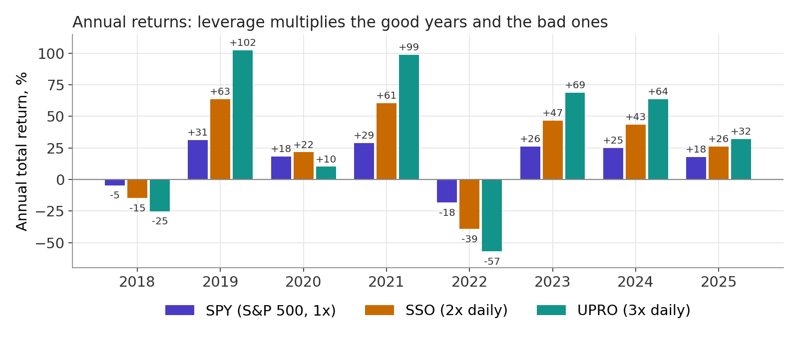
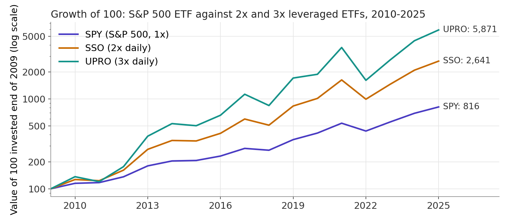

## What is a leveraged ETF? {.smaller}

- An **ETF** (exchange-traded fund) is a fund you buy and sell like a share.
  A plain S&P 500 ETF such as **SPY** holds the 500 stocks of the index: put in
  100, and you own 100 of stocks. Leverage: none.

- A **leveraged ETF** promises a **multiple of the index's daily return**:
  **SSO** targets 2 times the daily return of the S&P 500, **UPRO** 3 times.

- How: the fund borrows, or uses futures and swaps that do the borrowing for
  it. For every 100 you put into SSO, it holds 200 of exposure: your 100 plus
  100 borrowed. The borrowing cost and a fee of about 0.9% a year (against
  0.09% for SPY) are taken out of the fund.

::: {.box .box-a}
This is **homemade leverage sold as a product**: the fund borrows for you,
exactly as the investor of Lecture 7 who borrowed 500 and bought the unlevered
firm. Twice the exposure means twice the risk, so the expected return and the
swings both grow.
:::

## The daily reset: why 2x a day is not 2x a year {.smaller}

- The multiple holds for **one day**. Every evening the fund rebalances so
  that tomorrow it is again at 2 times. Over longer periods the result drifts.

- Example: the index rises 10% then falls 10%.

  | Day     | Index                   | 2x ETF                  |
  |:--------|:-----------------------:|:-----------------------:|
  | Start   | 100                     | 100                     |
  | Day 1   | $100 \times 1.10 = 110$ | $100 \times 1.20 = 120$ |
  | Day 2   | $110 \times 0.90 = 99$  | $120 \times 0.80 = 96$  |
  | Result  | $-1\%$                  | $-4\%$                  |

- The fund lost four times the index, not two. Ups and downs eat into a
  leveraged fund: **volatility decay**. In a steady rise it compounds in the
  fund's favour; in a choppy market it loses even if the index ends flat.

## Recent returns: SPY, SSO and UPRO {.smaller .shrink}

::: {.center}
{fig-align="center" height="255"}
:::

::: {.tiny}
Source: annual total returns, dividends reinvested, calendar years, from
totalrealreturns.com/n/SPY,SSO,UPRO, read 16 October 2026. Chart by the author.
:::

## Recent returns (con't): the long run {.smaller .shrink}

::: {.center}
{fig-align="center" height="255"}
:::

- Over a long bull market the leveraged funds won by a wide margin. The price:
  in March 2020 SPY fell 34% from its peak, SSO 59% and UPRO 77%.

- More leverage, more expected return
  **and** more risk. The fund creates no value; it repackages risk.

::: {.tiny}
Source: growth of 100 compounded from the annual total returns, and maximum
drawdowns, from totalrealreturns.com/n/SPY,SSO,UPRO, read 16 October 2026.
Chart by the author.
:::
