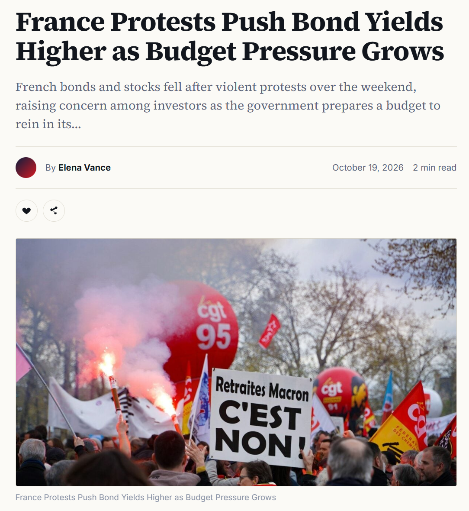

## In the news this morning {.smaller}

:::: {.columns}
::: {.column width="55%"}
{width="100%"}
:::

::: {.column width="45%"}
- Protests over the weekend, a budget to be voted, investors worried about
  how France will pay its debt.

- French government bonds **fell** in price, and their **yields rose**.

- The headline treats the two as one piece of news. They are: for a bond,
  a lower price **is** a higher yield.

- To see why, we need four words: **face value**, **coupon**, **price**
  and **yield**.
:::
::::

## What is a bond? {.smaller}

A bond is a loan cut into small pieces and sold to investors. France borrows by
selling bonds; whoever buys one is lending to France. The contract fixes:

- **Face value** (or principal): the amount repaid at the end. Say 100 euros.

- **Coupon rate**: the interest paid every year, as a percentage of the face
  value. A 3% coupon on 100 of face value pays $3\% \times 100 = 3$ euros a
  year.

- **Maturity**: when the face value is repaid. Say 10 years.

Two more words are **not** in the contract. They come from the market:

- **Price**: what an investor pays today to own the bond. It changes every
  minute, as investors buy and sell.

- **Yield** (yield to maturity): the return an investor earns if they pay
  today's price and hold the bond until it is repaid.

## The cash flows of the bond {.smaller}

Face value 100, coupon 3%, 10 years. The holder receives $3\% \times 100 = 3$
every year, and 100 back with the last coupon:

| Year     | 1 | 2 | 3 | 4 | 5 | 6 | 7 | 8 | 9 | 10 |
|:---------|:-:|:-:|:-:|:-:|:-:|:-:|:-:|:-:|:-:|:--:|
| Coupon   | 3 | 3 | 3 | 3 | 3 | 3 | 3 | 3 | 3 | 3 |
| Face value |   |   |   |   |   |   |   |   |   | 100 |
| **Total** | 3 | 3 | 3 | 3 | 3 | 3 | 3 | 3 | 3 | **103** |

Added up, the bond pays $10 \times 3 + 100 = 130$ euros over its life.

::: {.box .box-a}
These cash flows are **fixed by the contract**. Protests, budgets and
investor moods do not change a single one of them. The only thing that moves
is the **price** people are willing to pay today for this fixed stream.
:::

## From the price to the yield {.smaller}

The price is what you pay today; the cash flows are what you get. The yield is
the discount rate that makes the two sides equal:

$$\text{Price} = \frac{3}{1+y} + \frac{3}{(1+y)^2} + \dots + \frac{3}{(1+y)^{9}}
+ \frac{103}{(1+y)^{10}}$$

- Same logic as the IRR of a project (Lecture 8 extras): the investment is the
  price, the project is the bond, and $y$ is the return it earns.

- The market sets the price; the yield is then **computed** from it. Nobody
  sets a yield directly.

- If the price is exactly 100, the yield is exactly 3%: you lend 100, you
  receive 3 a year on it, you get your 100 back. Yield = coupon rate.

## Price falls, yield rises {.smaller}

Suppose the sell-off pushes the price from 100 down to 96.

- The buyer at 96 still receives 3 a year and 100 at the end. The same 130
  euros of cash flows now cost 4 euros less.

- Two sources of return instead of one: the coupon of 3 on an outlay of 96
  (about 3.1% a year), **plus** a gain of 4 when 96 turns into 100 at maturity.

- Solving the price equation with Price $= 96$ gives $y \approx 3.5\%$.

| Price paid today | Cash flows received | Yield |
|:----------------:|:-------------------:|:-----:|
| 100              | 3 a year + 100      | 3.0%  |
| 96               | 3 a year + 100      | 3.5%  |
| 90               | 3 a year + 100      | 4.3%  |

::: {.box .box-a}
Fixed cash flows, lower price, higher return. Price and yield always move in
**opposite directions**: "yields rose" and "bonds fell" are the same sentence.
:::

## So what does the headline mean? {.smaller}

- Investors fear France's budget will not be brought under control, so lending
  to France looks riskier than it did on Friday.

- For the same cash flows, they now demand a higher return. The only way to
  get it is to pay **less**: they sell, the price drops, the yield climbs.

- **Who loses today:** anyone already holding French bonds. Their bond pays
  the same 3 a year, but is worth 96 instead of 100 if sold now.

- **Who pays tomorrow:** France. The next bond it issues must offer about
  3.5% to find buyers, instead of 3%. Higher yield = higher cost of debt
  for the borrower, which deepens the budget problem the protests are about.

::: {.box .box-a}
In Lecture 9 terms: the yield is the **cost of debt** $r_D$. When the market
sells a borrower's bonds, its $r_D$ rises, and with it its WACC.
:::
