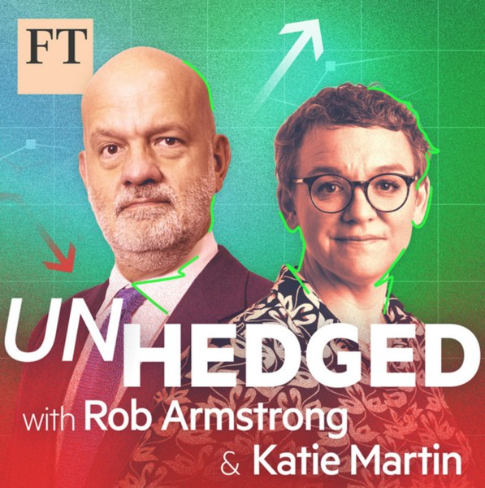
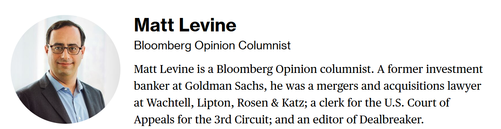
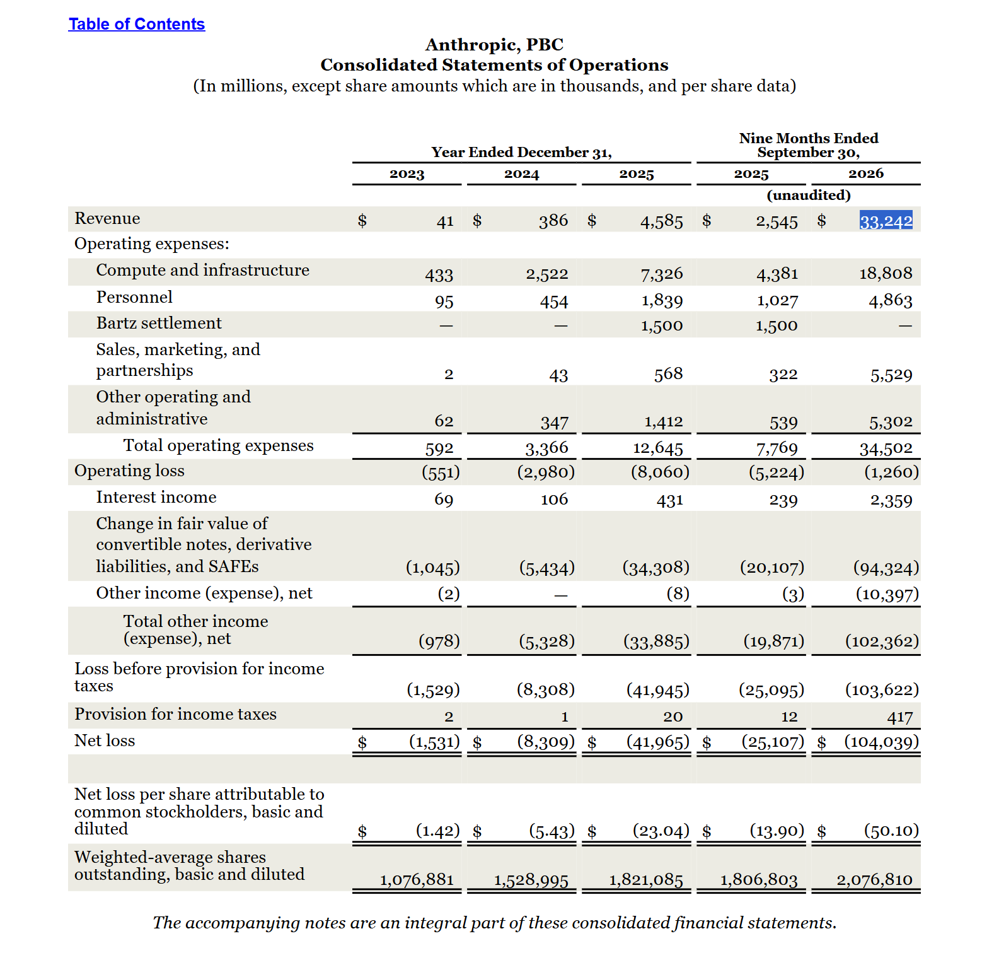

## Why follow finance every day? {.smaller}

- The ideas of this course (risk and return, the CAPM, market efficiency,
  capital structure) show up in the news **every day**: a firm borrows to buy
  back shares, a bank fails, a fund beats the market, or does not.

- A few minutes a day with a good source turns the formulas into stories you
  remember, and teaches you the vocabulary of the people who work in finance.

- Two free sources to start with:

  1. **Unhedged**, a podcast from the *Financial Times*.

  2. **Money Stuff**, a daily newsletter by Matt Levine at *Bloomberg*.

## Unhedged: the FT markets podcast {.smaller}

::::: {.columns}
::: {.column width="44%"}
{height="250" style="height: 440px; max-height: none; margin-top: 10px"}
:::

::: {.column width="56%"}
- A markets podcast from the **Financial Times**, every **Tuesday and
  Thursday**.

- Hosted by **Rob Armstrong** and **Katie Martin**, FT markets journalists.
  They explain the big ideas behind what is happening in finance right now.

- **Free.** Listen on:

  - [Spotify](https://open.spotify.com/show/42KqGvg4MxWwUPqZ0t98OC)

  - [Apple Podcasts](https://podcasts.apple.com/podcast/id1691284824)

  - [Acast](https://shows.acast.com/unhedged), or any podcast app: search
    "Unhedged".
:::
:::::

## Money Stuff: Matt Levine's newsletter {.smaller}

::: {.center}
{height="150"}
:::

- A column by **Matt Levine** at *Bloomberg Opinion*, sent by email **every
  weekday**. Deals, scandals and market oddities, explained clearly and with
  a lot of humour.

- **How to subscribe for free:**

  1. Go to
     [bloomberg.com/account/newsletters/money-stuff](https://www.bloomberg.com/account/newsletters/money-stuff).

  2. Create a free Bloomberg account with your email address.

  3. Sign up to *Money Stuff*. The full column arrives in your inbox each
     weekday, even though most Bloomberg articles on the website are behind a
     paywall.

## A story to follow: Anthropic's IPO {.smaller}

- **IPO**: a firm sells its shares to the public for the first time
  (Chap. 23.2, Lecture 11).

- **26 October 2026**: Anthropic filed its IPO document (S-1) with the SEC.
  Listing on the **Nasdaq**, ticker **ANT**. Price and size not yet set.

- **Last private value**: \$965bn (May 2026), up from \$380bn in February.

- **Founders keep 50.1% of the votes**: new shareholders get cash flows,
  little control.

## Anthropic: the income statement {.smaller}

::: {.center}
{height="230" style="height: 470px; max-height: none"}
:::

::: {.tiny}
Source: Anthropic, PBC, Form S-1 filed with the SEC, 26 October 2026. Amounts
in \$ millions.
:::

::: {.small .center}
**[Read the full S-1 filing on sec.gov](https://www.sec.gov/Archives/edgar/data/2130357/000162828026068676/anthropicpbc-sx1ax1.htm#i199fd6a8a0664d5da497db9a78cf0452_241)**
:::

## Anthropic: reading the numbers {.smaller}

- **Revenue explodes**: \$4.6bn in 2025, \$33.2bn in nine months of 2026.

- **Operating loss shrinks**: \$8.1bn in 2025, \$1.3bn in nine months of 2026.
  Biggest cost: **compute**.

- **Why a net loss of \$104bn?** \$94.3bn comes from **convertible notes**
  (loans that can turn into shares). As the firm grew more valuable, they
  became worth more: an accounting loss, with no cash paid out.

- **Course link**: about \$417bn promised to compute providers. **Fixed
  costs** raise risk: operating leverage (Lecture 6).
