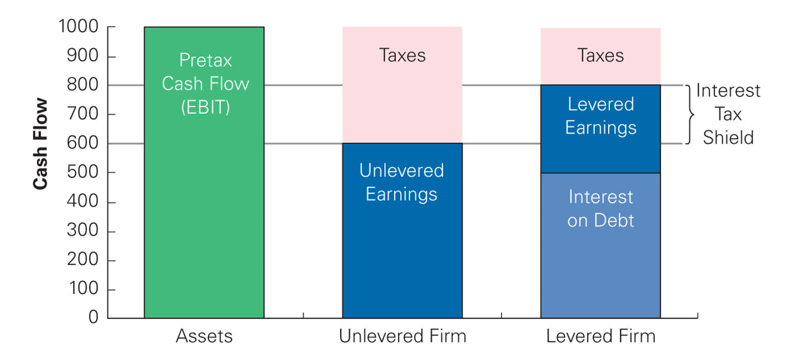
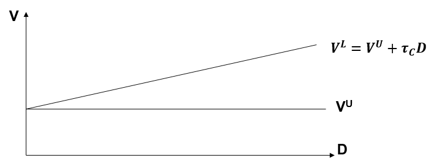
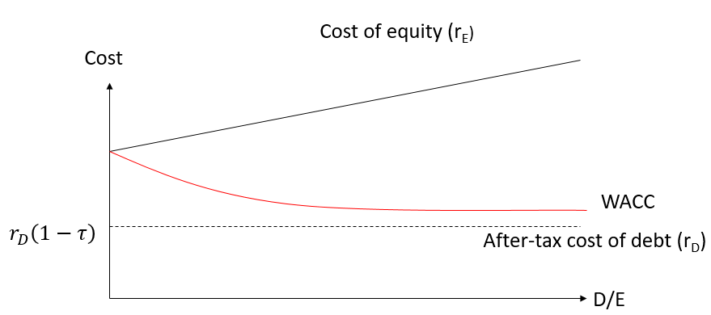
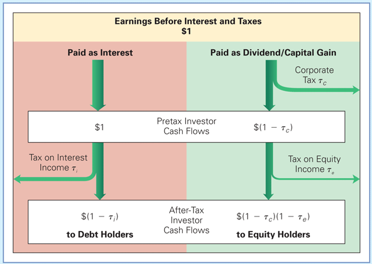
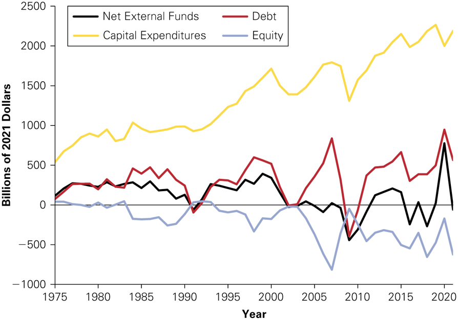
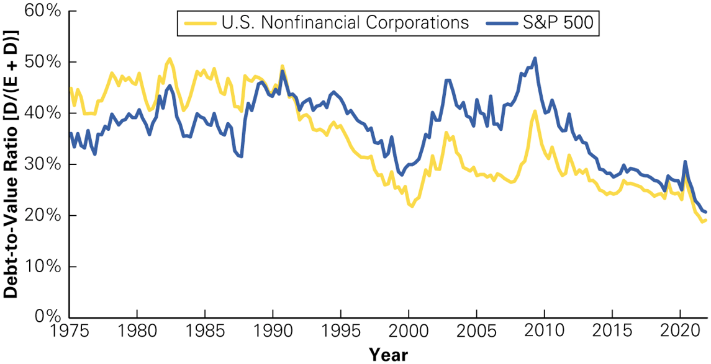
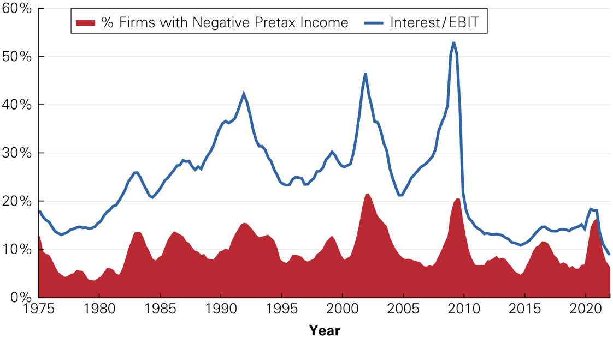
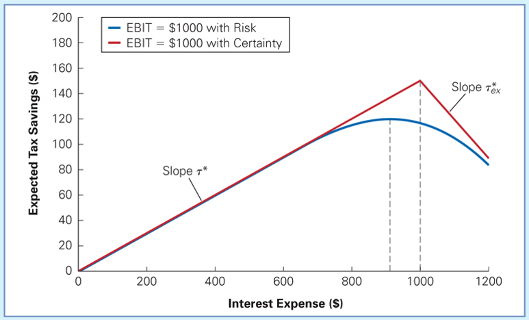
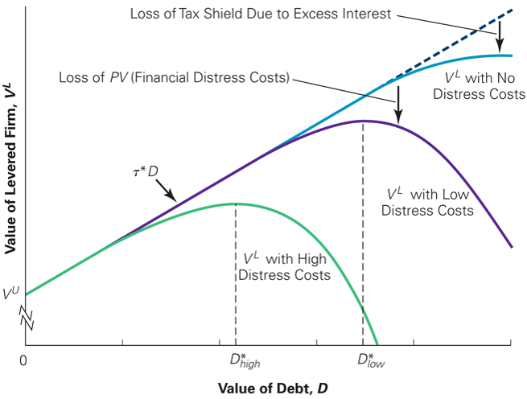

## Plan

- Recap from lecture 8

- See how the tax deduction on interest makes debt valuable

- Put a value on that tax saving: Modigliani-Miller with taxes

- See what taxes do to the cost of equity and to the WACC

- Add personal taxes, and ask how much debt firms should have

Mostly based on the BDM textbook Chap. 15, with some elements of Chap. 16.

## {.center}

::: {.content-visible when-format="revealjs"}
::: {.center .huge}
Recap lecture 8
:::
:::

```{=latex}
\vfill
\begin{center}
{\color{escpblue}\Huge\bfseries Recap lecture 8}
\end{center}
\vfill
```

## Recap: the perfect capital market {.smaller}

- Lectures 7 and 8 worked in a **perfect capital market** (Chap. 14.2):

  1. investors and firms trade the same securities at **fair prices**, equal to
     the present value of their cash flows;

  2. **no taxes**, transaction costs or issuance costs;

  3. **no bankruptcy costs**;

  4. all investors can **borrow and lend without restrictions at the risk-free
     rate**;

  5. financing changes neither the **cash flows** of the investments nor the
     **information** about them.

## Recap: MM Proposition I {.smaller}

::: {.box .box-a}
**MM Proposition I.** In a perfect capital market, the total value of a firm's
securities equals the market value of the cash flows generated by its assets,
and is not affected by its choice of capital structure.
:::

- **Why.** Everything the assets produce goes to the  share/debt holders. Same
  total cash flows, so same total value, whatever the slices.

- Miller's pizza: cutting the pizza into more slices does not make more pizza.

## Recap: MM Proposition II {.smaller}

::: {.box .box-a}
**MM Proposition II.** The cost of levered equity is the unlevered cost of
capital plus a premium that grows with the debt-to-equity ratio:
$$r^{L}_{E} = r^{U}_{E} + \frac{D}{E}\,\big(r^{U}_{E} - r_{D}\big)$$
:::

- $r^{U}_{E}$: cost of capital of the business without debt. $r^{L}_{E}$: cost
  of the levered firm's equity. $r_{D}$: cost of debt. $D$, $E$: market values
  of debt and equity.

- Leverage makes the equity riskier, so shareholders ask for more.

## Recap: the WACC does not move {.smaller}

::: {.box .box-a}
Without taxes, the WACC is constant whatever the
mix:
$$r_{WACC} = \frac{E}{E+D}\, r^{L}_{E} + \frac{D}{E+D}\, r_{D} = r^{U}_{E}$$
:::

- If it is always, constant, it always equals the unlevered cost of capital.

- Debt is cheaper, but each euro of debt makes the equity dearer, by exactly
  enough to keep the average the same.

## Recap: levered and unlevered betas {.smaller}

- Betas follow the same rule as returns:
  $$\beta^{L}_{E} = \beta^{U}_{E} + \frac{D}{E}\,\big(\beta^{U}_{E} - \beta_{D}\big)$$

- $\beta^{U}_{E}$: the **asset** beta, the market risk of the business without
  debt. $\beta^{L}_{E}$: the **equity** beta. $\beta_{D}$: the debt beta.

- With risk-free debt ($\beta_{D} = 0$):
  $\beta^{L}_{E} = \beta^{U}_{E}\,\big(1 + \frac{D}{E}\big)$.

- **Unlever** to compare or average firms with different debt, then
  **relever** at the target firm's own $D/E$.

## Recap: cash as negative debt {.smaller}

- Cash makes the equity **safer** than the business. Measure leverage with
  **net debt** $=$ debt $-$ cash.

- Cash dilutes the business risk the way debt concentrates it.

- A firm with negative net debt should be delevered before comparing.

## Recap: two fallacies {.smaller}

- **Leverage and EPS.** Debt can raise expected earnings per share, but it also
  makes them riskier. The higher average only pays for the extra risk: in a
  perfect market the share price does not change.

- **Equity issuance and dilution.** Issuing shares at their market value does
  not change the total value of owned by shareholders. Any gain or loss comes from
  the NPV of what the firm does with the money.

::: {.box .box-a}
In a perfect market, financing only **repackages** risk and return. Value comes
from the investments.
:::

## Recap: what MM leaves out {.smaller}

- MM tells us **where to look**: if capital structure matters, it must be
  because one of the perfect-market assumptions fails.

- Real markets have:

  - **taxes**: interest is tax deductible, dividends are not (today);

  - **bankruptcy costs**: lawyers, lost customers, fire sales (Chap. 16);

  - **agency costs and information**: debt changes how managers act and what
    investors learn (Chap. 16).

- Today: the first one, taxes.

## {.center}

::: {.content-visible when-format="revealjs"}
::: {.center .huge}
Beginning of lecture 9 content
:::

::: {.center .small}
Lecture 8 showed that without taxes the mix of debt and equity changes nothing.
Taxes change that: the government treats interest and dividends differently.
Today we see how much that is worth.
:::
:::

```{=latex}
\vfill
\begin{center}
{\color{escpblue}\Huge\bfseries Beginning of lecture 9 content}

\vspace{1.5em}
\begin{minipage}{0.8\textwidth}
\small\centering
Lecture 8 showed that without taxes the mix of debt and equity changes nothing.
Taxes change that: the government treats interest and dividends differently.
Today we see how much that is worth.
\end{minipage}
\end{center}
\vfill
```

## MM1 and MM2: the four propositions {.smaller}

::::: {.columns}
::: {.column width="49%"}
**MM1: no taxes (Lecture 8)**

::: {.box .box-a}
**MM1 Proposition 1.** Firm value does not depend on debt:
$$V^{L} = V^{U}$$
:::

::: {.box .box-a}
**MM1 Proposition 2.** The cost of equity rises with debt:
$$r^{L}_{E} = r^{U}_{E} + \frac{D}{E^{L}}\left(r^{U}_{E}-r_D\right)$$
:::
:::

::: {.column width="2%"}
:::

::: {.column width="49%"}
**MM2: with corporate taxes (Lecture 9)**

::: {.box .box-b}
**MM2 Proposition 1.** Debt adds the value of the tax it saves:
$$V^{L} = V^{U} + \tau_{C} D$$
:::

::: {.box .box-b}
**Equation (1).** The cost of equity rises more slowly:
$$r^{L}_{E} = r^{U}_{E} + \frac{D}{E^{L}}(1-\tau_C)\left(r^{U}_{E}-r_D\right)$$
:::
:::
:::::

## Introduction {.smaller}

- In practice, firms choose very different amounts of debt. In March 2022
  (Chap. 15):

  | Firm               | Debt-to-equity ratio $D/E$ |
  |:-------------------|:--------------------------:|
  | Vertex (biotech)   | 0.015                      |
  | Ford               | 2.1                        |
  | American Airlines  | 4.3                        |

- In a perfect market these choices would not matter. So something must be
  missing from the perfect market. The first candidate is **taxes**.

::: {.box .box-a}
Interest is paid **before** corporate tax, dividends **after**. Every euro paid
as interest instead of dividends saves tax. Today: how much is that saving
worth, and why do firms not borrow even more?
:::

## A. The interest tax deduction {.smaller}

- In most countries: interests = expenses

  - Interest expenses are thus (fully or partially) deductible

  - Remark: the dividends are paid from after-tax profits! So interests have a tax advantage over dividends.

- Example:

  - France in 2026: marginal corporate tax rate = 25% $\Rightarrow$
    interest expenses are deductible up to the higher of EUR 3 million
    or 30% of EBITDA.

  - US in 2026: marginal corporate tax rate (federal rate) = 21%
    $\Rightarrow$ interest expenses are deductible up to 30% of EBIT.

  $\Rightarrow$ We will assume for simplicity that interest expenses are
  fully deductible.

- **In words:** when the firm pays interest, its taxable profit falls, so the
  government pays part of the interest bill. When it pays dividends, the
  government pays nothing.

## Interest tax deduction: example {.smaller}

A company has no leverage and pays 34% tax on its profits of 10. The CEO
decides to take on a loan of 80 with an interest of 5% and to reduce its
equity by the same amount:

::::: {.columns}
::: {.column width="48%"}
Without leverage:

+--------+-----------------+
| Assets | Liabilities     |
+:=======+=======:+=======:+
| 100    | 100    | Equity |
+--------+--------+--------+
|        | 0      | Debt   |
+--------+--------+--------+
:::

::: {.column width="48%"}
With leverage:

+--------+-----------------+
| Assets | Liabilities     |
+:=======+=======:+=======:+
| 100    | 20     | Equity |
+--------+--------+--------+
|        | 80     | Debt   |
+--------+--------+--------+
:::
:::::

- Same assets, same profit of 10 before interest and tax (EBIT). Only the
  financing changes. What happens to the taxes, and to what investors receive?

## Interest tax deduction: step by step {.smaller}

- **Step 1, the interest.** $80 \times 5\% = 4$ goes to the lenders.

- **Step 2, the taxable profit.** Interest is deducted before tax:
  $10 - 4 = 6$ instead of 10.

- **Step 3, the tax.** $34\% \times 6 = 2.04$ instead of $34\% \times 10 = 3.4$.

- **Step 4, the shareholders.** Net income $6 - 2.04 = 3.96$ instead of 6.6.

- **Step 5, all investors together.** Shareholders get 3.96 and lenders 4:
  $3.96 + 4 = 7.96$ instead of 6.6.

- **Step 6, the gap.** $7.96 - 6.6 = 1.36$. That is exactly the tax saved:
  $3.4 - 2.04 = 1.36 = 34\% \times 4$.

## Interest tax deduction: example (con't) {.smaller}

|                               | Without leverage | With leverage       |
|:------------------------------|:-----------------|:--------------------|
| Income before tax             | 10               | 10 - 4 = 6          |
| Taxes                         | 3.4              | 2.04                |
| Net income                    | 6.6              | 3.96                |
| Interest paid to debt holders | 0                | 4                   |
| Total available to investors  | 6.6              | 3.96+4 = 7.96       |
| Interest tax shield           | 0                | 80\*0.05\*0.34=1.36 |

::: {.box .box-a}
Net income falls (3.96 against 6.6), but investors as a group receive more
(7.96 against 6.6). The difference, 1.36, is tax the firm no longer pays: the
**interest tax shield**.
:::

## Interest tax deduction: a 1st summary {.smaller}

- Leverage permits to reduce the tax payable:
  $$\text{Interest tax shield} = \text{Corporate tax rate} \times \text{Interest payments}$$

- Consequences $\Rightarrow$ increases revenues available for stock- and
  debtholders

::: {.content-visible when-format="revealjs"}
$$\binom{\text{Cash Flows to Investors}}{\text{with Leverage}}
= \binom{\text{Cash Flows to Investors}}{\text{without Leverage}}
+ \binom{\text{Interest Tax}}{\text{Shield}}$$
:::

```{=latex}
\[\resizebox{0.92\linewidth}{!}{$\displaystyle
\binom{\text{Cash Flows to Investors}}{\text{with Leverage}}
= \binom{\text{Cash Flows to Investors}}{\text{without Leverage}}
+ \binom{\text{Interest Tax}}{\text{Shield}}$}\]
```

- Thus: the total value of the company (V = E + D) increases.

- **Why.** The pie (EBIT) is the same, but the government's slice shrinks. More of the pie is left for investors.

## Cash Flows of the unlevered and levered firm {.smaller}

::: {.center}
{fig-align="center" height="240" style="height: 300px; max-height: none"}
:::

- Same EBIT of 1000 (tax rate 40%). Unlevered: tax 400, shareholders 600.
  Levered: interest 500, tax 200, shareholders 300. Investors get
  $500 + 300 = 800$, so 200 more: the interest tax shield, $40\% \times 500$.

## B. MM2: debt, tax, and firm value {.smaller}

- Reminder: MM1 framework $\Rightarrow$ Perfect capital markets + no
  taxes

- MM2 $\Rightarrow$ introduction of corporate taxes

::: {.box .box-a}
**MM2 Proposition 1.** The total value of the levered firm exceeds the value of
the firm without leverage due to the present value of the tax savings from
debt:
$$V^{L} = V^{U} + PV(\text{Interest tax shield}).$$
:::

- $V^{L}$: value of the firm **with** debt ($E^{L} + D$). $V^{U}$: value of the
  same firm **without** debt. $PV(\text{Interest tax shield})$: today's value
  of all the future tax savings.

- In words: debt adds value only through the tax it saves.

## MM2: the yearly tax shield

- Hypothesis: the company has a perpetual and constant debt at the
  constant risk-free rate of $r$. Then:
  $$\text{Annual tax shield} = \tau_{C}\, r\, D.$$

- $\tau_{C}$: corporate tax rate. $D$: amount of debt. $r\,D$: interest paid
  each year.

## MM2: the yearly tax shield (con't) {.smaller}

- **Example** (the one from section A): a firm earns a profit of 10 and pays
  34% tax on it. It borrows 80 at an interest rate of 5% and keeps this debt
  forever.

  - Interest paid each year: $5\% \times 80 = 4$.
  - The 4 of interest is deducted from profit, so the firm pays
    $34\% \times 4 = 1.36$ less tax:
    $$\text{Annual tax shield} = 34\% \times 5\% \times 80 = 1.36 \text{ every year, forever.}$$

- Next step: what is this stream of savings worth **today**?

## MM2 and the value of the interest tax shield {.smaller}

- Present value of the tax shield is:
  $$PV\left(\text{Tax shield}\right) = \sum_{i = 1}^{\infty} \frac{\tau_{C}r D}{\left(1+r\right)^{i}} = \frac{\tau_{C}r D}{1+r} + \frac{\tau_{C}r D}{\left(1+r\right)^{2}} + \frac{\tau_{C}r D}{\left(1+r\right)^{3}} + \dots$$

  - The same saving $\tau_{C} r D$ every year, discounted one year further
    each time. A payment $C$ every year forever is worth $C / r$ today, so
    $$PV\left(\text{Tax shield}\right) = \frac{\tau_{C}r D}{r} = \tau_{C} D.$$

  - Remark: valid as long as the perpetuity has the same risk as the
    debt.

- The Proposition 1 of MM2 becomes then: $V^{L} = V^{U} + \tau_{C} D$.

- **Example:** $1.36 / 0.05 = 27.2 = 34\% \times 80$. Each euro of permanent
  debt adds 34 cents of value.

## MM2: a simple example

- Firm U is financed with 500 EUR of equity and has no leverage. The
  marginal corporate tax rate is 30%.

- What is the value of firm, L, which has 250 EUR debt and is otherwise
  identical?

::: {.center}
{fig-align="center" height="200" style="height: 260px; max-height: none"}
:::

## MM2: a simple example (con't) {.smaller}

- **Step 1.** The firm without debt is worth $V^{U} = 500$.

- **Step 2.** The companyhas 250 of permanent debt. The tax shield is worth
  $\tau_{C} D = 0.30 \times 250 = 75$.

- **Step 3.** Add them:
  $$V^{L} = V^{U} + \tau_{C} D = 500 + 0.30 \times 250 = 575.$$

- **Reading the graph.** $V^{U}$ is flat: the business is the same whatever the
  debt. $V^{L}$ rises in a straight line with slope $\tau_{C} = 0.30$: each
  extra euro of debt adds 30 cents of value.

::: {.box .box-a}
Taken literally, MM2 1 says: borrow as much as possible.
:::

## C. MM2: debt, tax, and the cost of capital {.smaller}

- In Lecture 8 (no taxes), leverage raised the cost of equity:
  $r^{L}_{E} = r^{U}_{E} + \frac{D}{E}(r^{U}_{E} - r_{D})$.

- **Question:** what does that formula become with corporate taxes?

- As in section B, debt is permanent and the firm does not grow, so every
  year looks the same. Three steps, as in Lecture 8.

## Notation. {.smaller .spaced}

- $\Pi$: operating income (EBIT), the same with or without debt;

- $r^{U}_{E}$: cost of equity of the firm without debt;

- $r^{L}_{E}$: cost of equity of the firm with debt;

- $r_{D}$: cost of debt;

- $E^{L}$: value of the levered equity;

- $D$: value of the debt;

- $V^{U}$, $V^{L}$: value of the firm without and with debt;

- $\tau_{C}$: corporate tax rate.

## Step 1: what the shareholders earn {.smaller}

Let us establish the relation between the cost of equity of the levered
firm and the cost of equity of the unlevered firm.

- Each year, shareholders receive the operating income minus the interest,
  after tax. Their return is that amount divided by what their shares are
  worth:
  $$r^{L}_{E} = \frac{\left(\Pi-r_{D} D\right) \left(1-\tau_{C}\right)}{E^{L}} = \frac{\Pi\left(1-\tau_{C}\right) - r_{D} D \left(1-\tau_{C}\right)}{E^{L}},$$
  where $\Pi$ is the operating income (EBIT).

- The numerator has two parts: the after-tax operating income
  $\Pi(1-\tau_{C})$, and the after-tax cost of the interest
  $r_{D} D (1-\tau_{C})$.

## Step 2 {.smaller}

We decompose the after-tax operating income
  $\Pi(1-\tau_{C})$

- Without debt, the after-tax operating income is exactly
  what pays the owners their required return on the whole firm. We know that
  $$\Pi \left(1-\tau_{C}\right) = r_{WACC}^{U} V^{U} = r^{U}_{E} V^{U},$$

 - We now take $V^{U},$

- From MM2 Proposition 1:  $V^{U} + \tau_{C} D = V^{L}$

- Switch the side of $\tau_{C} D$: the firm without debt
  is worth the levered firm minus the tax shield:
  $$V^{U} = V^{L} - \tau_{C} D = \left(E^{L} + D \right) - \tau_{C} D.$$

## Step 3: substitute and simplify {.smaller}

- Thus:
  $$r^{L}_{E} = \frac{r^{U}_{E} \left(\left(E^{L} + D \right) - \tau_{C} D\right) - r_{D} D \left(1-\tau_{C}\right)}{E^{L}}$$

- Open the bracket, using $(E^{L} + D) - \tau_{C} D = E^{L} + D(1-\tau_{C})$:
  $$r^{L}_{E} = \frac{r^{U}_{E} E^{L} + r^{U}_{E} D (1-\tau_{C}) - r_{D} D (1-\tau_{C})}{E^{L}}$$

- Divide each term by $E^{L}$ and factor out $\frac{D}{E^{L}}(1-\tau_{C})$:

::: {.box .box-a}
**Equation (1).**
$$r^{L}_{E} = r^{U}_{E} + \frac{D}{E^{L}} \left(1-\tau_{C} \right)\left(r^{U}_{E}-r_{D} \right)$$
:::

## Equation (1) next to Lecture 8 {.smaller}

| Without taxes (Lecture 8)                                   | With corporate taxes (today)                                                      |
|:-----------------------------------------------------------:|:---------------------------------------------------------------------------------:|
| $r^{L}_{E} = r^{U}_{E} + \frac{D}{E}\,(r^{U}_{E} - r_{D})$ | $r^{L}_{E} = r^{U}_{E} + \frac{D}{E^{L}}\,(1-\tau_{C})\,(r^{U}_{E} - r_{D})$ |

- Same shape, with one extra factor $(1-\tau_{C})$, smaller than 1.

- **Intuition.** Interest is partly paid by the government, so debt takes less
  from shareholders in bad years. Equity still gets riskier with leverage, but
  more slowly than without taxes.

## Equation (1) next to Lecture 8 (con't) {.smaller}

- **Example.** $r^{U}_{E} = 10\%$, $r_{D} = 5\%$, $D/E^{L} = 1$, $\tau_{C} = 25\%$:

  - with taxes: $10\% + 1 \times 0.75 \times (10\% - 5\%) = 13.75\%$;

  - without taxes: $10\% + 1 \times (10\% - 5\%) = 15\%$.

## Tax and the effective cost of debt

- Because debt creates tax savings, its effective cost is lower than the
  interest payments

&nbsp;

$$\text{Effective cost of debt} = r_{D} \left(1-\tau_{C}\right) D.$$

## Tax and the effective cost of debt (con't) {.smaller}

- Example:

  - Debt of 100 000 EUR at the interest rate of 10%, with corporate tax
    rate of 34%.

  - Tax savings = 0.34\*(0.1\*100000) = 3400

  - Effective cost of debt = 0.1\*100000 - 3400 = 6600

- **As a rate.** Divide by the debt: $6600 / 100000 = 6.6\%$.

  - This is $r_{D}(1-\tau_{C}) = 10\% \times (1 - 0.34)$, the **after-tax
    cost of debt**: the rate that enters the WACC (Lecture 6).

## MM2: WACC with taxes {.smaller}

- The WACC of a levered firm is:
  $$\begin{aligned}
  r_{WACC}^{L} & = \frac{D}{D+E^{L}}r_{D}\left(1-\tau_{C}\right) + \frac{E^{L}}{D+E^{L}}  r^{L}_{E}, \\
  & = \frac{D}{D+E^{L}} r_{D} + \frac{E^{L}}{D+E^{L}} r_{E}^{L}  - \frac{D}{D+E^{L}} \tau_{C} r_{D}.
  \end{aligned}$$

- First line: the Lecture 6 WACC, debt at its after-tax cost. Second line: the
  same, split in two. The first two terms are the **pre-tax WACC**; the last
  term is what the tax shield saves.

## MM2: WACC with taxes, the result {.smaller}

- By using the expression in Equation (1) for $r^{L}_{E}$, we obtain:

::: {.box .box-a}
$$r_{WACC}^{L}=\underbrace{r_{WACC}^{U}}_{\begin{array}{c}\text{WACC without} \\ \text{leverage}\end{array}} \underbrace{\left(1-\tau_{C} \frac{D}{D+E^{L}}\right)}_{\begin{array}{c}\text{Reduction due} \\ \text{to interest tax shield}\end{array}}$$
:::

- **In words:** without taxes the WACC stayed flat (Lecture 8). With taxes it
  **falls** as the share of debt rises.

## MM2: Summary in a graph {.smaller}

::: {.center}
{fig-align="center" height="240" style="height: 320px; max-height: none"}
:::

- **Cost of equity** rises with $D/E$, as in Lecture 8 but more slowly.

- **After-tax cost of debt** $r_{D}(1-\tau_{C})$ is the cheapest source.

- **WACC** falls as more weight goes on the cheap, tax-deductible debt.

## Betas with taxes {.smaller}

- Remark: In MM2, we have (this can be derived using the expression in
  Equation (1)):
  $$\beta^{L}_{E} = \beta^{U}_{E} \left(1+\left(1-\tau_{C} \right)\frac{D}{E} \right).$$

- Lecture 8, risk-free debt and no taxes:
  $\beta^{L}_{E} = \beta^{U}_{E}\,\big(1 + \frac{D}{E}\big)$. Taxes add the
  same factor $(1-\tau_{C})$ as in Equation (1).

- **Example.** $\beta^{U}_{E} = 1$, $D/E^{L} = 1$, $\tau_{C} = 25\%$:
  $\beta^{L}_{E} = 1 \times (1 + 0.75 \times 1) = 1.75$, against 2 without
  taxes.

- **Unlevering** works the same way backwards:
  $\beta^{U}_{E} = \beta^{L}_{E} \,/\, \big(1 + (1-\tau_{C})\frac{D}{E^{L}}\big)$.

## Beyond MM2: Tax shield and "uncertain" debt levels {.smaller}

- MM2 $\Rightarrow$ perpetual, constant debt

  - Discounting the tax shield at the risk-free rate

- If the future level of leverage is unknown, a higher discount rate has
  to be used.

  - The tax savings then depend on how much the firm will borrow, which is
    risky, so their present value is lower than $\tau_{C} D$.

  - Remark: "general" case $\Rightarrow$
    $V^{L} = V^{U} + PV(\text{Interest tax shield}).$

## Beyond MM2: "uncertain" debt levels (con't) {.smaller}

- When debt is permanent and fixed, the tax shield is simply worth
  $\tau_C D$.

- When debt grows with the firm, the future tax savings are uncertain, and
  adding them up one by one is hard.

- We use a shortcut in these cases. The shortcut values the firm twice, once **with** the tax benefit and once
  **without**, and takes the difference.

## Beyond MM2: "uncertain" debt levels (con't 2)

- "Special" case: target debt-equity ratio

  - We can then evaluate the value of the levered company, $V^{L}$, by
    discounting the FCF "to the Firm" at the after-tax WACC.

  - The value of the interest tax shield is then the difference between
    $V^{L}$ and the unlevered value of the company, $V^{U}$, that can be
    found by discounting the FCF at the pre-tax WACC.

## Target debt-equity ratio: the two WACCs {.smaller}

- A **target** debt-equity ratio: the firm keeps $D/E$ constant, so its debt
  grows with the firm.

- **Pre-tax WACC**, debt at its full cost (no tax benefit):
  $$r_{\text{pre-tax}} = \frac{E}{E+D}\, r_{E} + \frac{D}{E+D}\, r_{D}$$

- **After-tax WACC**, debt at its after-tax cost (the usual WACC):
  $$r_{WACC} = \frac{E}{E+D}\, r_{E} + \frac{D}{E+D}\, r_{D}\,(1 - \tau_{C})$$

- With free cash flow $FCF$ next year growing at rate $g$ (growing perpetuity):
  $$V^{U} = \frac{FCF}{r_{\text{pre-tax}} - g} \qquad\qquad V^{L} = \frac{FCF}{r_{WACC} - g}$$

- The gap $V^{L} - V^{U}$ is the value of the interest tax shield.

## Target debt-equity ratio: example {.smaller}

- **Example 15.3.** Western Lumber expects free cash flow of 4.25 million
  next year, growing 4% a year. It keeps $D/E = 0.5$, so equity is $1/1.5$ of
  the firm and debt $0.5/1.5$. $r_{E} = 10\%$, $r_{D} = 6\%$, $\tau_{C} = 21\%$.

- **Step 1, pre-tax WACC.**
  $\tfrac{1}{1.5} \times 10\% + \tfrac{0.5}{1.5} \times 6\% = 8.67\%$, so
  $V^{U} = 4.25 / (8.67\% - 4\%) = 91$ million.

- **Step 2, after-tax WACC.**
  $\tfrac{1}{1.5} \times 10\% + \tfrac{0.5}{1.5} \times 6\% \times (1 - 0.21) = 8.25\%$,
  so $V^{L} = 4.25 / (8.25\% - 4\%) = 100$ million.

- **Step 3, the tax shield.** $100 - 91 = 9$ million.

## Recapitalizing to capture the tax shield: example {.smaller}

- A **leveraged recapitalization** ("recap"): the firm borrows and uses the
  money to buy back its own shares (or pay a dividend). Assets do not change;
  only the financing does.

- Micron SA has no debt and 20 million shares outstanding with a market
  price of 15 EUR per share. The company pays a 33% marginal tax rate.

- The CEO has decided to borrow 100 million EUR on a permanent basis
  through a leveraged recap in which borrowed funds would be used to
  repurchase outstanding shares.

  - What is the impact on firm value?

## Recapitalizing to capture the tax shield: example (con't) {.smaller}

```{=latex}
\begingroup\scriptsize\setlength{\tabcolsep}{4pt}
```

|  |  | Step 1 | Step 2 | Step 3 |
|:---|:---|:---|:---|:---|
|  | Initial | Recap Announced | Debt Issuance | Share Repurchase |
| **Assets (in M EUR)** |  |  |  |  |
| V(unlevered firm) | 300 | 300 | 300 | 300 |
| Interest tax shield | 0 | 33 | 33 | 33 |
| Cash | 0 | 0 | 100 | 0 |
| Total assets | 300 | 333 | 433 | 333 |
| **Liabilities (in M EUR)** |  |  |  |  |
| Equity | 300 | 333 | 333 | 233 |
| Debt | 0 | 0 | 100 | 100 |
| Total liabilities | 300 | 333 | 433 | 333 |
| Shares outstanding (M) | 20 | 20 | 20 | 13.994 |
| Price per share (EUR) | 15 | 16.65 | 16.65 | 16.65 |

```{=latex}
\endgroup
```

## Recapitalizing: the numbers step by step {.smaller}

- **Initial.** $V^{U} = 20 \times 15 = 300$ million.

- **Step 1, announcement.** The future tax shield is worth
  $\tau_{C} D = 33\% \times 100 = 33$. The market prices it at once: equity
  $300 + 33 = 333$, price $333 / 20 = 16.65$.

- **Step 2, debt issued.** The firm holds 100 of cash and owes 100: equity
  unchanged at 333.

- **Step 3, buyback** at 16.65: $100 / 16.65 = 6.006$ million shares, leaving
  $20 - 6.006 = 13.994$ million. Equity $13.994 \times 16.65 = 233$.

::: {.box .box-a}
The price jumps from 15 to 16.65 **when the recap is announced**. Shareholders
capture the whole tax shield: $20 \times 1.65 = 33$. The price cannot stay at
15: buying shares at 15 that will be worth 16.65 would be free money.
:::

## D. Personal taxes {.smaller}

- See: Merton MILLER "Debt and taxes", Journal of Finance, 1977

- Simple observation: between 1930 and 1950, the marginal company tax
  rate has increased from 10% to 52% in the US $\dots$ but the
  liabilities of US companies have not changed significantly.

- Explanation: MM2 overstates the tax savings due to leverage

  - Personal tax rates need to be taken into account!

  - Reminder: investors also need to pay income taxes (dividends,
    capital gains, and interest income).

## After-Tax Investor Cash Flows Resulting from \$1 in EBIT {.smaller}

::::: {.columns}
::: {.column width="55%"}
{height="300" style="height: 380px; max-height: none"}
:::

::: {.column width="45%"}
- **Paid as interest:** no corporate tax. The lender pays personal tax
  $\tau_{i}$ and keeps $1 - \tau_{i}$.

- **Paid to shareholders:** the firm pays $\tau_{C}$ first, then the
  shareholder pays $\tau_{e}$ on dividends or capital gains. They keep
  $(1-\tau_{C})(1-\tau_{e})$.

- Debt still wins if $1 - \tau_{i}$ is larger.
:::
:::::

## E. Optimal capital structure with taxes

- Question(s):

  - What leverage maximizes firm value?

  - What leverage minimizes the WACC?

- Reminder: firm value is the sum of all FCF "to the Firm" (which do not
  depend on leverage) discounted at the WACC.

- Thus, the leverage which minimizes the WACC also maximizes firm value.

## Do firms prefer debt? {.smaller .shrink}

Net External Financing and Capital Expenditures by U.S. Corporations,
1980-2021

::: {.center}
{fig-align="center" height="220" style="height: 300px; max-height: none"}
:::

- When firms raise money from outside, it is mostly **debt** (red); net
  equity (blue) is usually negative: firms **buy back** more shares than they
  issue. Most investment (yellow) is paid from internal cash.

::: {.small}

Source: Federal Reserve, Flow of Funds Accounts of the United States,
2021.

:::

## Do firms prefer debt? (con't 2) {.smaller .shrink}

Debt-to-Value Ratio \[$D / (E + D)$\] of U.S. Firms, 1975-2021

::: {.center}
{fig-align="center" height="220" style="height: 300px; max-height: none"}
:::

- Debt is between about 20% and 50% of firm value, and has fallen since 2010.

::: {.small}

- Source: Compustat and Federal Reserve, Flow of Funds Accounts of the
  United States, 2021.

- Remark: large companies only

:::

## Limits to the tax benefit of debt

- In 2020, debt represented on average "only" 20% of the liabilities of
  large U.S. companies.

  - Remark: large variations by industry.

  - Average leverage of French firms similar.

- Why does debt make up less than half of the capital structure of most
  firms?

- Why does the leverage choice vary so much across industries?

## The low leverage puzzle {.smaller .shrink}

Interest Payments as a Percentage of EBIT and Percentage of Firms with
Negative Pre-tax Income, S&P 500 1975-2021

::: {.center}
{fig-align="center" height="220" style="height: 340px; max-height: none"}
:::

- Interest uses well under half of EBIT in most years, and few firms have
  losses. Most firms could deduct much more interest: they leave tax savings
  unused.

## Interest above the limit saves no tax {.smaller}

- Debt saves tax only on interest the firm can deduct: up to its profit, and
  in the US up to 30% of EBIT (section A).

- **Example.** EBIT 1000, $\tau_{C} = 21\%$, deduction limit
  $30\% \times 1000 = 300$:

  |                    | No debt | Moderate debt | Excess debt |
  |:-------------------|:-------:|:-------------:|:-----------:|
  | Interest paid      | 0       | 300           | 500         |
  | Interest deducted  | 0       | 300           | 300         |
  | Taxable income     | 1000    | 700           | 700         |
  | Taxes (21%)        | 210     | 147           | 147         |
  | Tax saving         | 0       | **63**        | **63**      |

- The extra 200 of interest in the last column saves nothing. The
  tax-optimal interest is the limit itself.

## Tax savings for different levels of interest {.smaller .shrink}

::: {.center}
{fig-align="center" height="220" style="height: 300px; max-height: none"}
:::

- Here the limit is EBIT itself (1000). Up to it, each euro of interest saves
  $\tau^{*}$ (red line rises). Beyond it, extra interest saves no corporate tax
  but is still taxed in the lender's hands: slope $\tau^{*}_{ex}$, negative.

- With **risky** EBIT (blue), the firm may not earn enough to use all its
  deductions: the best interest level is lower (about 900).

## How to explain the "low" leverage? {.smaller}

- A number of factors not taken into account in Modigliani and Miller
  explain the low observed levels of leverage:

  - Bankruptcy costs: the possibility of bankruptcy doesn't change MM's
    arguments but if there are costs associated to bankruptcy (direct or
    indirect), the value of cash flows available for investors
    decreases.

  - Agency costs: the capital structure changes the way the company is
    managed and thus the FCF (contradicting MM's hypotheses). This
    effect can be positive or negative.

## Optimal leverage with taxes and financial distress costs {.smaller .shrink}

::: {.center}
{fig-align="center" height="230" style="height: 300px; max-height: none"}
:::

- At low debt, $V^{L}$ rises with slope $\tau^{*}$: the tax benefit. As debt
  grows, expected **financial distress costs** grow faster and pull value
  down.

- The best debt level $D^{*}$ is where one more euro of debt adds as much in
  distress costs as in tax savings. Higher distress costs mean less debt
  ($D^{*}_{high} < D^{*}_{low}$).

## Other theories of optimal capital structure

**Trade-off theory**

  - Optimal capital structure weighs the benefits of debt that result
    from shielding cash flows from taxes against the costs of financial
    distress associated with leverage.

**Pecking order theory** (linked to signalling)

  - Managers prefer to use retained earnings first, then debt and will
    issue equity only as a last resort.

## What to remember {.smaller}

- **Interest tax shield** $= \tau_{C} \times$ interest. Interest is paid before
  tax, dividends after, so debt lowers the government's share of EBIT.

- **MM2 Proposition 1**: $V^{L} = V^{U} + PV(\text{Interest tax shield})$;
  with permanent debt, $V^{L} = V^{U} + \tau_{C} D$.

- **Equation (1)**: $r^{L}_{E} = r^{U}_{E} + \frac{D}{E^{L}}(1-\tau_{C})(r^{U}_{E} - r_{D})$.
  Equity still gets riskier with debt, but more slowly than without taxes.

- **WACC with taxes** $= \frac{E}{E+D} r^{L}_{E} + \frac{D}{E+D} r_{D}(1-\tau_{C})$:
  it falls as the share of debt rises.

- **Personal taxes** cut the advantage to
  $\tau^{*} = 1 - \frac{(1-\tau_{C})(1-\tau_{e})}{1-\tau_{i}}$.

- **Trade-off**: tax savings against financial distress costs. Firms use less
  debt than taxes alone would suggest.

## Quiz

- Why does debt increase firm value when there are corporate taxes, but not
  in a perfect market?

- A firm without debt is worth 1000 and pays 25% corporate tax. It borrows 200
  permanently and buys back shares. What is it worth after the recap?

- Why do firms not borrow as much as MM2 suggests?

## Quiz: answers {.smaller}

- **Taxes.** Interest is deducted before corporate tax, so the government
  takes less of EBIT and investors as a group receive more. In a perfect market
  there is no tax to save, and the total stays the same.

- **The recap.** $V^{L} = V^{U} + \tau_{C} D = 1000 + 0.25 \times 200 = 1050$.
  The shareholders capture the 50 when the recap is announced.

- **Limits.** Interest above taxable income (or above the legal limit) saves no
  tax; personal taxes reduce the advantage to $\tau^{*}$; and too much debt
  brings financial distress costs. The best level trades off the tax saving
  against those costs.
